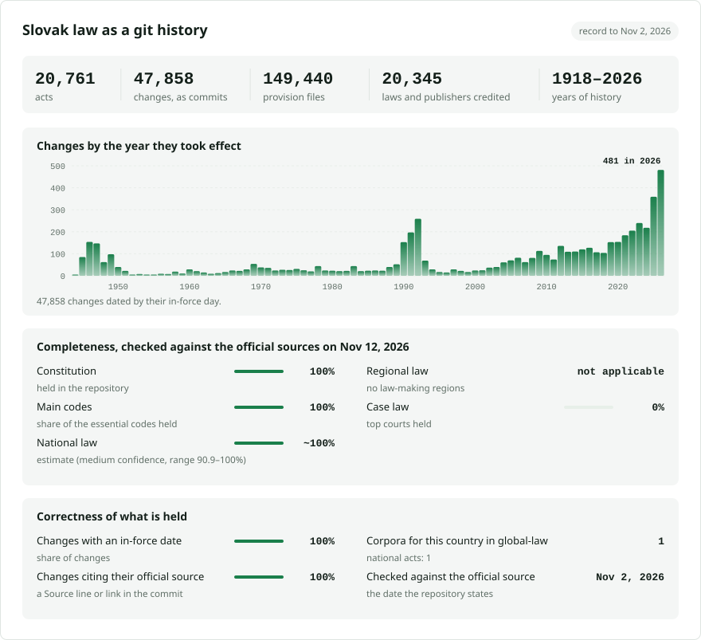

# Slovakia: law history in git

**English** · **[Alebo čítajte po slovensky](README.md)**

<picture>
<source media="(prefers-color-scheme: dark)" srcset="data/effort-dark.svg">

</picture>

The law of Slovakia as a git history: one file per article or section, one commit per version on the day it took effect, and the act that made each change as the commit's author. `git blame` names the act behind every article; `git log` lists every change to an article; picking a date gives the text in force that day.

Part of [lexifina/global-law](https://github.com/lexifina/global-law), one git history for every country's law: this is Slovakia's national law, which global-law reads at `slovakia/national/acts/`.

**What is in it now:** the Constitution and the election act (180/2014 Z. z.), with all of their 28 and 21 versions; 20,759 other acts and items of the Collection of Laws (Zbierka zákonov, 1918-2026), with 34,348 versions: 13,284 with their text now and 7,475 repealed or no longer in effect, kept with their history and their files removed when they ended; 5,444 of those held now are still only their version in force on 2 November 2026, among them the Civil Code, the Commercial Code, the Criminal Code, the Code of Criminal Procedure, the Civil Contentious Procedure Code, the Labour Code and the Tax Procedure Code; 106 measures of the Register opatrení (2016-2018); and 464 generally binding regulations (VZN) of four cities: Bratislava, Žilina, Banská Bystrica and Nitra. [`PLAN.md`](PLAN.md) lists every part this repository is meant to hold and how far each one is.

Each act is in `zz/<year>/<number>/` (from 1993) or `zb/<year>/<number>/` (1918-1992): `zz/2001/311/par-001.md` is § 1 of the Zákonník práce, the Labour Code, 311/2001 Z. z. The Constitution is in `constitution/ustava/`, the election act in `volebny-zakon/`, measures in `ro/<year>/<number>/` and VZN in `local/<city>/<year>/<number>/`. Before 2026-11-10 each folder was named by the act's id (`ustava`, `zz-2001-311`); tags and `tools/ku_dnu.py` use the id, and `data/paths.json` maps each id to its folder.

The text is in Slovak (older Czechoslovak acts also in Czech), as Slov-Lex publishes it. An English translation is not part of this record.

## Questions as git commands

| Question | Command |
| --- | --- |
| Every change to Article 7 of the Constitution | `git log -p --follow --word-diff -- constitution/ustava/cl-007.md` |
| Which act wrote each line of Article 7? | `git blame constitution/ustava/cl-007.md` |
| Every version of the Constitution, with the day each took effect | `git log --no-walk --format="%h %(trailers:key=In-force,valueonly,separator=) %an" --tags="ustava/*"` |
| Article 7 as in force on 1 January 2020 | `python tools/ku_dnu.py 2020-01-01 ustava 7` |

**Outside git**, we also host this record publicly, for free:

- **[Ask Claude about Slovak law](https://global-law.lexifina.com/v1/try_claude?country=slovakia)**: opens Claude with a first question ready.
- **[Ask ChatGPT](https://global-law.lexifina.com/v1/try_chatgpt?country=slovakia)**: the same question in ChatGPT.
- **[Search Slovak law on our site](https://lexifina.com/law?country=slovakia&q=dovolenka)**: a search for "dovolenka", with each provision's text and its versions, no account needed.
- **[Developer REST API](https://global-law.lexifina.com/v1/search_law?query=dovolenka&jurisdiction=slovakia)**: the same search as JSON, with no key. See the [documentation here](https://lexifina.com/api/global-law).

Both assistants read the record through the free Global law connector (MCP, `https://global-law.lexifina.com/mcp`); the first time, the chat gives you the link that adds it. Ask in Slovak or in English.

**Host it yourself easily.** All it takes is git and Python, and the tools run on your machine:

```sh
git clone --depth 1 https://github.com/lexifina/global-law && cd global-law
python3 tools/countries.py add slovakia/national/acts
python3 tools/law.py show 2026-01-01 slovakia/national/acts/constitution/ustava/cl-007.md
```

Opened in Claude Code, Cursor, VS Code or Codex, the clone also starts a local MCP server with the same tools ([MCP.md](https://github.com/lexifina/global-law/blob/main/MCP.md)).

## Dates

Each commit is dated at noon, Europe/Bratislava, on the day the version took effect, and carries it in its `In-force:` trailer:

- for every version of an act or a measure, the day Slov-Lex gives as its start ("účinnosť od");
- for a repeal, the day after the act's last version ends ("účinnosť do"): that commit removes the act's files;
- for a VZN, the day it took effect as the city's register gives it;
- git cannot store dates before 1970, so the few earlier commits are dated 1970-01-01, with the real day in `In-force:`, which `tools/ku_dnu.py` reads.

Each version is credited to the act Slov-Lex names for it (`255/2025 Z. z.`, at an address ending `@slov-lex.invalid`); where Slov-Lex names several acts or none, the commit is by Slov-Lex and credited to no act. In the Constitution and the election act the credit is per provision, from the changes Slov-Lex marks in its text; a VZN is credited to itself.

## How it is checked

- `tools/check_repo.py` read every version of the Constitution and the election act back from git on the day it took effect and compared it with Slov-Lex's text, file by file and word for word: 49 versions, 0 mismatches ([`REPRODUCE.md`](REPRODUCE.md)).
- `tools/check_wave3.py` checks every act held as its current version: its folder and files, every image and annex with its sha256, and every commit's trailers.
- Before each push of new items, the letters and digits of each version page must be in its files (at least 99.5% of them, or the item waits), and each commit's folder must equal that version's files.
- History is append-only: plain pushes, never forced, and every author is an act, a publisher or Lexifina.
- [vulnerabilities/](vulnerabilities/README.en.md): possible drafting mistakes in Slovak law, found by global-law's detectors and checked by hand.

## What it does not show

- **Most of the Collection.** Slov-Lex lists 25,891 items since 1918; 5,822 are here. Repealed acts, acts that only amend others, 5,800 notices (treaties among them), 205 Constitutional Court findings, 839 resolutions and decisions and 271 corrections are being added (see `PLAN.md`).
- **Earlier versions of 5,813 acts**, held as their version in force on 2 November 2026; their earlier versions are being added behind them.
- **Which act made some changes.** 1,583 current versions are by Slov-Lex, credited to no act; where two acts took effect on the same day, Slov-Lex does not say which changed what.
- **Case law, bills and drafts**, and the VZN of the 8 regions and the other 2,890 municipalities: planned (see `PLAN.md`).

## Sources

| Source | Kind | Past versions | Notes |
| --- | --- | --- | --- |
| [Slov-Lex](https://www.slov-lex.sk) (Ministerstvo spravodlivosti SR) | Official collection: Zbierka zákonov, Register opatrení | yes, every dated version | Read from its static mirror; the legally binding text is the PDF of the Collection |
| The cities' registers of VZN (Bratislava, Žilina, Banská Bystrica, Nitra) | Local acts | as published | Each document kept byte for byte, with its text read mechanically |

## Licence

See [`LICENSE`](LICENSE). The text of a legal regulation is not a subject of copyright in Slovakia (§ 5 písm. b) of the Copyright Act, 185/2015 Z. z.); the history, commit messages, tables and tools are CC0 1.0.

No AI model wrote or changed legal text; the scripts were written by an AI model (see [`REPRODUCE.md`](REPRODUCE.md)).

## Visualisations

- [visualisations/](visualisations/README.en.md): charts drawn from this repository. Not drawn yet.

## More

From [lexifina/global-law](https://github.com/lexifina/global-law):

- [FEATURES.md](https://github.com/lexifina/global-law/blob/main/FEATURES.md): every feature, and what every corpus must support (`git blame`, `law.py`, the MCP tools)
- [FAQ.md](https://github.com/lexifina/global-law/blob/main/FAQ.md): questions and answers · [CONTRIBUTING.md](https://github.com/lexifina/global-law/blob/main/CONTRIBUTING.md): proposing changes · [MCP.md](https://github.com/lexifina/global-law/blob/main/MCP.md): the MCP server · [REPRODUCE.md](https://github.com/lexifina/global-law/blob/main/REPRODUCE.md): how it was built · [CHANGELOG.md](https://github.com/lexifina/global-law/blob/main/CHANGELOG.md)
- [FRESHNESS.md](https://github.com/lexifina/global-law/blob/main/FRESHNESS.md): how current each corpus is · [Monitoring](https://github.com/lexifina/global-law/tree/main/monitoring): whether updates are running · [WATCHING.md](https://github.com/lexifina/global-law/blob/main/WATCHING.md): how each official source is watched for changes
- [performance/](https://github.com/lexifina/global-law/tree/main/performance): how fast the tools are, measured
- [visualisations/](https://github.com/lexifina/global-law/tree/main/visualisations): charts and bridges across the world's law
- [Vulnerabilities](https://github.com/lexifina/global-law/tree/main/vulnerabilities): mistakes in legislation as published
