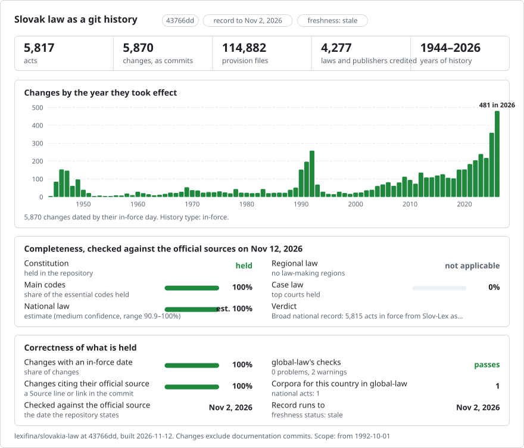

# Slovak law, change by change

[Slovenčina](README.md) · **English**

<picture>
<source media="(prefers-color-scheme: dark)" srcset="data/effort-dark.svg">

</picture>

Part of [lexifina/global-law](https://github.com/lexifina/global-law), one git history for every country's law: this is Slovakia's national law, which global-law reads at `slovakia/national/acts/`.

Slovak law as a git repository. Two acts are traced version by version: the Constitution (Ústava Slovenskej
republiky, 460/1992 Zb.) and the Act on the Conditions for Exercising the Right to Vote (zákon č. 180/2014 Z. z. o
podmienkach výkonu volebného práva); 664 other acts in force, chosen as "The acts in force" below says, are
held as their current version. In the two traced acts each amending act is one commit, credited to that act and dated the day it took effect, at noon in Bratislava.
The text is the consolidated text published by the Ministry of Justice in [Slov-Lex](https://www.slov-lex.sk).

## The whole Collection of Laws, version by version (being added from 2026-11-13)

Being added now, in batches pushed as they are checked: every item of the Collection of Laws (Zbierka zákonov) that
Slov-Lex lists, 25,891 since 1918 (laws, constitutional acts, government and ministerial regulations, Constitutional
Court findings, notices, among them the treaties the Ministry of Foreign Affairs announces, resolutions and decisions),
in force or repealed, each with every dated version Slov-Lex keeps; and, for the acts held above as their current
version, their earlier and later versions. [PLAN.md](PLAN.md) lists every part of the plan and how far each has got.

- **Folders.** `zz/<year>/<number>/` from 1993, `zb/<year>/<number>/` for 1918-1992; `data/paths.json` maps each act
  id (`zz-2010-1`) to its folder. Files are named as above; an item with no section or article (a notice, a finding)
  is one file, `text.md`, with `prilohy.md` and `poznamky.md` where it has annexes or footnotes.
- **One commit per dated version**, dated the day it took effect (`In-force:`, Slov-Lex's "účinnosť od"), changing only
  the files that changed. The first version is credited to the act itself when Slov-Lex names no amending act for it
  (`Kind: law`; `Kind: court` for a finding). A later version is credited to the one act Slov-Lex names for it
  (`Evidence:` says the credit is at the level of the version, not of each provision); where Slov-Lex names several
  (`Kind: candidates`) or none (`Kind: unexplained`), the commit is by Slov-Lex and credited to no act.
- **Repeal.** When an act's last version ends ("účinnosť do") before the data was read, a commit on the next day removes
  its files: credited to the act Slov-Lex names under "Predpis je zrušený", or by Slov-Lex when it names none or several.
- **Items with no dated version** keep their published text, dated the day of publication (`Kind: published`).
- **Earlier versions of acts already held** come after the version held since 2026-11-02, oldest first, so each act's
  last commit is its newest text; they carry `Backfill:`. Every commit carries its `In-force:` day, and readers take
  the newest commit whose `In-force:` is on or before the day asked, as `tools/ku_dnu.py` does.
- **Tables.** `data/zbierka/<year>.csv` (the items added), `data/historia/<year>.csv` (the acts whose versions were
  added), `data/poradie-zbierka/<year>.json` (the order of each act's files in the source).
- **Checks before each push.** The letters and digits of each version page (the act, annexes and footnotes, read
  without the reader) must all be in its files (at least 99.5% of them, else the item waits, with the reason recorded); every image
  and annex is kept or marked; each commit's folder equals that version's files exactly; no other path changes; every
  author and committer address is `@lexifina.com` or `.invalid`; history only grows (plain pushes, never forced).

Data from Slov-Lex's static mirror (`https://static.slov-lex.sk/static/SK/ZZ/<year>/<number>/` and its version pages),
at most 20 requests a second, with the user agent `lexifina-watch/1.0`.

## Local acts: generally binding regulations (VZN), being added from 2026-11-13

Municipalities, cities and the self-governing regions make their own law, *všeobecne záväzné nariadenia* (VZN). There
is no national register of them (zákon 369/1990 Zb. § 6 ods. 9: a VZN is published on the council's official board and
website), so each council's own register is read, where it is machine-readable. [PLAN.md](PLAN.md) shows which.

- **Folders.** `local/<council>/<year>/<number>/`: `local/bratislava/2023/4/` is VZN 4/2023 of the capital. Each holds
  the council's document byte for byte (`vzn.pdf`, `vzn.rtf`), its attachments (`prilohy/`), and `text.md`, the text
  read mechanically from the document (an RTF without its control words, or a PDF's own text layer). Nothing is typed in
  or corrected; a scanned document with no text layer has no `text.md`. The document is the published form.
- **Commits.** One per VZN, dated the day it took effect as the council's register gives it, credited to the VZN
  (`VZN 4/2023 (Bratislava)` at an address ending `.invalid`), with `Kind: local`, `Council:`, `In-force:`, `Source:`
  (the register page), `Text-source:` (the document) and `Document-sha256:`. A repeal the register records is a commit
  removing the folder on that day, credited to the repealing VZN when the register names it. Consolidated texts a
  council publishes (Košice: "úplné znenie ... účinné od") are `Kind: consolidated` commits by the council.
- **Councils so far.** Bratislava (the city's register on bratislava.sk/vzn; `data/local/bratislava-vzn.csv` lists all
  359), Žilina and Banská Bystrica (the cities' registers on their own sites); Košice and the regions follow.
- Drafts (*návrh*) are not law and are left out here.

## The questions, as git commands

| Question | Command |
| --- | --- |
| What did čl. 7 of the Constitution say on 1 January 2020? | `python tools/ku_dnu.py 2020-01-01 ustava 7` |
| The whole Constitution as it stood in 2000 | `python tools/ku_dnu.py 2000-01-01 ustava` |
| § 4 of the election act on 1 January 2017 | `python tools/ku_dnu.py 2017-01-01 volebny-zakon 4` |
| Which act wrote each paragraph of čl. 7? | `git blame ustava/cl-007.md` |
| Every change to čl. 7, with the act and the day | `git log --follow ustava/cl-007.md` |
| Everything one act changed | `git show --stat zz/2025-255` |
| What changed in the election act on one day | `git show --stat volebny-zakon/2022-01-01` |
| The amending acts with all their dates | [`predpisy.csv`](predpisy.csv) |
| Changes where two acts took effect the same day | `git log --grep="dva predpisy v jeden deň"` |
| Changes credited to the act's own deferred commencement | `git log --grep="Evidence: commencement"` |
| Changes credited by date only (no change mark) | `git log --grep="Evidence: date only"` |
| Acts amending the election act in 2022 | `git log --format="%an %s" --author="/2022 Z. z." -- volebny-zakon` |

## The dates, and which one we use

A Slovak act has the day the National Council passed it (`Enacted:`), the day it was published in the Collection of
Laws (`Published:`), and the day it took effect (`In-force:`). **Commits are dated the day the change took effect**, at
noon in Bratislava (CET, or CEST in summer time): that is the day that decides which text applies. It is the day
Slov-Lex gives as the start of the version the act produced. All three dates are in every commit message of the two
traced acts; the acts appended as their current version carry `In-force:` (with `In-force-basis:` and
`Text-as-of:`) but not `Enacted:` or `Published:`. No date in these two acts is before 1970.

## What "author" means

The author of a commit is the act that made the change: `255/2025 Z. z.` (with an address ending
`@slov-lex.invalid`, which cannot exist), so `git blame` names the act. Constitutional Court findings (nálezy) published
in the Collection are authors too. Slov-Lex lists, for each version, the acts that produced it, and marks each element
of the text that the version changed. A change is credited to the version's act when Slov-Lex marks an element of that
provision as changed. Three further rules, each labelled in the commit: text removed or a provision inserted without a
mark goes to the one act of that day ("date only"); part headings that moved with a provision go with the act that
changed it; and a version for which Slov-Lex names no act is credited to the act itself when its own commencement
provision names that day (Act 180/2014 took effect in three steps).

Where two acts took effect on the same day, Slov-Lex does not say which changed what: such changes are committed by
`Slov-Lex (Ministerstvo spravodlivosti SR)`, labelled "dva predpisy v jeden deň", and name both acts in `Candidate:`
trailers. They are never credited to either. The committer is always `Lexifina`.

## How it is checked

For the two traced acts, `tools/check_repo.py` (it needs `build.py`, kept with the build notes) reads every version of
each act back from git on the day it took effect and compares it with the
official text: file by file with the text parsed from Slov-Lex's page, and word for word with all the words of the page,
read independently of the parser. `tools/test_repo.py` checks that the commands above work. The results are in
[`REPRODUCE.md`](REPRODUCE.md).

## Files

Each act is a folder (`ustava/`, `volebny-zakon/`). Each article (článok) or section (paragraf) is one file named after
Slov-Lex's identifier: `ustava/cl-007.md` is `ustavnyclanok-7`, `volebny-zakon/par-014a.md` is `paragraf-14a`, and
`volebny-zakon/clanok-2.md` is Čl. II of Act 180/2014 (an article that amends another act). The headings of the parts
that begin with a provision are `##` lines at the top of its file; the provision's number and heading are the `#` line;
each paragraph (odsek) is one line, and each letter (písmeno) and point (bod) is a list item. `uvod.md` is the title and
preamble or enacting words, `zaver.md` the signatures, `prilohy/` the annexes and `poznamky.md` the footnotes. A
repealed provision is removed, as Slov-Lex removes it from the consolidated text.

## What it does not show

- Versions Slov-Lex does not publish: the Constitution's text is recorded from 1 October 1992, its first dated version.
- Which of two acts of the same day made a change (above).
- The earlier versions of the acts held as their current version, and the amending acts behind them: being added
  (above, and [PLAN.md](PLAN.md)).

The consolidated text is for information: Slov-Lex says that the legally binding content is the PDF version of the
Collection of Laws.

## How it is built

The two traced acts were written by a build script (`build.py`) kept with the build notes, not in this repository;
the acts appended after them by a second private script. Every step, the sources, the decisions made by hand and
what an AI model did are in [`REPRODUCE.md`](REPRODUCE.md). `tools/ku_dnu.py` reads any act on any day, in the
order the source gives its provisions; `tools/check_wave3.py` checks the appended acts.
[`corpus.json`](corpus.json) describes the corpus for tools that read several of Lexifina's law repositories.

## Licence

The text of a legal regulation is not a subject of copyright in Slovakia (§ 5 písm. b) of the Copyright Act,
185/2015 Z. z.). Source: Slov-Lex, www.slov-lex.sk, Ministerstvo spravodlivosti Slovenskej republiky. The history,
commit messages, tables and tools are released under [CC0 1.0](LICENSE).

## The acts in force, current version

Besides the two acts traced version by version, the record holds 5815 acts in force at Slov-Lex, one commit each: the version in force when the data was read, dated by its own day of effect; credited to the act when it is the act as enacted (`Kind: law`), otherwise committed by Slov-Lex as a `Kind: baseline` and credited to no act. Earlier versions will be added behind them without rewriting history. Notices, decisions, rulings and acts that only amend others are left out. The list is `data/ucinne-predpisy.csv`; an act's folder is `zz-<year>-<number>` (from 1993) or `zb-<year>-<number>`.

Images and annexes Slov-Lex gives only as PDF are kept as published, byte for byte, in each act's `assets/` folder and linked where they stand (`data/assets.tsv` lists them); one that could not be kept is marked `[Image omitted: ...]` at its place (columns `obrazky`, `prilohy_pdf`, `vynechane` of the table). Check the record with `python -X utf8 tools/check_wave3.py`.

## More

From [lexifina/global-law](https://github.com/lexifina/global-law):

- [FEATURES.md](https://github.com/lexifina/global-law/blob/main/FEATURES.md): every feature, and what every corpus must support (`git blame`, `law.py`, the MCP tools)
- [FAQ.md](https://github.com/lexifina/global-law/blob/main/FAQ.md): questions and answers · [CONTRIBUTING.md](https://github.com/lexifina/global-law/blob/main/CONTRIBUTING.md): proposing changes · [MCP.md](https://github.com/lexifina/global-law/blob/main/MCP.md): the MCP server · [REPRODUCE.md](https://github.com/lexifina/global-law/blob/main/REPRODUCE.md): how it was built · [CHANGELOG.md](https://github.com/lexifina/global-law/blob/main/CHANGELOG.md)
- [FRESHNESS.md](https://github.com/lexifina/global-law/blob/main/FRESHNESS.md): how current each corpus is · [Monitoring](https://github.com/lexifina/global-law/tree/main/monitoring): whether updates are running · [WATCHING.md](https://github.com/lexifina/global-law/blob/main/WATCHING.md): how each official source is watched for changes
- [performance/](https://github.com/lexifina/global-law/tree/main/performance): how fast the tools are, measured
- [visualisations/](https://github.com/lexifina/global-law/tree/main/visualisations): charts and bridges across the world's law
- [Vulnerabilities](https://github.com/lexifina/global-law/tree/main/vulnerabilities): mistakes in legislation as published
