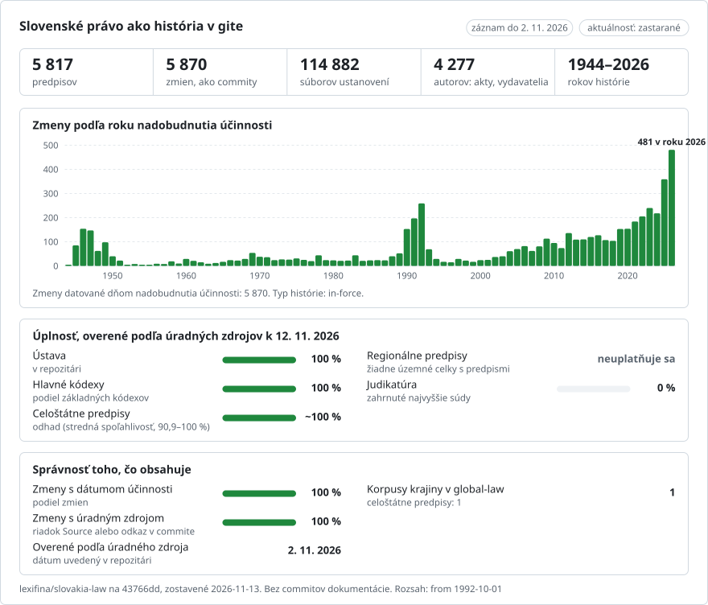

# Slovenské právo, zmena po zmene

**Slovenčina** · [English](README.en.md)

<picture>
<source media="(prefers-color-scheme: dark)" srcset="data/sk/effort-dark.svg">

</picture>

Súčasť [lexifina/global-law](https://github.com/lexifina/global-law), jednej histórie git pre právo každej krajiny: toto je vnútroštátne právo Slovenska, ktoré global-law číta v `slovakia/national/acts/`.

Slovenské právo ako repozitár git. Verziu po verzii sú zaznamenané dva predpisy: Ústava Slovenskej republiky
(460/1992 Zb.) a zákon č. 180/2014 Z. z. o podmienkach výkonu volebného práva; ďalších 664 účinných predpisov,
vybraných tak, ako opisuje oddiel „Účinné predpisy“ nižšie, je zaznamenaných v aktuálnom znení. V dvoch zaznamenaných
predpisoch je každý novelizujúci predpis jeden commit, pripísaný tomuto predpisu a datovaný dňom, keď nadobudol
účinnosť, na poludnie v Bratislave. Text je konsolidované znenie, ktoré zverejňuje Ministerstvo spravodlivosti
v [Slov-Lexe](https://www.slov-lex.sk).

## Celá Zbierka zákonov, verziu po verzii (pridáva sa od 13. 11. 2026)

Práve sa pridáva, v dávkach odosielaných po ich kontrole: každá položka Zbierky zákonov, ktorú Slov-Lex uvádza,
25 891 od roku 1918 (zákony, ústavné zákony, nariadenia vlády a vyhlášky ministerstiev, nálezy Ústavného súdu,
oznámenia, medzi nimi zmluvy, ktoré oznamuje Ministerstvo zahraničných vecí, uznesenia a rozhodnutia), účinné aj
zrušené, každá so všetkými datovanými verziami, ktoré Slov-Lex uchováva; a pri predpisoch, ktoré sú vyššie zaznamenané
v aktuálnom znení, aj ich staršie a neskoršie verzie. [PLAN.md](PLAN.md) uvádza každú časť plánu a ako ďaleko sa
s ňou pokročilo.

- **Priečinky.** `zz/<year>/<number>/` od roku 1993, `zb/<year>/<number>/` pre roky 1918 – 1992; `data/paths.json`
  priraďuje každému identifikátoru predpisu (`zz-2010-1`) jeho priečinok. Súbory sú pomenované ako vyššie; položka
  bez paragrafov a článkov (oznámenie, nález) je jeden súbor, `text.md`, s `prilohy.md` a `poznamky.md`, ak má
  prílohy alebo poznámky pod čiarou.
- **Jeden commit na každú datovanú verziu**, datovaný dňom, keď nadobudla účinnosť (`In-force:`, v Slov-Lexe
  „účinnosť od“), ktorý mení len súbory, ktoré sa zmenili. Prvá verzia sa pripisuje samotnému predpisu, ak pri nej
  Slov-Lex neuvádza nijaký novelizujúci predpis (`Kind: law`; `Kind: court` pri náleze). Neskoršia verzia sa
  pripisuje jedinému predpisu, ktorý pri nej Slov-Lex uvádza (`Evidence:` hovorí, že pripísanie je na úrovni verzie,
  nie jednotlivých ustanovení); ak Slov-Lex uvádza viac predpisov (`Kind: candidates`) alebo žiadny
  (`Kind: unexplained`), commit je od Slov-Lexu a nepripisuje sa nijakému predpisu.
- **Zrušenie.** Ak posledná verzia predpisu skončila („účinnosť do“) pred získaním údajov, commit nasledujúceho dňa
  odstráni jeho súbory: pripísaný predpisu, ktorý Slov-Lex uvádza pod „Predpis je zrušený“, alebo od Slov-Lexu, ak
  neuvádza žiadny alebo uvádza viac.
- **Položky bez datovanej verzie** si ponechávajú vyhlásený text, datovaný dňom vyhlásenia (`Kind: published`).
- **Staršie verzie predpisov, ktoré už repozitár obsahuje,** nasledujú za verziou zaznamenanou od 2. 11. 2026, od
  najstaršej, takže posledný commit každého predpisu je jeho najnovší text; nesú `Backfill:`. Každý commit nesie svoj
  deň `In-force:` a čitatelia berú najnovší commit, ktorého `In-force:` pripadá na požadovaný deň alebo skôr, tak ako
  to robí `tools/ku_dnu.py`.
- **Tabuľky.** `data/zbierka/<year>.csv` (pridané položky), `data/historia/<year>.csv` (predpisy, ktorých verzie
  boli pridané), `data/poradie-zbierka/<year>.json` (poradie súborov každého predpisu v zdroji).
- **Kontroly pred každým odoslaním.** Písmená a číslice každej stránky verzie (predpis, prílohy a poznámky pod čiarou,
  čítané nezávisle od parsera) musia byť všetky v jej súboroch (aspoň 99,5 % z nich, inak položka čaká a dôvod sa
  zaznamená); každý obrázok a každá príloha sa zachová alebo označí; priečinok každého commitu sa presne zhoduje so
  súbormi danej verzie; žiadna iná cesta sa nemení; každá adresa autora a commitera je `@lexifina.com` alebo
  `.invalid`; história iba rastie (bežné pushe, nikdy vynútené).

Údaje pochádzajú zo statického zrkadla Slov-Lexu (`https://static.slov-lex.sk/static/SK/ZZ/<year>/<number>/` a jeho
stránok verzií), najviac 20 požiadaviek za sekundu, s user agentom `lexifina-watch/1.0`.

## Miestne predpisy: všeobecne záväzné nariadenia (VZN), pridávajú sa od 13. 11. 2026

Obce, mestá a samosprávne kraje vydávajú vlastné predpisy, *všeobecne záväzné nariadenia* (VZN). Ich celoštátny
register neexistuje (zákon 369/1990 Zb. § 6 ods. 9: VZN sa vyhlasuje na úradnej tabuli a na webovom sídle), preto sa
číta vlastný register každej samosprávy, ak je strojovo čitateľný. [PLAN.md](PLAN.md) ukazuje, ktoré to sú.

- **Priečinky.** `local/<council>/<year>/<number>/`: `local/bratislava/2023/4/` je VZN 4/2023 hlavného mesta. Každý
  obsahuje dokument samosprávy bajt po bajte (`vzn.pdf`, `vzn.rtf`), jeho prílohy (`prilohy/`) a `text.md`, text
  strojovo načítaný z dokumentu (RTF bez riadiacich slov alebo vlastná textová vrstva PDF). Nič sa ručne neprepisuje
  ani neopravuje; naskenovaný dokument bez textovej vrstvy nemá `text.md`. Vyhlásenou podobou je dokument.
- **Commity.** Jeden na každé VZN, datovaný dňom, keď VZN nadobudlo účinnosť, podľa registra samosprávy, pripísaný
  VZN (`VZN 4/2023 (Bratislava)` s adresou končiacou `.invalid`), s `Kind: local`, `Council:`, `In-force:`, `Source:`
  (stránka registra), `Text-source:` (dokument) a `Document-sha256:`. Zrušenie, ktoré register zaznamenáva, je commit,
  ktorý v ten deň odstráni priečinok, pripísaný zrušujúcemu VZN, ak ho register uvádza. Úplné znenia, ktoré samospráva
  zverejňuje (Košice: „úplné znenie ... účinné od“), sú commity `Kind: consolidated` od samosprávy.
- **Doterajšie samosprávy.** Bratislava (register mesta na bratislava.sk/vzn; `data/local/bratislava-vzn.csv` uvádza
  všetkých 359), Žilina a Banská Bystrica (registre miest na ich vlastných stránkach); Košice a kraje nasledujú.
- Návrhy (*návrh*) nie sú právom, preto tu nie sú zahrnuté.

## Otázky ako príkazy git

| Otázka | Príkaz |
| --- | --- |
| Čo znel čl. 7 Ústavy 1. januára 2020? | `python tools/ku_dnu.py 2020-01-01 ustava 7` |
| Celá Ústava v znení z roku 2000 | `python tools/ku_dnu.py 2000-01-01 ustava` |
| § 4 volebného zákona k 1. januáru 2017 | `python tools/ku_dnu.py 2017-01-01 volebny-zakon 4` |
| Ktorý predpis napísal ktorý odsek čl. 7? | `git blame ustava/cl-007.md` |
| Každá zmena čl. 7, s predpisom a dňom | `git log --follow ustava/cl-007.md` |
| Všetko, čo zmenil jeden predpis | `git show --stat zz/2025-255` |
| Čo sa vo volebnom zákone zmenilo v jeden deň | `git show --stat volebny-zakon/2022-01-01` |
| Novelizujúce predpisy so všetkými ich dátumami | [`predpisy.csv`](predpisy.csv) |
| Zmeny, pri ktorých v ten istý deň nadobudli účinnosť dva predpisy | `git log --grep="dva predpisy v jeden deň"` |
| Zmeny pripísané odloženej účinnosti samotného predpisu | `git log --grep="Evidence: commencement"` |
| Zmeny pripísané len podľa dátumu (bez označenia zmeny) | `git log --grep="Evidence: date only"` |
| Predpisy, ktoré novelizovali volebný zákon v roku 2022 | `git log --format="%an %s" --author="/2022 Z. z." -- volebny-zakon` |

## Dátumy a ktorý z nich používame

Slovenský predpis má deň, keď ho Národná rada schválila (`Enacted:`), deň, keď bol vyhlásený v Zbierke zákonov
(`Published:`), a deň, keď nadobudol účinnosť (`In-force:`). **Commity sú datované dňom, keď zmena nadobudla
účinnosť**, na poludnie v Bratislave (SEČ, v letnom čase SELČ): to je deň, ktorý rozhoduje o tom, ktoré znenie sa
uplatňuje. Je to deň, ktorý Slov-Lex uvádza ako začiatok verzie, ktorú predpis vytvoril. Všetky tri dátumy sú v každej
správe commitu dvoch zaznamenaných predpisov; predpisy pripojené v aktuálnom znení nesú `In-force:` (s
`In-force-basis:` a `Text-as-of:`), ale nie `Enacted:` ani `Published:`. Žiadny dátum v týchto dvoch predpisoch nie
je starší ako rok 1970.

## Čo znamená „autor“

Autorom commitu je predpis, ktorý zmenu urobil: `255/2025 Z. z.` (s adresou končiacou `@slov-lex.invalid`, ktorá
nemôže existovať), takže `git blame` uvádza predpis. Autormi sú aj nálezy Ústavného súdu vyhlásené v Zbierke.
Slov-Lex pri každej verzii uvádza predpisy, ktoré ju vytvorili, a označuje každý prvok textu, ktorý verzia zmenila.
Zmena sa pripisuje predpisu verzie, ak Slov-Lex označí niektorý prvok daného ustanovenia ako zmenený. Tri ďalšie
pravidlá, každé označené v commite: odstránený text alebo ustanovenie vložené bez označenia pripadá jedinému predpisu
daného dňa („date only“); nadpisy častí, ktoré sa presunuli s ustanovením, idú s predpisom, ktorý ho zmenil; a verzia,
pri ktorej Slov-Lex neuvádza nijaký predpis, sa pripisuje samotnému predpisu, ak tento deň uvádza jeho vlastné
ustanovenie o účinnosti (zákon 180/2014 nadobúdal účinnosť v troch krokoch).

Ak dva predpisy nadobudli účinnosť v ten istý deň, Slov-Lex neuvádza, ktorý z nich zmenil čo: takéto zmeny commituje
`Slov-Lex (Ministerstvo spravodlivosti SR)`, sú označené „dva predpisy v jeden deň“ a oba predpisy uvádzajú
v trailoroch `Candidate:`. Nikdy sa nepripisujú ani jednému z nich. Commiterom je vždy `Lexifina`.

## Ako sa to kontroluje

Pri dvoch zaznamenaných predpisoch `tools/check_repo.py` (potrebuje `build.py`, uložený spolu s poznámkami
k zostaveniu) načíta z gitu každú verziu každého predpisu v deň, keď nadobudla účinnosť, a porovná ju s úradným
textom: súbor po súbore s textom spracovaným zo stránky Slov-Lexu a slovo po slove so všetkými slovami stránky,
čítanými nezávisle od parsera. `tools/test_repo.py` kontroluje, že príkazy uvedené vyššie fungujú. Výsledky sú
v [`REPRODUCE.md`](REPRODUCE.md).

## Súbory

Každý predpis je priečinok (`ustava/`, `volebny-zakon/`). Každý článok alebo paragraf je jeden súbor pomenovaný podľa
identifikátora Slov-Lexu: `ustava/cl-007.md` je `ustavnyclanok-7`, `volebny-zakon/par-014a.md` je `paragraf-14a`
a `volebny-zakon/clanok-2.md` je Čl. II zákona 180/2014 (článok, ktorý novelizuje iný predpis). Nadpisy častí, ktoré
sa začínajú ustanovením, sú riadky `##` na začiatku jeho súboru; číslo a nadpis ustanovenia sú riadok `#`; každý
odsek je jeden riadok a každé písmeno a bod je položka zoznamu. `uvod.md` je názov a preambula alebo úvodná veta,
`zaver.md` podpisy, `prilohy/` prílohy a `poznamky.md` poznámky pod čiarou. Zrušené ustanovenie sa odstráni, tak ako
ho Slov-Lex odstraňuje z konsolidovaného znenia.

## Čo neukazuje

- Verzie, ktoré Slov-Lex nezverejňuje: znenie Ústavy je zaznamenané od 1. októbra 1992, jej prvej datovanej verzie.
- Ktorý z dvoch predpisov toho istého dňa urobil zmenu (pozri vyššie).
- Staršie verzie predpisov zaznamenaných v aktuálnom znení a novelizujúce predpisy, ktoré ich vytvorili: pridávajú sa
  (pozri vyššie a [PLAN.md](PLAN.md)).

Konsolidované znenie má informatívny charakter: Slov-Lex uvádza, že právne záväzný obsah sa nachádza v pdf verzii
Zbierky zákonov.

## Ako je zostavený

Dva zaznamenané predpisy zapísal skript na zostavenie (`build.py`) uložený spolu s poznámkami k zostaveniu, nie
v tomto repozitári; predpisy pripojené po nich druhý, neverejný skript. Každý krok, zdroje, rozhodnutia urobené ručne
a to, čo urobil model umelej inteligencie, sú v [`REPRODUCE.md`](REPRODUCE.md). `tools/ku_dnu.py` načíta ktorýkoľvek
predpis k ľubovoľnému dňu, v poradí, v akom zdroj uvádza jeho ustanovenia; `tools/check_wave3.py` kontroluje pripojené
predpisy. [`corpus.json`](corpus.json) opisuje korpus pre nástroje, ktoré čítajú viaceré právne repozitáre Lexifiny.

## Licencia

Text právneho predpisu nie je na Slovensku predmetom autorského práva (§ 5 písm. b) Autorského zákona,
185/2015 Z. z.). Zdroj: Slov-Lex, www.slov-lex.sk, Ministerstvo spravodlivosti Slovenskej republiky. História,
správy commitov, tabuľky a nástroje sú uvoľnené pod licenciou [CC0 1.0](LICENSE).

Toto je preklad anglickej verzie ([README.en.md](README.en.md)); ak sa líšia, platí anglická verzia.

## Účinné predpisy, aktuálne znenie

Okrem dvoch predpisov zaznamenaných verziu po verzii obsahuje záznam 5 815 predpisov účinných podľa Slov-Lexu, každý v jednom commite: verziu účinnú v čase získania údajov, datovanú dňom jej vlastnej účinnosti; ak ide o pôvodné znenie, je pripísaná predpisu (`Kind: law`), inak ju commituje Slov-Lex ako `Kind: baseline` a nepripisuje sa nijakému predpisu. Staršie verzie pribudnú za nimi bez prepisovania histórie. Oznámenia, rozhodnutia, nálezy a predpisy, ktoré len novelizujú iné predpisy, sú vynechané. Zoznam je v `data/ucinne-predpisy.csv`; priečinok predpisu je `zz-<year>-<number>` (od roku 1993) alebo `zb-<year>-<number>`.

Obrázky a prílohy, ktoré Slov-Lex poskytuje len ako PDF, sú zachované tak, ako boli vyhlásené, bajt po bajte, v priečinku `assets/` každého predpisu a odkazuje sa na ne na mieste, kde sa nachádzajú (uvádza ich `data/assets.tsv`); obrázok alebo príloha, ktorú sa nepodarilo zachovať, je na svojom mieste označená `[Image omitted: ...]` (stĺpce `obrazky`, `prilohy_pdf`, `vynechane` tabuľky). Záznam skontrolujete príkazom `python -X utf8 tools/check_wave3.py`.

## Viac

Z repozitára [lexifina/global-law](https://github.com/lexifina/global-law) (v angličtine):

- [FEATURES.md](https://github.com/lexifina/global-law/blob/main/FEATURES.md): všetky funkcie a čo musí každý korpus podporovať (`git blame`, `law.py`, nástroje MCP)
- [FAQ.md](https://github.com/lexifina/global-law/blob/main/FAQ.md): otázky a odpovede · [CONTRIBUTING.md](https://github.com/lexifina/global-law/blob/main/CONTRIBUTING.md): navrhovanie zmien · [MCP.md](https://github.com/lexifina/global-law/blob/main/MCP.md): MCP server · [REPRODUCE.md](https://github.com/lexifina/global-law/blob/main/REPRODUCE.md): ako bol vytvorený · [CHANGELOG.md](https://github.com/lexifina/global-law/blob/main/CHANGELOG.md)
- [FRESHNESS.md](https://github.com/lexifina/global-law/blob/main/FRESHNESS.md): aký aktuálny je každý korpus · [Monitorovanie](https://github.com/lexifina/global-law/tree/main/monitoring): či aktualizácie fungujú · [WATCHING.md](https://github.com/lexifina/global-law/blob/main/WATCHING.md): ako sa pri každom úradnom zdroji sledujú zmeny
- [performance/](https://github.com/lexifina/global-law/tree/main/performance): aké rýchle sú nástroje, namerané
- [visualisations/](https://github.com/lexifina/global-law/tree/main/visualisations): grafy a väzby naprieč právom celého sveta
- [Zraniteľnosti](https://github.com/lexifina/global-law/tree/main/vulnerabilities): chyby v predpisoch tak, ako boli vyhlásené
