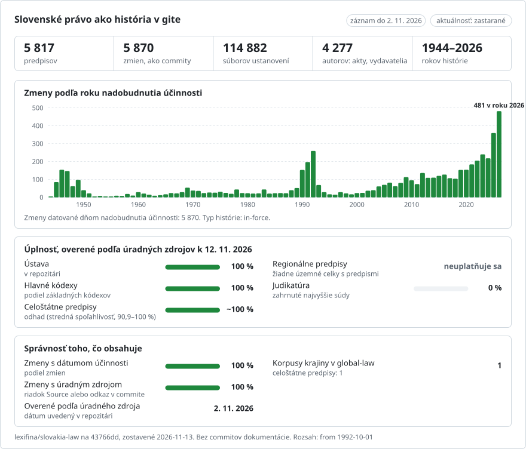

# Slovensko: história práva v gite

**Slovenčina** · **[Or read it in English](README.en.md)**

<picture>
<source media="(prefers-color-scheme: dark)" srcset="data/sk/effort-dark.svg">

</picture>

Právo Slovenska ako história git: jeden súbor na článok alebo paragraf, jeden commit na každé znenie v deň, keď nadobudlo účinnosť, a ako autor commitu predpis, ktorý zmenu vykonal. `git blame` pri každom článku uvedie predpis, ktorý za ním stojí; `git log` vypíše každú zmenu článku; zvolený dátum dá text účinný k tomuto dňu.

Súčasť projektu [lexifina/global-law](https://github.com/lexifina/global-law), jednej histórie git pre právo všetkých krajín: toto je vnútroštátne právo Slovenska, ktoré global-law číta v `slovakia/national/acts/`.

**Čo obsahuje teraz:** Ústavu a volebný zákon (180/2014 Z. z.) so všetkými ich 28 a 21 zneniami; 20 759 ďalších predpisov a položiek Zbierky zákonov (1918-2026) s 34 348 zneniami: 13 284 s textom dnes a 7 475 zrušených alebo už neúčinných, uchovaných s ich históriou a so súbormi odstránenými, keď skončili; z tých, ktoré tu dnes sú, je 5 444 stále len v znení účinnom 2. novembra 2026, medzi nimi Občiansky zákonník, Obchodný zákonník, Trestný zákon, Trestný poriadok, Civilný sporový poriadok, Zákonník práce a Daňový poriadok; 106 opatrení z Registra opatrení (2016-2018); a 464 všeobecne záväzných nariadení (VZN) štyroch miest: Bratislavy, Žiliny, Banskej Bystrice a Nitry. [`PLAN.md`](PLAN.md) uvádza všetky časti, ktoré má tento repozitár obsahovať, a ako ďaleko je každá z nich.

Každý predpis je v `zz/<rok>/<číslo>/` (od roku 1993) alebo `zb/<rok>/<číslo>/` (1918-1992): `zz/2001/311/par-001.md` je § 1 Zákonníka práce, 311/2001 Z. z. Ústava je v `constitution/ustava/`, volebný zákon vo `volebny-zakon/`, opatrenia v `ro/<rok>/<číslo>/` a VZN v `local/<mesto>/<rok>/<číslo>/`. Pred 10. 11. 2026 sa každý priečinok volal podľa id predpisu (`ustava`, `zz-2001-311`); tagy a `tools/ku_dnu.py` používajú id a `data/paths.json` priraďuje každému id jeho priečinok.

Text je v slovenčine (staršie československé predpisy aj v češtine), tak ako ho zverejňuje Slov-Lex. Anglický preklad nie je súčasťou tohto záznamu.

## Otázky ako príkazy git

| Otázka | Príkaz |
| --- | --- |
| Každá zmena čl. 7 Ústavy | `git log -p --follow --word-diff -- constitution/ustava/cl-007.md` |
| Ktorý predpis napísal každý riadok čl. 7? | `git blame constitution/ustava/cl-007.md` |
| Každé znenie Ústavy s dňom, keď nadobudlo účinnosť | `git log --no-walk --format="%h %(trailers:key=In-force,valueonly,separator=) %an" --tags="ustava/*"` |
| Čl. 7 v znení účinnom k 1. januáru 2020 | `python tools/ku_dnu.py 2020-01-01 ustava 7` |

**Mimo gitu** tento záznam aj verejne a bezplatne prevádzkujeme:

- **[Opýtajte sa Claude na slovenské právo](https://global-law.lexifina.com/v1/try_claude?country=slovakia)**: otvorí Claude s pripravenou prvou otázkou.
- **[Opýtajte sa ChatGPT](https://global-law.lexifina.com/v1/try_chatgpt?country=slovakia)**: tá istá otázka v ChatGPT.
- **[Hľadajte v slovenskom práve na našom webe](https://lexifina.com/law?country=slovakia&q=dovolenka)**: hľadanie „dovolenka“, s textom každého ustanovenia a jeho zneniami, bez účtu.
- **[REST API pre vývojárov](https://global-law.lexifina.com/v1/search_law?query=dovolenka&jurisdiction=slovakia)**: rovnaké hľadanie ako JSON, bez kľúča. Dokumentácia je [tu](https://lexifina.com/api/global-law).

Obaja asistenti čítajú záznam cez bezplatný konektor Global law (MCP, `https://global-law.lexifina.com/mcp`); prvýkrát vám chat dá odkaz, ktorým sa konektor pridá. Pýtajte sa po slovensky alebo po anglicky.

**Jednoducho ho prevádzkujte sami.** Stačí git a Python a nástroje bežia na vašom počítači:

```sh
git clone --depth 1 https://github.com/lexifina/global-law && cd global-law
python3 tools/countries.py add slovakia/national/acts
python3 tools/law.py show 2026-01-01 slovakia/national/acts/constitution/ustava/cl-007.md
```

Otvorený v Claude Code, Cursore, VS Code alebo Codexe klon spustí aj lokálny server MCP s rovnakými nástrojmi ([MCP.md](https://github.com/lexifina/global-law/blob/main/MCP.md)).

## Dátumy

Každý commit je datovaný na poludnie bratislavského času (Europe/Bratislava) dňom, keď znenie nadobudlo účinnosť, a tento deň nesie v traileri `In-force:`:

- pri každom znení predpisu alebo opatrenia deň, ktorý Slov-Lex uvádza ako jeho začiatok („účinnosť od“);
- pri zrušení deň po skončení posledného znenia predpisu („účinnosť do“): tento commit odstráni súbory predpisu;
- pri VZN deň, keď nadobudlo účinnosť, ako ho uvádza register mesta;
- git nevie uložiť dátumy pred rokom 1970, preto je niekoľko skorších commitov datovaných 1970-01-01 a skutočný deň je v `In-force:`, ktorý číta `tools/ku_dnu.py`.

Každé znenie je pripísané predpisu, ktorý preň uvádza Slov-Lex (`255/2025 Z. z.`, s adresou končiacou `@slov-lex.invalid`); kde Slov-Lex uvádza viac predpisov alebo žiadny, commit je od Slov-Lexu a nie je pripísaný žiadnemu predpisu. V Ústave a vo volebnom zákone sa zmeny pripisujú po jednotlivých ustanoveniach, podľa zmien, ktoré Slov-Lex v texte označuje; VZN je pripísané samo sebe.

## Ako sa kontroluje

- `tools/check_repo.py` načítal každé znenie Ústavy a volebného zákona z gitu ku dňu, keď nadobudlo účinnosť, a porovnal ho s textom Slov-Lexu, súbor po súbore a slovo po slove: 49 znení, 0 rozdielov ([`REPRODUCE.md`](REPRODUCE.md)).
- `tools/check_wave3.py` kontroluje každý predpis zaznamenaný v aktuálnom znení: jeho priečinok a súbory, každý obrázok a prílohu s ich sha256 a trailery každého commitu.
- Pred každým odoslaním nových položiek musia byť písmená a číslice každej stránky znenia v jeho súboroch (aspoň 99,5 % z nich, inak položka čaká) a priečinok každého commitu sa musí rovnať súborom daného znenia.
- História sa len dopĺňa: bežné pushe, nikdy vynútené, a každý autor je predpis, vydavateľ alebo Lexifina.
- [vulnerabilities/](vulnerabilities/): možné legislatívne chyby v slovenskom práve, ktoré našli detektory z global-law a ktoré boli ručne overené.

## Čo neukazuje

- **Väčšinu Zbierky.** Slov-Lex uvádza 25 891 položiek od roku 1918; 5 822 je tu. Zrušené predpisy, predpisy, ktoré len menia iné, 5 800 oznámení (medzi nimi medzinárodné zmluvy), 205 nálezov Ústavného súdu, 839 uznesení a rozhodnutí a 271 opráv sa pridávajú (pozri `PLAN.md`).
- **Skoršie znenia 5 813 predpisov**, zaznamenaných v znení účinnom 2. novembra 2026; ich skoršie znenia sa pridávajú za ne.
- **Ktorý predpis vykonal niektoré zmeny.** 1 583 aktuálnych znení je od Slov-Lexu, nepripísaných žiadnemu predpisu; kde dva predpisy nadobudli účinnosť v ten istý deň, Slov-Lex neuvádza, ktorý čo zmenil.
- **Judikatúru, návrhy zákonov a návrhy predpisov** ani VZN 8 samosprávnych krajov a ďalších 2 890 obcí: sú plánované (pozri `PLAN.md`).

## Zdroje

| Zdroj | Druh | Skoršie znenia | Poznámky |
| --- | --- | --- | --- |
| [Slov-Lex](https://www.slov-lex.sk) (Ministerstvo spravodlivosti SR) | Úradná zbierka: Zbierka zákonov, Register opatrení | áno, každé datované znenie | Čítaný z jeho statického zrkadla; právne záväzný je text v PDF Zbierky |
| Registre VZN miest (Bratislava, Žilina, Banská Bystrica, Nitra) | Miestne predpisy | tak, ako sú zverejnené | Každý dokument uložený bajt po bajte, s textom prečítaným strojovo |

## Licencia

Pozri [`LICENSE`](LICENSE). Text právneho predpisu nie je na Slovensku predmetom autorského práva (§ 5 písm. b) Autorského zákona, 185/2015 Z. z.); história, správy commitov, tabuľky a nástroje sú CC0 1.0.

Žiadny model AI nenapísal ani nezmenil právny text; skripty napísal model AI (pozri [`REPRODUCE.md`](REPRODUCE.md)).

Toto je preklad anglickej verzie ([README.en.md](README.en.md)); ak sa líšia, platí anglická verzia.

## Vizualizácie

- [visualisations/](visualisations/): grafy nakreslené z tohto repozitára. Zatiaľ nenakreslené.

## Viac

Z repozitára [lexifina/global-law](https://github.com/lexifina/global-law) (v angličtine):

- [FEATURES.md](https://github.com/lexifina/global-law/blob/main/FEATURES.md): všetky funkcie a čo musí každý korpus podporovať (`git blame`, `law.py`, nástroje MCP)
- [FAQ.md](https://github.com/lexifina/global-law/blob/main/FAQ.md): otázky a odpovede · [CONTRIBUTING.md](https://github.com/lexifina/global-law/blob/main/CONTRIBUTING.md): navrhovanie zmien · [MCP.md](https://github.com/lexifina/global-law/blob/main/MCP.md): MCP server · [REPRODUCE.md](https://github.com/lexifina/global-law/blob/main/REPRODUCE.md): ako bol vytvorený · [CHANGELOG.md](https://github.com/lexifina/global-law/blob/main/CHANGELOG.md)
- [FRESHNESS.md](https://github.com/lexifina/global-law/blob/main/FRESHNESS.md): aký aktuálny je každý korpus · [Monitorovanie](https://github.com/lexifina/global-law/tree/main/monitoring): či aktualizácie fungujú · [WATCHING.md](https://github.com/lexifina/global-law/blob/main/WATCHING.md): ako sa pri každom úradnom zdroji sledujú zmeny
- [performance/](https://github.com/lexifina/global-law/tree/main/performance): aké rýchle sú nástroje, namerané
- [visualisations/](https://github.com/lexifina/global-law/tree/main/visualisations): grafy a väzby naprieč právom celého sveta
- [Zraniteľnosti](https://github.com/lexifina/global-law/tree/main/vulnerabilities): chyby v predpisoch tak, ako boli vyhlásené
