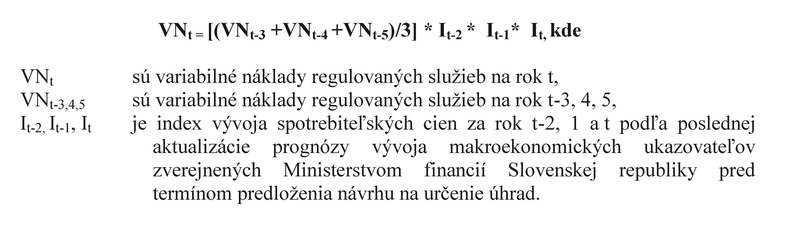

# § 3 Rozsah a podrobnosti uplatňovania princípov spoplatňovania železničnej infraštruktúry, servisných zariadení a ekonomicky oprávnených nákladov

(1) Systém úhrad je založený na rovnakých princípoch pre celú železničnú sieť, ktorú spravuje regulovaný subjekt a zabezpečuje, aby úhrady za rovnaké používanie železničnej infraštruktúry boli rovnocenné a nediskriminačné pre všetky železničné podniky a aby regulované služby rovnakého druhu na trhu železničnej dopravy podliehali rovnakým úhradám.

(2) Úhrady sa určia na základe ekonomicky oprávnených nákladov vynaložených na prevádzku vlaku na železničnej infraštruktúre.

(3) Ekonomicky oprávnené náklady podľa odseku 2 sú na účely regulácie úhrad variabilné náklady vznikajúce priamo prevádzkou vlaku na železničnej infraštruktúre za účelom poskytovania regulovaných služieb (ďalej len „variabilné náklady regulovaných služieb“).

(4) Variabilné náklady regulovaných služieb sú preukázateľne a v nevyhnutnom rozsahu vznikajúce náklady na obstaranie a spotrebu priameho materiálu, energií a služieb, mzdové náklady a ostatné osobné náklady, technologicky nevyhnutné ostatné priame náklady a časť prevádzkovej a strediskovej réžie, ktoré vznikli priamo ako výsledok prevádzky vlaku a ktoré sú v osobitnom predpise1) označené ako priame náklady na celosieťovom základe; sú to náklady spojené

- a) so spracovaním žiadostí o pridelenie kapacity,

- b) s využitím pridelenej kapacity železničnej infraštruktúry, vrátane použitia výhybiek, odbočiek a priecestí,

- c) s riadením vlakov, vrátane signalizácie, regulácie, odbavovania, spojenia a zabezpečenia informácií o pohybe vlaku,

- d) s používaním zariadenia na dodávku elektrického trakčného prúdu,

- e) s ostatnými informáciami potrebnými na uskutočnenie alebo prevádzku dopravných služieb, na ktoré bola poskytnutá kapacita,

- f) s používaním staníc osobnej dopravy, ich budov a zariadení vrátane zariadení pre informácie týkajúce sa cestovania a miest na predaj prepravných dokladov,

- g) s používaním nákladných terminálov, zriaďovacích staníc a zariadení na zoraďovanie vlakov vrátane zariadení na posun,

- h) s používaním odstavných koľají, osobitne určených na dočasné odstavenie vozňov medzi dvoma úlohami.

(5) Do variabilných nákladov regulovaných služieb sa nezahŕňajú náklady, ktoré neboli vynaložené na prevádzku vlaku na železničnej infraštruktúre, nevznikli prevádzkou vlakových služieb a neslúžia na zabezpečenie poskytovania regulovaných služieb, a to náklady na

- a) správu majetku železničných tratí a stavieb, oznamovacej a zabezpečovacej techniky, energetiky a elektrotechniky,

- b) správnu réžiu, celosieťovú réžiu a časť prevádzkovej a strediskovej réžie nezahrnutej do variabilných nákladov regulovaných služieb podľa odseku 4,

- c) opravu a údržbu objektov a zariadení,

- d) telekomunikačné zariadenia a služby,

- e) služby ubytovania a stravovania,

- f) správu a prevádzkovanie vozidiel a mechanizmov.

(6) Do variabilných nákladov regulovaných služieb sa ďalej nezahŕňajú

- a) náklady týkajúce sa poskytovania úseku trate, ktoré musí znášať manažér infraštruktúry, a to aj vtedy, keď po ňom nechodia vlaky,

- b) náklady nákladových stredísk, ktoré nie sú priamo spojené s poskytovaním regulovaných služieb,

- c) náklady na nadobudnutie, predaj, demontáž, dekontamináciu, rekultiváciu alebo prenájom pozemkov alebo iného dlhodobého majetku,

- d) náklady súvisiace s technologickým pokrokom alebo zastarávaním,

- e) náklady na nehmotný majetok,

- f) náklady na odpisovanie,

- g) environmentálne náklady,

- h) sankcie, zmluvné pokuty a manká,

- i) náklady spojené s odstraňovaním škôd na majetku,

- j) finančné náklady,

- k) náklady na reklamu, propagáciu a dary,

- l) chybne započítané náklady vyplývajúce z chýb v počtoch, v kalkulačných prepočtoch alebo účtovníctve,

- m) duplicitne uhrádzané náklady,

- n) iné náklady, ktoré nemožno zahrnúť do variabilných nákladov regulovaných služieb podľa odseku 4.

(7) Variabilné náklady regulovaných služieb na rok t sa vypočítajú podľa vzorca

(8) Variabilné náklady regulovaných služieb roku t-3, 4, 5 sa preukazujú kalkulačnými podkladmi, ktoré sa sledujú na výkonových číslach súvisiacich s regulovanými službami, a sú doplnené odôvodnením ich alokácie k skupine služieb, pre ktorú sa navrhujú samostatné úhrady.

(9) Pri určovaní úhrad je primeraný zisk nula.
