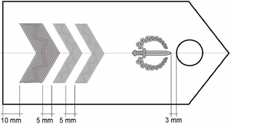
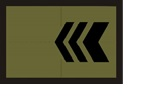
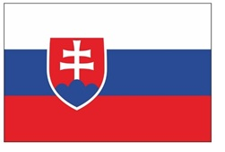

# Čl. I

Výnos Ministerstva obrany Slovenskej republiky zo 4. decembra 2015 č. ÚLP-11-32/2015-OdL, ktorým sa ustanovujú druhy vojenskej rovnošaty, výstrojových súčiastok, špecifických znakov vojenskej rovnošaty, ich nosenie a používanie a spôsob nosenia vyznamenaní na vojenskej rovnošate (oznámenie č. 382/2015 Z. z.) v znení opatrenia z 13. decembra 2018 č. 1/2018 (oznámenie č. 398/2018 Z. z.) sa mení a dopĺňa takto:

- 1. V § 1 ods. 3 písm. d) sa slová „tmavomodrej farby“ nahrádzajú slovami „čiernej farby“ a slová „bledomodrej farby“ sa nahrádzajú slovami „tmavomodrej farby“.

- 2. V § 1 odsek 5 znie:

- „(5) Baretka sa nosí k poľnej rovnošate, k služobnej rovnošate a k spoločenskej rovnošate; na ľavej strane baretky je umiestnený odznak podľa prílohy č. 1. Profesionálny vojak môže nosiť baretku namiesto poľnej čiapky, služobnej čiapky, čiapky – lodičky a spoločenskej čiapky. Príslušník Vojenskej polície môže nosiť tmavomodrú baretku. Profesionálny vojak strategického centra krízového manažmentu, profesionálny vojak jednotky zaradenej do síl vysokej pripravenosti, profesionálny vojak vyčlenený podľa § 71 ods. 1 písm. f) zákona a profesionálny vojak plniaci úlohy vo vojenských operáciách mimo územia Slovenskej republiky môže nosiť tmavozelenú baretku. Profesionálny vojak plniaci úlohy v mierových silách Organizácie Spojených národov môže nosiť bledomodrú baretku. Profesionálny vojak ustanovený do funkcie s predpísanou odbornosťou špeciálne operácie alebo profesionálny vojak, ktorý má alebo mal za názvom funkcie bližšiu špecifikáciu funkcie výsadkár, a profesionálny vojak so špecializáciou padákový odborník letectva môže nosiť bordovú baretku. Profesionálny vojak tankovej jednotky alebo profesionálny vojak, ktorý mal predchádzajúcu príslušnosť k tankovej jednotke, môže nosiť čiernu baretku. Profesionálny vojak, ktorému nosenie baretky nevyplýva z výkonu zastávanej funkcie, baretku nenosí.“.

- 3. V § 1 sa za odsek 6 vkladá nový odsek 7, ktorý znie:

- „(7) Príslušník Vojenskej polície môže nosiť zimnú pletenú čiapku s označením „VOJENSKÁ POLÍCIA“ bielej farby k zimnej poľnej bunde, k vrchnej časti zimnej poľnej bundy s digitalizovanou potlačou, k pracovnému odevu a k bezpečnostnej bunde reflexnej žltej farby s označením „VOJENSKÁ POLÍCIA“.“.

- Doterajšie odseky 7 až 17 sa označujú ako odseky 8 až 18.

- 4. V § 2 ods. 8 sa na konci pripája táto veta:

- „Príslušník Medzinárodného centra výnimočnosti pre oblasť vyhľadávania, identifikácie a likvidácie nástražných výbušných systémov nosí označenie „EOD COE“ bielej farby.“.

- 5. § 2 sa dopĺňa odsekom 16, ktorý znie:

- „(16) Príslušník Vojenskej polície nosí počas plnenia úloh spojených s dohľadom nad bezpečnosťou a plynulosťou cestnej premávky bezpečnostnú vestu reflexnej žltej farby

- s označením „VOJENSKÁ POLÍCIA“ alebo bezpečnostnú bundu reflexnej žltej farby

- s označením „VOJENSKÁ POLÍCIA“.“.

- 6. V § 10 ods. 1 sa slovo „bledomodrého“ nahrádza slovom „čierneho“.

- 7. V § 14 ods. 25 sa na konci pripája táto veta:

- „Rozmery vyobrazenia štátnej vlajky Slovenskej republiky sú 70 mm × 46,67 mm.“.

- 8. V § 15 odseky 3 a 4 znejú: „(3) Na poľnej blúze, na poľnom kabáte, na zimnej poľnej bunde, na bunde nepremokavého odevu a na oddeliteľnej vložke zimnej poľnej bundy sa nosí poľná menovka zo suchého zipsu

- s potlačou danej súčiastky poľnej rovnošaty. Poľnú menovku, na ktorej je čiernou farbou napísané priezvisko a krvná skupina profesionálneho vojaka, nosí profesionálny vojak, ak si to vyžaduje charakter plnenia služobných úloh. Ak si to nevyžaduje charakter plnenia služobných úloh, profesionálny vojak nosí poľnú menovku, na ktorej je čiernou farbou napísané priezvisko profesionálneho vojaka. Rozmery poľnej menovky na poľnej blúze, na poľnom kabáte, na vrchnej časti zimnej poľnej bundy s digitalizovanou potlačou, na oddeliteľnej vnútornej časti zimnej poľnej bundy s digitalizovanou potlačou a na bunde nepremokavého odevu sú

- 15 cm × 2,5 cm. Veľkosť písmen na poľnej menovke je 13 mm × 5 mm, hrúbka písmen je 2 mm, medzery medzi písmenami sú 3 mm; ak je to potrebné, možno medzery medzi písmenami prispôsobiť dĺžke priezviska profesionálneho vojaka. Rozmery poľnej menovky musia zostať zachované. (4) Na košeľovom tričku a na poľnej košeli sa nosí poľná menovka zo suchého zipsu

- s potlačou danej súčiastky poľnej rovnošaty. Poľnú menovku, na ktorej je čiernou farbou napísané priezvisko a krvná skupina profesionálneho vojaka, nosí profesionálny vojak, ak si to vyžaduje charakter plnenia služobných úloh. Ak si to nevyžaduje charakter plnenia služobných úloh, profesionálny vojak nosí poľnú menovku, na ktorej je čiernou farbou napísané priezvisko profesionálneho vojaka. Rozmery poľnej menovky na košeľovom tričku a na poľnej košeli sú

- 12 cm × 2,5 cm. Veľkosť písmen na poľnej menovke je 13 mm × 5 mm, hrúbka písmen je 2 mm, medzery medzi písmenami sú 3 mm; ak je to potrebné, možno medzery medzi písmenami prispôsobiť dĺžke priezviska profesionálneho vojaka. Rozmery poľnej menovky musia zostať zachované.“.

- 9. V prílohe č. 8 sa bod A dopĺňa označením kadeta 6. ročníka, ktoré znie:

- „kadet 6. ročníka

- „

- 10. V prílohe č. 8 sa bod C dopĺňa označením kadeta 6. ročníka, ktoré znie:

- „kadet 6. ročníka

- „

- 11. V prílohe č. 10 bode A sa vyobrazenie rukávového znaku Slovensko na poľnú rovnošatu nahrádza vyobrazením:

- “ „
