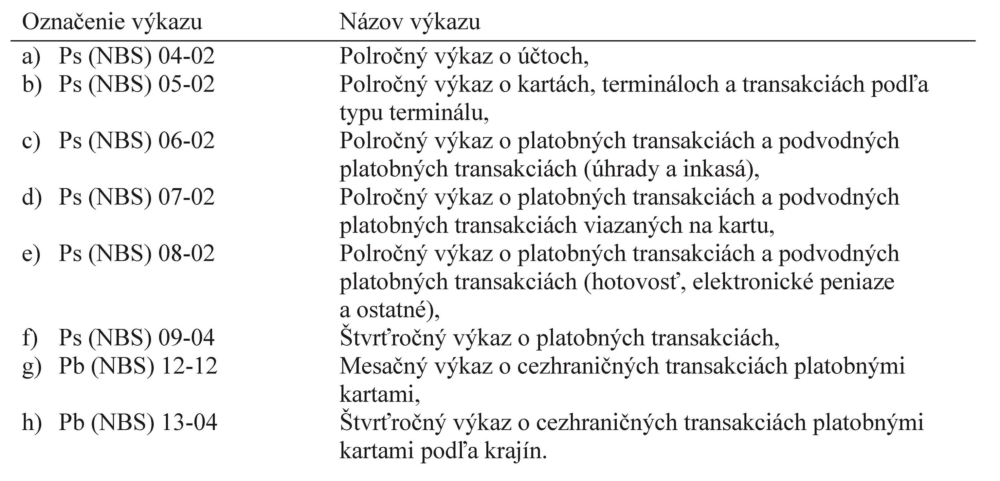

# § 1

(1) Výkazy predkladané platobnou inštitúciou, pobočkou zahraničnej platobnej inštitúcie, inštitúciou elektronických peňazí alebo pobočkou zahraničnej inštitúcie elektronických peňazí (ďalej len „poskytovateľ platobných služieb“) sú tieto:

(2) Vzory výkazov podľa odseku 1 sú uvedené v prílohách č. 1 až 8; súčasťou príloh sú aj vysvetlivky na vypracúvanie týchto výkazov.
