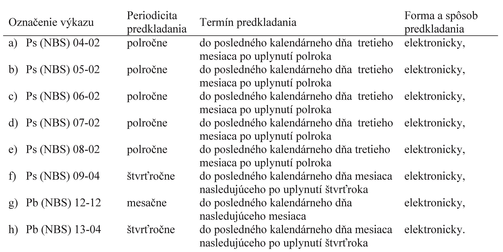

# § 2

(1) Výkazy poskytovateľov platobných služieb podľa § 1 ods. 1 sa predkladajú takto:

(2) Elektronickým predkladaním výkazov podľa odseku 1 je predkladanie výkazov prostredníctvom informačného systému Štatistický zberový portál.
