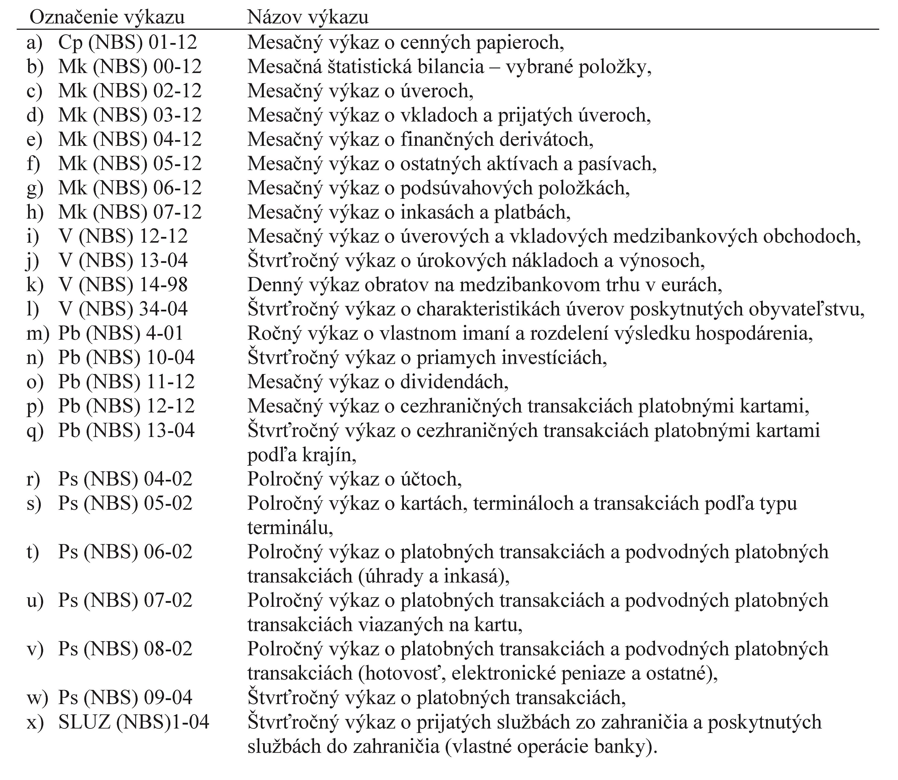
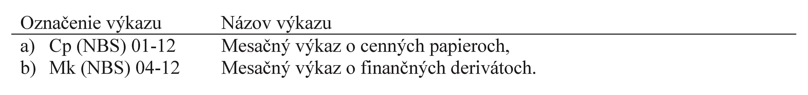

# § 1

(1) Výkazy predkladané bankami alebo pobočkami zahraničných bánk sú tieto:

(2) Výkazy predkladané obchodníkmi s cennými papiermi alebo pobočkami zahraničných obchodníkov s cennými papiermi, ktorí nie sú bankou alebo pobočkou zahraničnej banky, sú tieto:

(3) Vzory výkazov podľa odsekov 1 a 2 sú uvedené v prílohách č. 1 až 24; súčasťou príloh sú aj vysvetlivky na vypracúvanie týchto výkazov.
