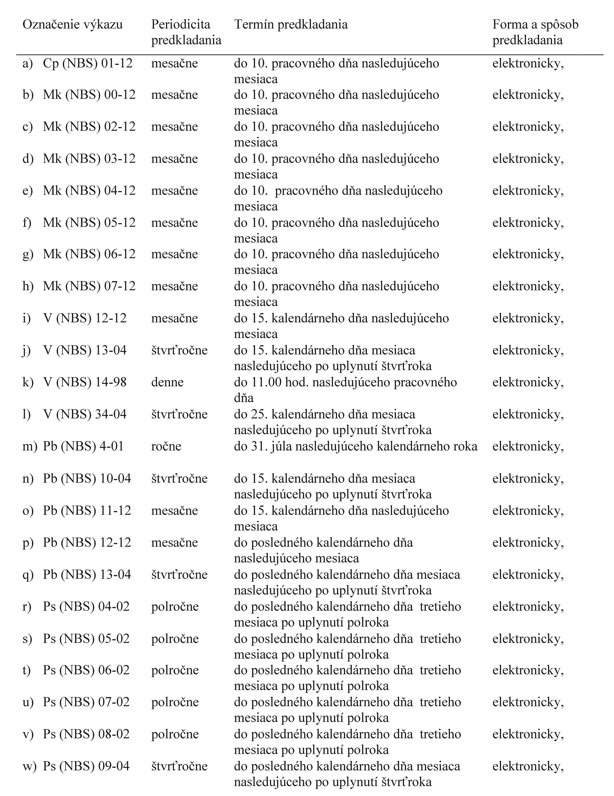
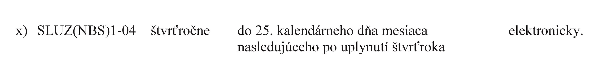
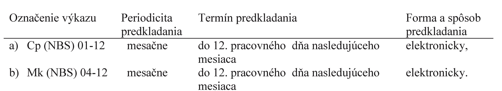

# § 2

(1) Výkazy bánk alebo pobočiek zahraničných bánk podľa § 1 ods. 1 sa predkladajú takto:

(2) Výkazy obchodníkov s cennými papiermi alebo pobočiek zahraničných obchodníkov s cennými papiermi, ktorí nie sú bankou alebo pobočkou zahraničnej banky podľa § 1 ods. 2, sa predkladajú takto:

(3) Elektronickým predkladaním výkazov podľa odsekov 1 a 2 je predkladanie výkazov prostredníctvom informačného systému Štatistický zberový portál.
