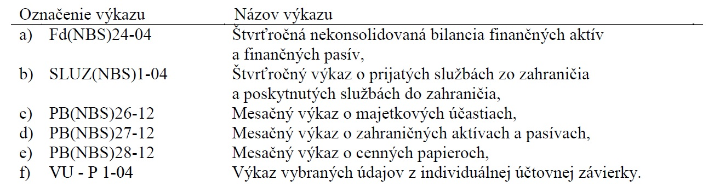

# § 1

(1) Výkazy predkladané poisťovňou, zaisťovňou, pobočkou zahraničnej poisťovne, pobočkou zahraničnej zaisťovne, poisťovňou z iného členského štátu, zaisťovňou z iného členského štátu, dôchodkovou správcovskou spoločnosťou alebo doplnkovou dôchodkovou spoločnosťou sú tieto:

(2) Vzory výkazov podľa odseku 1 písm. a) až e) sú uvedené v prílohách č. 1 až 5; súčasťou príloh je aj metodika na vypracúvanie týchto výkazov.

(3) Výkaz podľa odseku 1 písm. f) sa vypracúva v štruktúre vzoru výkazu podľa osobitného predpisu.1)
