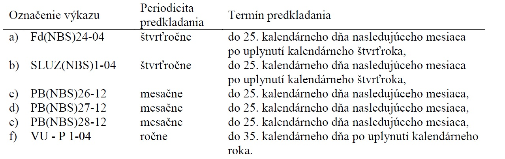

# § 3

(1) Výkazy podľa § 1 ods. 1 sa predkladajú takto:

(2) Výkazy podľa § 1 ods. 1 písm. a), c) a d) zostavené z údajov ročnej účtovnej závierky sa vypracúvajú aj ročne a predkladajú sa do 31. marca nasledujúceho kalendárneho roka.

(3) Výkaz podľa § 1 ods. 1 písm. f) sa vypracúva a predkladá do 31. marca nasledujúceho kalendárneho roka podľa ročnej účtovnej závierky, ak sa údaje vo výkaze predloženom v termíne podľa odseku 1 písm. f) nezhodujú s údajmi v ročnej účtovnej závierke.

(4) Ak sa osobe uvedenej v § 2 ako daňovníkovi dane z príjmov predĺži lehota na podanie daňového priznania,4) výkazy podľa odseku 1 sa bezodkladne predkladajú po zostavení ročnej účtovej závierky; v takomto prípade sa do 31. marca príslušného kalendárneho roka predloží Národnej banke Slovenska informácia o predĺžení lehoty na podanie daňového priznania a výkazy podľa odseku 1 sa predkladajú aj do 31. marca príslušného kalendárneho roka, a to na základe údajov o stave majetku, čistého obchodného imania, záväzkov, výnosov, nákladov a výsledku hospodárenia k 31. decembru predchádzajúceho kalendárneho roka, ktoré sú známe k 31. marcu príslušného kalendárneho roka s tým, že ide o predbežné údaje.

(5) Výkazy podľa § 1 ods. 1 sa predkladajú Národnej banke Slovenska elektronicky prostredníctvom informačného systému Štatistický zberový portál.
