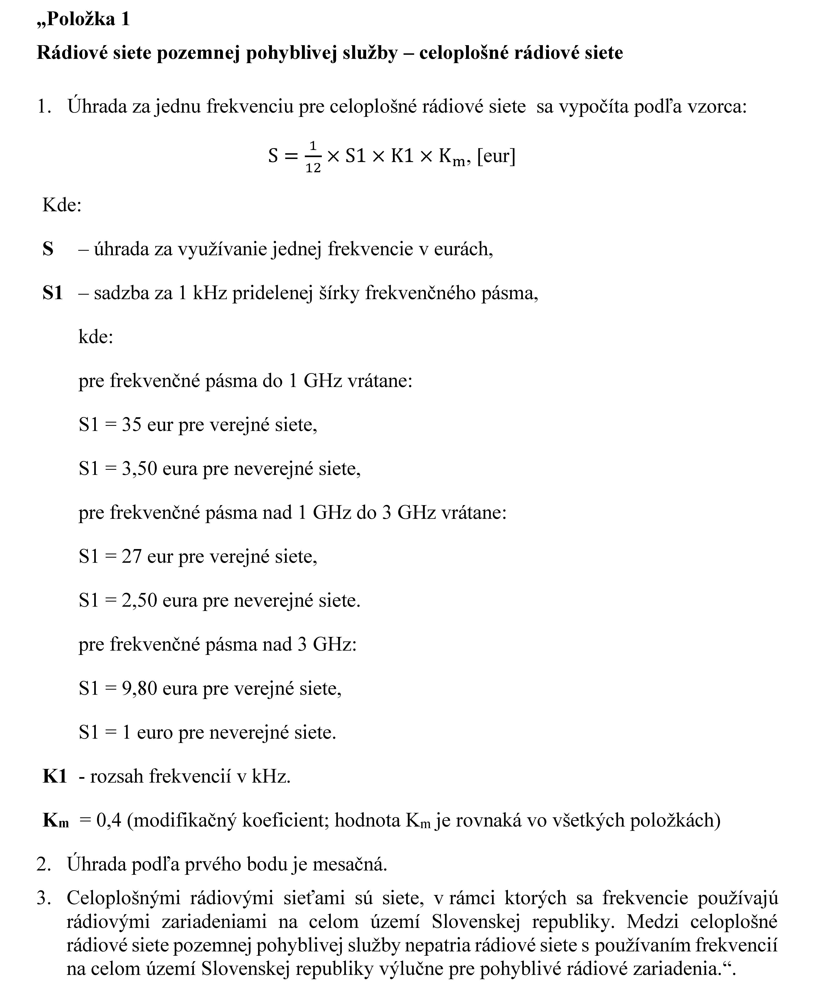
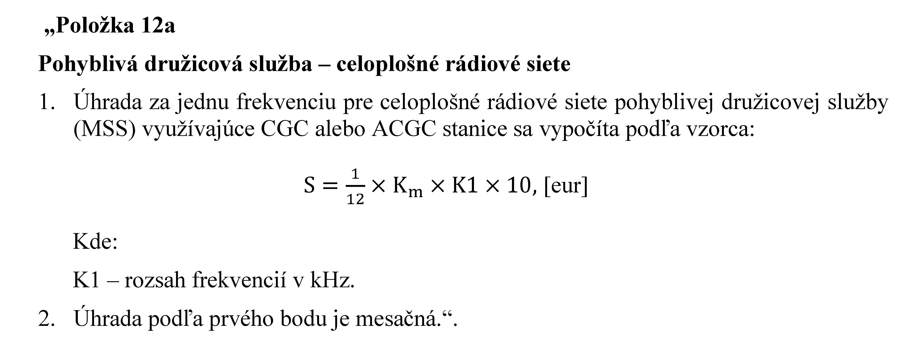

# Čl. I

Opatrenie Telekomunikačného úradu Slovenskej republiky zo 7. marca 2012 č. O-29/2012, ktorým sa ustanovuje sadzobník úhrad za právo používať frekvenciu alebo identifikačný znak v znení opatrenia Úradu pre reguláciu elektronických komunikácií a poštových služieb č. 1/2017, sa mení a dopĺňa takto:

- 1. V prílohe prvej časti Pozemná pohyblivá služba položka 1 vrátane nadpisu znie:

- 

- 2. V prílohe tretej časti Družicová služba sa za položku 12 Pohyblivá družicová služba vkladá Položka 12a, ktorá vrátane nadpisu znie:

- 
