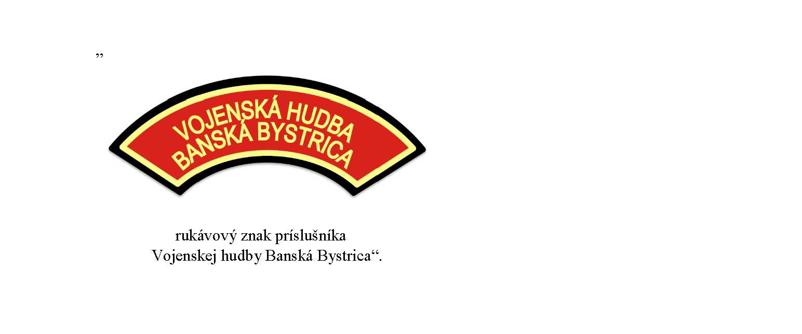

# Čl. I

Výnos Ministerstva obrany Slovenskej republiky zo 4. decembra 2015 č. ÚLP-11-32/2015-OdL, ktorým sa ustanovujú druhy vojenskej rovnošaty, výstrojových súčiastok, špecifických znakov vojenskej rovnošaty, ich nosenie a používanie a spôsob nosenia vyznamenaní na vojenskej rovnošate (oznámenie č. 382/2015 Z. z.) v znení opatrenia z 13. decembra 2018 č. 1/2018 (oznámenie č. 398/2018 Z. z.) a opatrenia z 8. júna 2021 č. 1/2021 (oznámenie č. 240/2021 Z. z.) sa mení a dopĺňa takto:

- 1. V § 1 sa za odsek 3 vkladá nový odsek 4, ktorý znie:

- „(4)

- Výstrojová súčiastka je súčasť vojenskej rovnošaty alebo súčiastka určená na osobné používanie pre profesionálneho vojaka.“.

  - Doterajšie odseky 4 až 18 sa označujú ako odseky 5 až 19.

- 2. V § 1 odsek 8 znie:

- „(8)

- Zimná pletená čiapka tmavozelená a zimná pletená čiapka tmavozelená so znakom ozbrojených síl tmavozelenej farby sa môže nosiť k poľnej rovnošate a k pracovnému odevu. Zimná pletená čiapka tmavozelená so znakom ozbrojených síl vo farebnom vyhotovení a zimná pletená čiapka tmavomodrá so znakom ozbrojených síl vo farebnom vyhotovení sa môže nosiť k zimnej výberovej bunde alebo k služobnej bunde v závislosti od klimatických podmienok; nenosia sa pri zabezpečovaní a účasti na protokolárnych aktoch, pri príležitostiach spoločenského charakteru a pri reprezentácii ozbrojených síl na verejnosti. Príslušník Vojenskej polície môže nosiť zimnú pletenú čiapku čiernu s označením „VOJENSKÁ POLÍCIA“ bielej farby k poľnej rovnošate, k pracovnému odevu, k zimnej výberovej bunde pre Vojenskú políciu, k služobnej bunde a k bezpečnostnej bunde reflexnej žltej farby s označením „VOJENSKÁ POLÍCIA“.

- 3. V § 2 sa vypúšťa odsek 15.

  - Doterajší odsek 16 sa označuje ako odsek 15.

- 4. V § 3 ods. 8 sa za slovo „plášť“ vkladajú slová „a zimné topánky“.

- 5. V § 13 ods. 1 písm. a) a ods. 5 písm. a) sa za slovo „zbore“ vkladajú slová „generálov a v hodnostnom zbore“.

- 6. V § 13 ods. 1 písm. b) a ods. 5 písm. b) sa slová „mužstva a“ nahrádzajú slovami „mužstva, v hodnostnom zbore“.

- 7. V § 13 ods. 2 poslednej vete sa slová „rozlišovacie znaky nenosí.“ nahrádzajú slovami „hodnostné označenie nosí, ak tak rozhodne príslušná cirkevná autorita.“.

- 8. V § 13 ods. 6 tretia veta a štvrtá veta znejú: „Profesionálny vojak ustanovený do funkcie vojenského duchovného, ktorý na základe rozhodnutia príslušnej cirkevnej autority nenosí na vojenských rovnošatách hodnostné označenie, nosí na vojenských rovnošatách len rozlišovacie znaky. Umiestnenie rozlišovacích znakov na náplecníkoch na vojenských rovnošatách profesionálneho vojaka ustanoveného do funkcie vojenského duchovného, ktorý na základe rozhodnutia príslušnej cirkevnej autority nenosí na vojenských rovnošatách hodnostné označenie, je uvedené v prílohe č. 5.“.

- 9. V § 14 ods. 17 sa za slová „nosí profesionálny vojak“ vkladajú slová „v generálskej hodnosti a“.

- 10. Nadpis prílohy č. 5 znie: „Umiestnenie rozlišovacích znakov na náplecníkoch služobnej rovnošaty, spoločenskej rovnošaty a slávnostnej rovnošaty profesionálneho vojaka ustanoveného do funkcie vo vojenskej odbornosti vojenská duchovná služba, ktorý nenosí hodnostné označenie“.

- 11. V prílohe č. 10 sa časť A dopĺňa o rukávový znak Vojenskej hudby Banská Bystrica, ktorý znie:

- 

- „[Konsolidovane znenie](assets/7209b92b42852aec2fc421e518abb90513367624808e7fdd0a1c35884cda3250.pdf)“.
