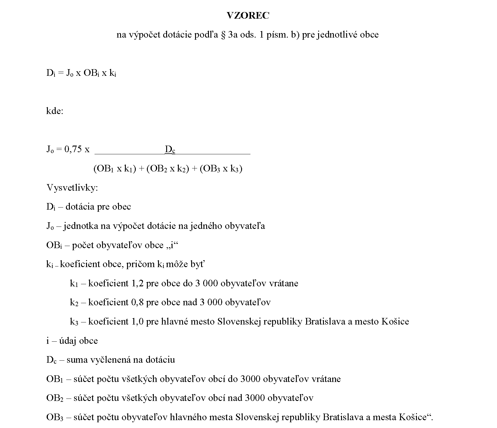

# Čl. I

Výnos Ministerstva financií Slovenskej republiky z 9. decembra 2005 č. 26825/2005-441 o poskytovaní dotácií v pôsobnosti Ministerstva financií Slovenskej republiky (oznámenie č. 583/2005 Z. z.) v znení opatrenia z 19. januára 2022 č. MF/004274/2022-119 (oznámenie č. 26/2022 Z. z.) sa dopĺňa takto:

- 1. Za § 3 sa vkladá § 3a, ktorý vrátane nadpisu znie:

- 㤠3a

- Dotácia na úhradu výdavkov obcí a vyšších územných celkov v súvislosti s negatívnymi dôsledkami inflácie

- (1)

- Dotáciu na úhradu výdavkov obcí a vyšších územných celkov v súvislosti s negatívnymi dôsledkami inflácie možno poskytnúť obci a vyššiemu územnému celku z rozpočtu kapitoly štátneho rozpočtu, ktorú spravuje ministerstvo, na úhradu bežných výdavkov súvisiacich s výkonom ich samosprávnych pôsobností takto:

- a)

- pre vyššie územné celky 25% z celkovej sumy vyčlenenej na dotáciu podľa odseku 2, pričom suma pre jednotlivé vyššie územné celky sa vypočíta ako súčin počtu obyvateľov vyššieho územného celku a jednotky na obyvateľa; jednotka na obyvateľa sa vypočíta ako podiel celkovej sumy vyčlenenej na dotáciu podľa odseku 2 pre vyššie územné celky a súčtu obyvateľov všetkých vyšších územných celkov,

- b)

- obciam 75% z celkovej sumy vyčlenenej na dotáciu podľa odseku 2, pričom suma pre jednotlivé obce sa vypočíta podľa vzorca uvedeného v prílohe.

- (2)

- Suma vyčlenená na dotáciu na účel podľa odseku 1 je suma dohodnutá vládou Slovenskej republiky so zástupcami vyšších územných celkov a s republikovými združeniami obcí; počtom obyvateľov obce alebo vyššieho územného celku sa rozumie počet obyvateľov obce alebo vyššieho územného celku s trvalým pobytom na ich území k 1. januáru 2022.

- (3)

- Dotácia podľa odseku 1 sa poskytuje na základe oznámenia ministerstva. Oznámenie o poskytnutí dotácie obsahuje

- a)

- identifikačné údaje prijímateľa, a to názov, sídlo, IČO,

- b)

- účel, na ktorý sa dotácia poskytuje,

- c)

- výšku poskytnutej dotácie,

- d)

- informáciu o právach a povinnostiach prijímateľa v súvislosti s poskytnutím dotácie.“.

- 2. Za § 6a sa vkladá § 6b, ktorý vrátane nadpisu znie:

- 㤠6b

- Prechodné ustanovenie k úprave účinnej od 27. septembra 2023

- Dotáciu podľa § 3a je možné použiť na krytie bežných výdavkov v roku 2023.“.

- 3. Opatrenie sa dopĺňa prílohou, ktorá vrátane nadpisu znie:

- „Príloha k opatreniu č. MF/010575/2023-119“.

- 

[Konsolidovane znenie](assets/580839510fd09b3415c5dcd003404ff40cc501408f91bfe491f49747470d26aa.pdf)
