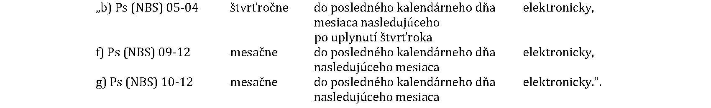

# Čl. I

Opatrenie Národnej banky Slovenska z 21. júna 2021 č. 7/2021 o predkladaní výkazov platobnou inštitúciou, pobočkou zahraničnej platobnej inštitúcie, inštitúciou elektronických peňazí alebo pobočkou zahraničnej inštitúcie elektronických peňazí na štatistické účely (oznámenie č. 276/2021 Z. z.) sa mení a dopĺňa takto:

- 1. V § 1 ods. 1 písmená b), f) a g) znejú:

- 

- 2. V § 1 ods. 1 sa vypúšťa písmeno h).

- 3. V § 1 ods. 2 sa slová „č. 1 až 8“ nahrádzajú slovami „č. 1 až 7“.

- 4. V § 2 ods. 1 písmená b), f) a g) znejú:

- 

- 5. V § 2 ods. 1 sa vypúšťa písmeno h).

- 6. Za § 5 sa vkladá § 5a, ktorý znie:

- 㤠5a

- Výkaz Pb (NBS) 12-12 za jún 2024, výkazy Pb (NBS) 13-04 a Ps (NBS) 09-04 za druhý kalendárny štvrťrok 2024 a výkaz Ps (NBS) 05-02 za prvý kalendárny polrok 2024 sa zostavia a predložia podľa tohto opatrenia v znení účinnom do 30. júna 2024.“.

- 7. Prílohy č. 1 až 7 sa nahrádzajú prílohami č. 1 až 7 k tomuto opatreniu.

- 8. Príloha č. 8 sa vypúšťa.

[Konsolidovane znenie](assets/4455141e4992a2e876cf04f1d1e865aa66c9c9d79d3f22eb059528234c532e2f.pdf)
