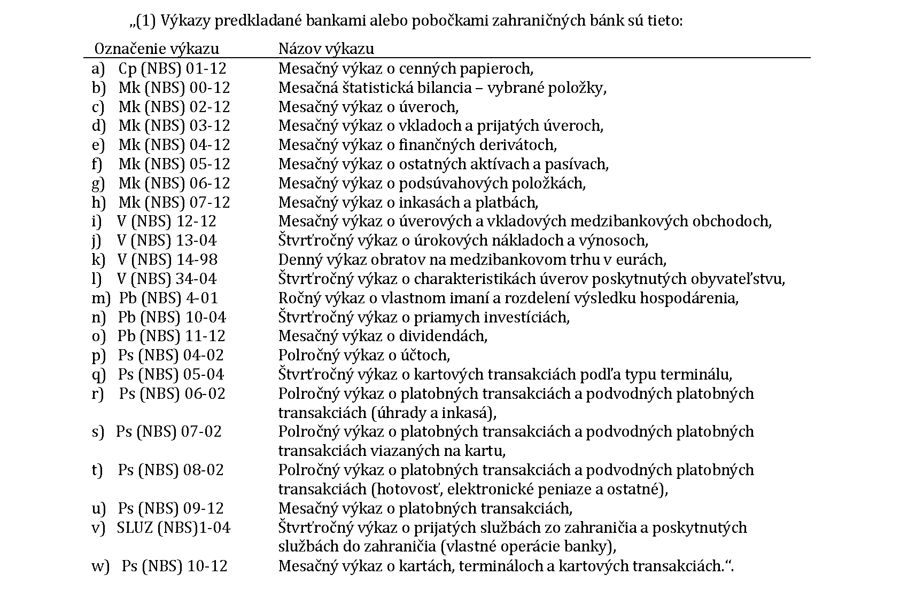
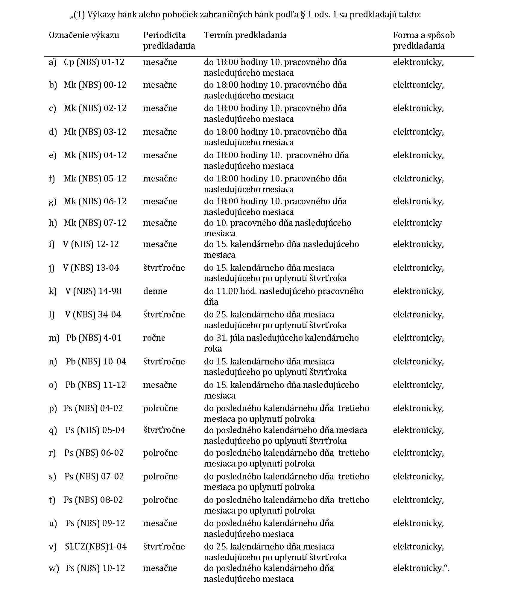

# Čl. I

Opatrenie Národnej banky Slovenska z 21. júna 2021 č. 8/2021 o predkladaní výkazov bankami, pobočkami zahraničných bánk, obchodníkmi s cennými papiermi alebo pobočkami zahraničných obchodníkov s cennými papiermi na štatistické účely (oznámenie č. 277/2021 Z. z.) sa mení a dopĺňa takto:

- 1. V § 1 odsek 1 znie:

- 

- 3. V § 1 ods. 3 sa slová „č. 1 až 24“ nahrádzajú slovami „č. 1 až 25“.

- 4. V § 2 odsek 1 znie:

- 

- 6. Za § 6 sa vkladá § 6a, ktorý znie:

- 㤠6a

- (1)

- Výkaz Pb (NBS) 12-12 za jún 2024, výkazy Pb (NBS) 13-04 a Ps (NBS) 09-04 za druhý kalendárny štvrťrok 2024 a výkaz Ps (NBS) 05-02 za prvý kalendárny polrok 2024 sa zostavia a predložia podľa tohto opatrenia v znení účinnom do 30. júna 2024.

- (2)

- Výkaz Mk (NBS) 07-12 sa zostaví za mesiac december 2024 a predloží sa

- do 16. januára 2025 podľa tohto opatrenia v znení účinnom do 31. decembra 2024.“.

- 7. V prílohe č. 3 vysvetlivky znejú:

- „[Vysvetlivky na vypracúvanie výkazu Mk (NBS) 02 – 12](assets/eb4e9f57fbb6110adaebe8c2e97d9839f17e5c1222b628253faa3515a29ad22c.pdf)“.

- 8. Príloha č. 6 sa nahrádza prílohou č. 1 k tomuto opatreniu.

- 10. Prílohy č. 16 a 17 sa vypúšťajú.

- 11. Prílohy č. 18 až 23 sa nahrádzajú prílohami č. 2 až 7 k tomuto opatreniu.

- 12. Opatrenie sa dopĺňa prílohou č. 25, ktorá vrátane nadpisu znie:

- „[Príloha č. 25 k opatreniu č. 8/2021](assets/4c5ef345d0f21e4193a93849d9a597397ef6d774a33a6410b0ef1204417cd580.pdf)“.

[Konsolidovane znenie](assets/d6a23fa4ecb217afce2a9d15eb6fc868f1065f2e3ed362ac18d328627c58462f.pdf)
