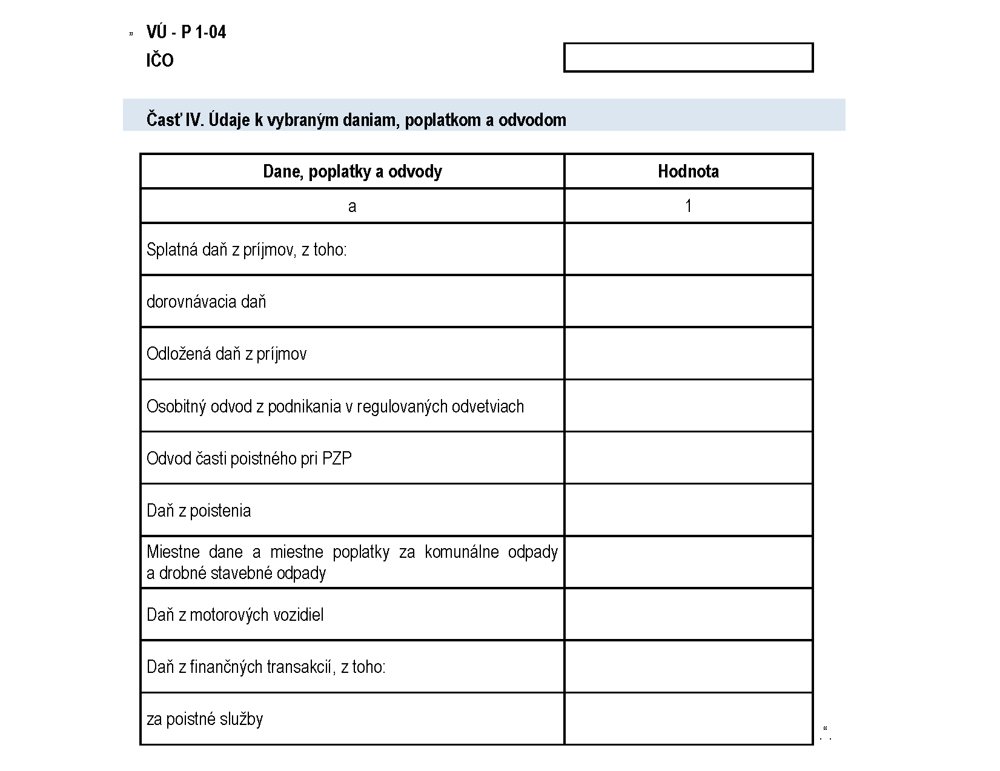

# Čl. I

Opatrenie Ministerstva financií Slovenskej republiky z 8. decembra 2011 č. MF/25918/2011-74, ktorým sa ustanovuje rozsah, spôsob, miesto a termíny ukladania výkazu vybraných údajov z individuálnej účtovnej závierky pre účtovné jednotky, ktorými sú poisťovne, pobočky zahraničnej poisťovne, zaisťovne, pobočky zahraničnej zaisťovne, Slovenská kancelária poisťovateľov a Exportno-importná banka Slovenskej republiky (oznámenie č. 557/2011 Z. z.) v znení opatrenia z 30. októbra 2013 č. MF/14275/2013-74 (oznámenie č. 377/2013 Z. z.), opatrenia z 3. decembra 2014 č. MF/21025/2014-74 (oznámenie č. 359/2014 Z. z.), opatrenia zo 16. septembra 2015 č. MF/14725/2015-74 (oznámenie č. 230/2015 Z. z.), opatrenia z 5. decembra 2018 č. MF/16648/2018-74 (oznámenie č. 357/2018 Z. z.), opatrenia z 9. decembra 2021 č. MF/011078/2021-74 (oznámenie č. 530/2021 Z. z.) a opatrenia z 13. decembra 2023 č. MF/011685/2023-74 (oznámenie č. 489/2023 Z. z.) sa mení a dopĺňa takto:

- 1. V § 2 ods. 2 sa na konci pripája táto veta: „Ak koniec lehoty pripadne na sobotu, nedeľu alebo deň pracovného pokoja, posledným dňom lehoty je najbližší nasledujúci pracovný deň.“.

- 2. Za § 3e sa vkladá § 3f, ktorý vrátane nadpisu znie:

- 㤠3f

- Prechodné ustanovenie k úpravám účinným od 1. apríla 2025

- Vzor výkazu vybraných údajov uvedený v prílohe v znení účinnom od 1. apríla 2025 sa použije prvýkrát pri ukladaní výkazu vybraných údajov z individuálnej účtovnej závierky zostavenej za druhý kalendárny štvrťrok 2025.“.

- 3. V prílohe časti I. Vybrané údaje z aktív a pasív písm. a) a b) riadku č. 24 stĺpce a, b, 1 a 2 znejú:

- „

- 24 | A.H. | Tax receivables, of which: | Daňové pohľadávky, z toho:

- .“.

- “.

- 4. V prílohe časti I. Vybrané údaje z aktív a pasív písm. a) a b) riadku č. 30 stĺpce a, b, 1 a 2 znejú:

- „

- 30 | P.A. | Financial liabilities, of which: | Finančné záväzky, z toho:

- .“.

- “.

- 5. V prílohe časti I. Vybrané údaje z aktív a pasív písm. a) a b) riadku č. 47 stĺpce a, b, 1 a 2 znejú:

- „

- 47 | P.H. | Tax payables, of which: | Daňové záväzky, z toho:

- .“.

- “.

- 6. V prílohe časti II. Vybrané údaje z nákladov a výnosov písm. a) a b) riadku č. 11 stĺpce a, b, 1 a 2 znejú:

- „

- 11 | 2.1.2. | Attributable expenses | Priraditeľné náklady na poistné služby

- .“.

- “.

- 7. V prílohe časti II. Vybrané údaje z nákladov a výnosov písm. a) a b) riadku č. 13 stĺpce a, b, 1 a 2 znejú:

- „

- 13 | 2.2. | Acquisition costs | Obstarávacie náklady

- .“.

- “.

- 8. V prílohe časť IV. Údaje k vybraným daniam, poplatkom a odvodom znie:

- 

- 9. V prílohe časti Vysvetlivky sa za bod 12 vkladá nový bod 13, ktorý znie:

- „13.

- V časti I. písm. a) a b) riadku 24 sa vykazuje hodnota daňových pohľadávok, ktoré účtovná jednotka má ku dňu, ku ktorému sa zostavuje účtovná závierka, a vykazovaná hodnota môže byť väčšia ako súčet hodnoty vykázanej v riadkoch 25 a 26.“.

  - Doterajšie body 13 až 36 sa označujú ako body 14 až 37.

- 10. V prílohe časti Vysvetlivky bod 17 znie:

- „17.

- V časti I. písm. a) a b) riadku 30 sa vykazuje hodnota finančných záväzkov, ktoré účtovná jednotka má ku dňu, ku ktorému sa zostavuje účtovná závierka, a vykazovaná hodnota môže byť väčšia ako súčet hodnoty vykázanej v riadkoch 31 a 32. V časti I. písm. a) a b) riadku 31 sa vykazujú údaje zo zmlúv, ktoré nespĺňajú kritériá podľa IFRS 17.“.

- 11. V prílohe časti Vysvetlivky sa za bod 17 vkladá nový bod 18, ktorý znie:

- „18.

- V časti I. písm. a) a b) riadku 47 sa vykazuje hodnota daňových záväzkov, ktoré účtovná jednotka má ku dňu, ku ktorému sa zostavuje účtovná závierka, a vykazovaná hodnota môže byť väčšia ako súčet hodnoty vykázanej v riadkoch 48 a 49. “.

  - Doterajšie body 18 až 37 sa označujú ako body 19 až 38.

- 12. V prílohe časti Vysvetlivky body 27 a 28 znejú:

- „27.

- V časti II. písm. a) a b) riadku 9 sa vykazujú vzniknuté poistné plnenia a ostatné náklady znížené o neoddeliteľný investičný komponent. V riadku 10 sa vykazujú náklady na poistné plnenia v hrubej výške neznížené o neoddeliteľný investičný komponent a v riadku 12 sa so znamienkom (+) vykazuje hodnota neoddeliteľného investičného komponentu. V riadku 9 sa hodnota vykazuje ako súčet hodnoty vykázanej v riadkoch 10, 11 a 12.

- 28.

- V časti II. písm. a) a b) riadku 11 sa vykazujú všetky priamo a nepriamo priraditeľné náklady (attributable), ktoré súvisia s poskytovaním poistných služieb, okrem obstarávacích nákladov. Zároveň sa v tomto riadku vykazuje aj daň z finančných transakcií,7b) ktorá sa priamo viaže k poistným službám, napríklad k úhradám poistných plnení; náklady na daň z finančných transakcií, ktoré sa neviažu k poistným službám, sa vykazujú v riadku 48.“.

  - Poznámka pod čiarou k odkazu 7b znie:

  - „7b) Zákon č. 279/2024 Z. z. o dani z finančných transakcií a o zmene a doplnení niektorých zákonov v znení neskorších predpisov.“.

- 13. V prílohe časti Vysvetlivky sa za bod 28 vkladá nový bod 29, ktorý znie:

- „29.

- V časti II. písm. a) a b) riadku 13 sa vykazujú amortizované obstarávacie náklady a priraditeľné (attributable) obstarávacie náklady bežného účtovného obdobia, časovo rozlíšené provízie, okrem provízií za správu a udržanie poistného kmeňa. Následné provízie, ktoré slúžia ako odmena za správu a udržanie poistného kmeňa, sa vykazujú v riadku 11.“.

  - Doterajšie body 29 až 38 sa označujú ako body 30 až 39.

- 14. V prílohe časti Vysvetlivky sa za bod 35 vkladá nový bod 36, ktorý znie:

- „36.

- V časti II. písm. a) a b) riadku 48 sa vykazujú všetky nepriraditeľné (non attributable) náklady na poistné zmluvy a ostatné náklady, ktoré nevstupujú do výsledku za poistné služby a finančného výsledku.“.

  - Doterajšie body 36 až 39 sa označujú ako body 37 až 40.

- 15. V prílohe časti Vysvetlivky sa za bod 37 vkladá nový bod 38, ktorý znie:

- „38.

- V časti II. písm. a) a b) riadku 50 sa vykazuje hodnota splatnej dane z príjmov, odloženej dane z príjmov a osobitného odvodu z podnikania v regulovaných odvetviach.8)“.

  - Doterajšie body 38 až 40 sa označujú ako body 39 až 41.

- 16. V prílohe časti Vysvetlivky bode 41 sa slová „odpady11) a dane z motorových vozidiel12)“ nahrádzajú slovami „odpady,11) dane z motorových vozidiel,12) dane z finančných transakcií7b) a dorovnávacej dane13)“ a na konci sa pripájajú tieto vety: „Údaj o dani z finančných transakcií sa v stĺpci „Hodnota“ uvádza v celkovej výške nákladov na daň z finančných transakcií a samostatne sa vykazujú náklady na daň z finančných transakcií pri platobných operáciách priamo súvisiacich s poistnými službami. Údaj o dorovnávacej dani sa uvádza, ak účtovná jednotka je daňovníkom dorovnávacej dane alebo ak očakáva, že sa ním stane v bezprostredne nasledujúcom účtovnom období. Údaj o dorovnávacej dani v stĺpci „Hodnota“ sa uvádza ako časť nákladu na splatnú daň z príjmov pripadajúcu na dorovnávaciu daň pri daňovníkovi dorovnávacej dane alebo ako odhad vplyvu dorovnávacej dane pri potenciálnom daňovníkovi dorovnávacej dane.“.

  - Poznámka pod čiarou k odkazu 13 znie:

  - „13) Zákon č. 507/2023 Z. z. o dorovnávacej dani na zabezpečenie minimálnej úrovne zdanenia nadnárodných skupín podnikov a veľkých vnútroštátnych skupín a o doplnení zákona č. 563/2009 Z. z. o správe daní (daňový poriadok) a o zmene a doplnení niektorých zákonov v znení neskorších predpisov v znení zákona č. 355/2024 Z. z.“.

[Konsolidovane znenie](assets/f0d8ddfd8044996f4e08a5c78edb237ab3a2167eecf85ae509d78638ded5bcaf.pdf)
