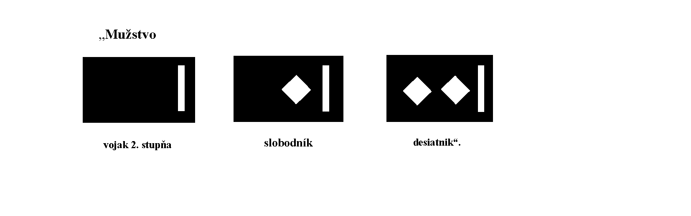

# Čl. I

Výnos Ministerstva obrany Slovenskej republiky zo 4. decembra 2015 č. ÚLP-11-32/2015-OdL, ktorým sa ustanovujú druhy vojenskej rovnošaty, výstrojových súčiastok, špecifických znakov vojenskej rovnošaty, ich nosenie a používanie a spôsob nosenia vyznamenaní na vojenskej rovnošate (oznámenie č. 382/2015 Z. z.) v znení opatrenia z 13. decembra 2018 č. 1/2018 (oznámenie č. 398/2018 Z. z.), opatrenia z 8. júna 2021 č. 1/2021 (oznámenie č. 240/2021 Z. z.) a opatrenia z 9. decembra 2022 č. 1/2022 (oznámenie č. 449/2022 Z. z.) sa mení a dopĺňa takto:

- 1. V § 1 ods. 6 šiestej vete sa vypúšťa slovo „a“ a za slovo „letectva“ sa vkladajú slová „a profesionálny vojak v prípravnej štátnej službe vo funkcii kadet, ktorý je pripravovaný pre hodnostný zbor dôstojníkov na funkciu s bližšou špecifikáciou výsadkár,“.

- 2. V § 13 ods. 1 písm. a) sa slová „dôstojníkov, pre profesionálneho vojaka v prípravnej štátnej službe vo funkcii kadet, ktorý je pripravovaný pre hodnostný zbor dôstojníkov,“ nahrádzajú slovom „dôstojníkov“.

- 3. V § 13 ods. 1 písm. b) sa čiarka za slovom „mužstva“ nahrádza slovom „a“ a vypúšťajú sa slová „a pre profesionálneho vojaka v prípravnej štátnej službe – čakateľa“.

- 4. V § 14 odseky 15 a 16 znejú:

- „(15)

- Odznak pre absolventov vysokých škôl môže nosiť profesionálny vojak, ktorý je absolventom vojenskej vysokej školy a profesionálny vojak, ktorý počas prípravnej štátnej služby absolvoval štúdium na vysokej škole inej než vojenskej vysokej škole.

- (16)

- Profesionálny vojak, ktorý je absolventom vysokej školy podľa odseku 15 a niektorej zahraničnej vojenskej školy, nosí odznak pre absolventov vysokých škôl a odznak pre absolventov zahraničných škôl.“.

- 5. V § 14 ods. 39 poslednej vete sa za slovom „dôstojníkov“ vypúšťa čiarka a vkladajú sa slová „a umiestnenie hodnostného označenia“.

- 6. Príloha č. 8 znie:

- [Príloha č. 8 k výnosu č. ÚLP-11-32/2015-OdL](assets/9318ee845a7dd47f863804997e5954f9e41a8f82ab6585d954641193dcb53c36.pdf)

- 7. V prílohe č. 10 sa časť C. Hodnostné označenie príslušníkov Vojenskej polície a označenie príslušníkov Vojenskej polície na vybraných výstrojových súčiastkach Vojenskej polície čiernej farby dopĺňa zobrazením hodnostného označenia mužstva, ktoré znie:

- 

[Konsolidovane znenie](assets/a556c3f74ddba4062f68ccb66669898acbb7d8df03c45c26ac3c9144541caab1.pdf)
