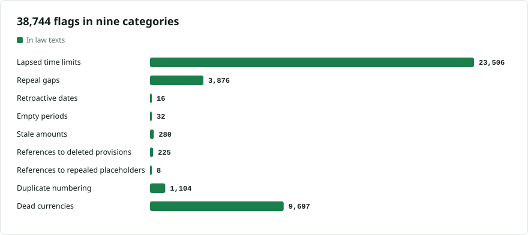

# Vulnerabilities in Slovak law

[Slovenčina](README.md) · **English**

<picture>
<source media="(prefers-color-scheme: dark)" srcset="img/flags-by-category-dark.svg">

</picture>

The vulnerability detectors from [lexifina/global-law](https://github.com/lexifina/global-law/tree/main/vulnerabilities) look for mechanical mistakes in legislation: a rule applying "until" a date that has passed, a time limit extended only after it had run out, an act in force before it was published, a reference to a section that no longer exists or now reads only "Zrušený". global-law's published list (9 November 2026) covered Slovakia from an older and much smaller copy of this repository (commit `1435c1c` of 2 November 2026): it had 2 flags, a repeal gap in Article 127 of the Constitution and a reference to the deleted § 99 of the election act, both judged artefacts. This is a run over this repository only, as it stood at commit [`e9b2869`](https://github.com/lexifina/slovakia-law/commit/e9b2869f14c766c5f77024fe36d4865198b52225) of 16 November 2026: the Constitution, the election act, the acts of the Collection of Laws (Zbierka zákonov) with their earlier versions where the repository holds them, the measures of the Register opatrení and the generally binding regulations (VZN) of four cities.

**In short:** the detectors raised 38,744 flags. A language model reviewed 203 of the strongest, arguing each one for and against; 63 survived. Checked by hand in this repository and, where the repository does not hold the amending act, against its text as published on Slov-Lex, seven look like real mistakes in Slovak law. Two references point to sections that were deleted while the provisions citing them were left alone: Act No. 57/2011 Z. z. deleted § 11 of the Act on Allotment Gardens (64/1997 Z. z.), the compensation for the land, and replaced "§ 11" in § 12, but § 7(1) and § 10(1) and (2) still refer to it; Act No. 361/2015 Z. z. deleted §§ 131a to 132n of the Securities Act (566/2001 Z. z.) from 1 July 2016, but § 114(3) still forbids "market manipulation under § 131a". Five flags are time limits moved only after they had passed: Act No. 180/2004 Z. z. extended the lending of ranks (§ 201a) and the old uniforms (§ 205b(2)) of the Fire and Rescue Service Act, which ended on 31 December 2003, only from 1 May 2004; Act No. 172/1994 Z. z. moved the municipalities' deadline for converting municipal enterprises (567/1992 Zb., § 32(2)) from 31 December 1993 to 31 December 1994 only from 20 July 1994; Government Regulation No. 145/2005 Z. z. moved the hauliers' deadline for professional competence (302/2003 Z. z., § 17(3)) from 1 August 2004 to 1 September 2005 only from 15 April 2005; and Act No. 148/1994 Z. z. wrote into § 12(4) of Act No. 134/1992 Zb., from 1 July 1994, that the authority decides "by 30 June 1993". Of the other 56, 28 come from how this repository is built or how its record dates changes, 11 are lawful, 12 are the same figure in another act, 2 are misread, 1 is spent and 2 are left open. Later, this will be formalised in Lean, similar to our work on [the US tax code](https://lexifina.com/blog/formalizing-the-us-tax-code) and [US case law](https://lexifina.com/blog/formalizing-all-us-case-law-in-lean).

A flag is a prompt to look, not legal advice, and nothing here has been tested in court.

## Flags by category

| Category | What it looks for | Flags | In law texts | Reviewed | Survived review |
| --- | --- | ---: | ---: | ---: | ---: |
| Lapsed time limits | Text still applying a rule "until" a date that has passed | 23,506 | 23,506 | 40 | 0 |
| Repeal gaps | A provision removed before its replacement took effect | 3,876 | 3,876 | 40 | 7 |
| Retroactive dates | An act in force before it was published | 16 | 16 | 16 | 6 |
| Empty periods | A time limit extended by an act that took effect only after it had passed | 32 | 32 | 27 | 22 |
| Stale amounts | An amount changed in one place but still standing elsewhere | 280 | 280 | 40 | 23 |
| References to deleted provisions | A provision citing a section that no longer exists | 225 | 225 | 40 | 5 |
| References to repealed placeholders | A provision citing a section that now reads only "Zrušený" | 8 | 8 | 0 | 0 |
| Duplicate numbering | Two units with the same number in one provision | 1,104 | 1,104 | 0 | 0 |
| Dead currencies | Amounts in currencies no longer in use | 9,697 | 9,697 | 0 | 0 |

"In law texts" counts every file of the Constitution, the election act, the Collection of Laws, the Register opatrení and the cities' VZN; this repository holds nothing else that the detectors read, so every flag is in a law text. Many of them are in articles of an act other than its first ("Čl. II" and after, `clanok-*.md`), which amend other acts or set commencement: 10,459 lapsed time limits, 3,367 dead currencies and 892 duplicate numbers. The search for lapsed time limits reads "do 31. decembra 2020", "31.12.2020" and "31. 12. 2020" and, since this run, the end of a year ("do konca roka 2012", 111 such phrases in the repository, past or future); it still leaves out "do roku 2012" (273) and a month with a year ("do decembra 2004", 70). Amounts in Slovak korunas ("5 000 Sk", "slovenských korún") and Czechoslovak korunas ("Kčs") are read since this run too, as amounts and as dead currencies: both are no longer in use, the Slovak koruna having been replaced by the euro. No same-day conflicts, failed amendments or dead fines were found.

*Edge cases: the 63 flags that survived the review, grouped by what they turned out to be, and what the other flags are, in [EDGE-CASES.en.md](EDGE-CASES.en.md).*

## Problems found in this repository

- **Histories written twice:** for 1,432 act folders, mostly of repealed acts, the whole history is in the record twice: 5,620 commits have a twin with the same act, the same day in force and the same change. Act No. 567/1992 Zb. on budget rules, for example, is added, amended by 159/1993 Z. z. and 172/1994 Z. z. and repealed by 303/1995 Z. z., and then the same again ([`b38307b`](https://github.com/lexifina/slovakia-law/commit/b38307ba43ae80cd286e8c10ec3777cb5b10149e) and [`15aa88b`](https://github.com/lexifina/slovakia-law/commit/15aa88b610d4d78e5bb2c2785194f4e5fe2e5ee6) are the same change). The detectors found 23 empty periods twice for this reason; the list counts each once.
- **Cities' dates that contradict the VZN:** the in-force and enactment dates of four VZN come from the cities' registers and disagree with the regulations' own text: VZN 79/2000 of Banská Bystrica was approved on 17 February 2000 and took effect on 10 March 2000, while the record has it enacted on 17 February 2002; Žilina's VZN 9/1992 says it takes effect on 20 September 1992 (the record: 20 September 1991), VZN 10/1993 on 2 December 1993 (the record: 12 February 1993), and VZN 1/2001 on 14 March 2001 (the record: 23 February 2001). All four came out as retroactive dates.
- **A change dated three months late:** Slov-Lex, and with it this record ([`4551db7`](https://github.com/lexifina/slovakia-law/commit/4551db7e38d6537ce4c9a73304b252e73f4d5976)), shows the change of "31 December 2001" to "31 December 2003" in §§ 110, 110b and 112 of the Social Assistance Act (195/1998 Z. z.) in the version from 1 April 2002. Those changes are points 64 to 70 of Art. VIII of Act No. 416/2001 Z. z., which Art. XXII does not list among the points taking effect on 1 April 2002, so they took effect with the rest of the act on 1 January 2002, the day after the old date ran out.

## Files

| File | What it holds |
| --- | --- |
| [data/flags.csv](data/flags.csv) | Every flag, one row per provision and issue |
| [data/reviewed.csv](data/reviewed.csv) | The 203 flags the model reviewed, with its verdict and reason |
| [data/by_category.csv](data/by_category.csv) | The counts in the table above |
| [tools/](tools/) | The scripts that made this run |

Columns: `category` and `category_sk` (the category in English and Slovak), `detector`, `kind` (`law` or `other`), `path` (the provision in this repository), `date` (the date the flag turns on), `reference` (the act or line involved), `summary`, `score` (the detector's ranking, 0 to 1), `review` (`artefact`, `lawful` or `candidate_defect`), `survives_rebuttal`, `review_note` (the model's reason, in English), `url` (the provision at the commit that was read, or, for a provision removed since, at the last commit that held it).

## How it was made

- **Detectors:** global-law's [vulnerabilities/scripts](https://github.com/lexifina/global-law/tree/main/vulnerabilities/scripts), with the fixes in [tools/patch_detectors.py](tools/patch_detectors.py) and the Slovak ones in [tools/patch_sk.py](tools/patch_sk.py), run on this repository at commit `e9b2869`. The history table the detectors read was built from this repository's own commits (the act that made each change and the `In-force` trailer), with changes credited to no act or to several acts at once (`Kind: unexplained`, `candidates`), the changes to the Constitution and the election act by kind of amending act, and the cities' VZN counted as law; documentation and the court record keep their own kind. The Slovak fixes read "do konca roka" as 31 December, amounts in "Sk" and "Kčs" and Slovak korunas as dead currencies, a placeholder only where a section reads "Zrušený." or "(zrušené včítane nadpisov)" as a whole, and another act named after a reference ("§ 7 ods. 1 zákona č. 1/1991 Zb.", "§ 93, 94 Tr. zák.", "§ 270a Zákonníka práce") as a reference to that act. Without them the run gave 377 references to deleted provisions, 120 references to repealed placeholders and no dead currencies; with them 225, 8 and 9,697.
- **Model review:** gpt-5.4-mini, the 40 strongest flags per category (all 16 retroactive dates); the 40 strongest lapsed time limits in law texts are the same 40. One pass says whether a flag is real, a second argues that it is not. Empty periods use global-law's own review for that category, on the 21 flags whose old and new date stand in one sentence and the shortest gaps (40 chosen, 27 different flags once the duplicates from the twice-written histories are removed), then the same second pass. References to deleted provisions were reviewed again after the Slovak reference fix. The model does not review references to repealed placeholders, duplicate numbering or dead currencies. global-law's own list used a different model.
- **Hand check:** every flag that survived was read in this repository's texts and history, and against the amending act's own text: in this repository where it holds it (57/2011, 361/2015, 374/2014, 172/1994 in part), otherwise as published on Slov-Lex (416/2001, 180/2004, 172/1994, 145/2005, 148/1994, 59/1993, 71/1994, 355/1999, 140/2016). All 8 references to repealed placeholders were read.

To report a correction, open an issue with the provision and an official source.

## Licence

The lists and notes are Lexifina's, dedicated to the public domain under CC0 1.0 like the rest of this repository's own contributions. Quoted law text is as Slov-Lex publishes it; the text of a legal regulation is not a subject of copyright in Slovakia (§ 5 písm. b) of the Copyright Act, 185/2015 Z. z.), and only the Collection of Laws is authoritative. See [LICENSE](../LICENSE).
