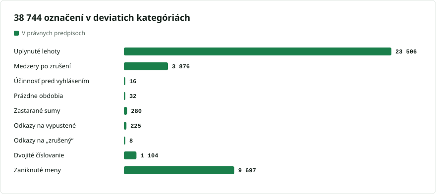

# Zraniteľnosti v slovenskom práve

**Slovenčina** · [English](README.en.md)

<picture>
<source media="(prefers-color-scheme: dark)" srcset="img/flags-by-category-dark.sk.svg">

</picture>

Detektory zraniteľností z repozitára [lexifina/global-law](https://github.com/lexifina/global-law/tree/main/vulnerabilities) hľadajú mechanické chyby v právnych predpisoch: pravidlo, ktoré sa stále uplatňuje „do“ dňa, ktorý už uplynul, lehotu predĺženú až po tom, ako uplynula, predpis účinný pred svojím vyhlásením, odkaz na paragraf, ktorý už neexistuje alebo znie už len „Zrušený“. Zoznam, ktorý global-law zverejnil 9. novembra 2026, zahŕňal Slovensko podľa staršej a oveľa menšej kópie tohto repozitára (commit `1435c1c` z 2. novembra 2026): mal 2 označenia, medzeru po zrušení v čl. 127 Ústavy a odkaz na vypustený § 99 volebného zákona, obe posúdené ako artefakty. Toto je preto kontrola len tohto repozitára v stave commitu [`e9b2869`](https://github.com/lexifina/slovakia-law/commit/e9b2869f14c766c5f77024fe36d4865198b52225) zo 16. novembra 2026: Ústavy, volebného zákona, predpisov Zbierky zákonov aj s ich skoršími zneniami, ak ich repozitár obsahuje, opatrení z Registra opatrení a všeobecne záväzných nariadení (VZN) štyroch miest.

**Stručne:** detektory vytvorili 38 744 označení. Jazykový model posúdil 203 najsilnejších a pri každom zvážil argumenty za aj proti; 63 obstálo. Po ručnej kontrole v tomto repozitári a tam, kde repozitár novelu neobsahuje, v jej texte vyhlásenom na Slov-Lexe, vyzerá sedem ako skutočné chyby v slovenskom práve. Dva odkazy smerujú na paragrafy, ktoré boli vypustené, hoci ustanovenia, ktoré ich citujú, zostali nezmenené: zákon č. 57/2011 Z. z. vypustil § 11 zákona o záhradkových osadách (64/1997 Z. z.), náhradu za pozemky, a slová „§ 11“ nahradil v § 12, § 7 ods. 1 a § 10 ods. 1 a 2 však na neho stále odkazujú; zákon č. 361/2015 Z. z. vypustil s účinnosťou od 1. júla 2016 § 131a až 132n zákona o cenných papieroch (566/2001 Z. z.), § 114 ods. 3 však stále zakazuje „manipuláciu s trhom podľa § 131a“. Päť označení sú lehoty posunuté až po tom, ako uplynuli: zákon č. 180/2004 Z. z. predĺžil prepožičanie hodnosti (§ 201a) a doterajšie rovnošaty (§ 205b ods. 2) podľa zákona o Hasičskom a záchrannom zbore, ktoré skončili 31. decembra 2003, až s účinnosťou od 1. mája 2004; zákon č. 172/1994 Z. z. posunul lehotu, v ktorej mala obec zmeniť obecný podnik (567/1992 Zb., § 32 ods. 2), z 31. decembra 1993 na 31. decembra 1994 až s účinnosťou od 20. júla 1994; nariadenie vlády č. 145/2005 Z. z. posunulo lehotu na odbornú spôsobilosť prepravcov zvierat (302/2003 Z. z., § 17 ods. 3) z 1. augusta 2004 na 1. septembra 2005 až s účinnosťou od 15. apríla 2005; a zákon č. 148/1994 Z. z. vložil do § 12 ods. 4 zákona č. 134/1992 Zb. s účinnosťou od 1. júla 1994, že orgán rozhodne „do 30. júna 1993“. Zo zvyšných 56 jich 28 vyplýva zo zostavenia tohto repozitára alebo z toho, ako jeho záznam datuje zmeny, 11 je v súlade s právom, 12 je tá istá suma v inom predpise, 2 detektor nesprávne prečítal, 1 je vyčerpané pravidlo a 2 zostávajú otvorené. Neskôr to bude formalizované v Leane, podobne ako naša práca na [daňovom zákonníku USA](https://lexifina.com/blog/formalizing-the-us-tax-code) a [judikatúre USA](https://lexifina.com/blog/formalizing-all-us-case-law-in-lean).

Označenie je podnetom na bližší pohľad, nie právnou radou, a nič z toho nebolo preskúmané súdom.

## Označenia podľa kategórií

| Kategória | Čo hľadá | Označenia | V predpisoch | Posúdené | Obstálo |
| --- | --- | ---: | ---: | ---: | ---: |
| Uplynuté lehoty | Text, ktorý stále uplatňuje pravidlo „do“ dňa, ktorý už uplynul | 23 506 | 23 506 | 40 | 0 |
| Medzery po zrušení | Ustanovenie odstránené skôr, ako nadobudlo účinnosť to, ktoré ho nahrádza | 3 876 | 3 876 | 40 | 7 |
| Účinnosť pred vyhlásením | Predpis účinný skôr, ako bol vyhlásený | 16 | 16 | 16 | 6 |
| Prázdne obdobia | Lehota predĺžená predpisom, ktorý nadobudol účinnosť až po jej uplynutí | 32 | 32 | 27 | 22 |
| Zastarané sumy | Suma zmenená na jednom mieste, ktorá inde naďalej zostáva | 280 | 280 | 40 | 23 |
| Odkazy na vypustené ustanovenia | Ustanovenie odkazujúce na paragraf, ktorý už neexistuje | 225 | 225 | 40 | 5 |
| Odkazy na ustanovenia „zrušený“ | Ustanovenie odkazujúce na paragraf, ktorý znie už len „Zrušený“ | 8 | 8 | 0 | 0 |
| Dvojité číslovanie | Dve jednotky s rovnakým číslom v jednom ustanovení | 1 104 | 1 104 | 0 | 0 |
| Zaniknuté meny | Sumy v menách, ktoré sa už nepoužívajú | 9 697 | 9 697 | 0 | 0 |

„V predpisoch“ zahŕňa každý súbor Ústavy, volebného zákona, Zbierky zákonov, Registra opatrení a VZN miest; nič iné, čo detektory čítajú, tento repozitár neobsahuje, takže každé označenie je v právnom predpise. Mnohé sú v článkoch predpisu za prvým („Čl. II“ a ďalšie, `clanok-*.md`), ktoré menia iné predpisy alebo určujú účinnosť: 10 459 uplynutých lehôt, 3 367 zaniknutých mien a 892 dvojitých čísel. Hľadanie uplynutých lehôt číta „do 31. decembra 2020“, „31.12.2020“ aj „31. 12. 2020“ a od tejto kontroly aj koniec roka („do konca roka 2012“, v repozitári 111 takých spojení, s dátumom uplynutým aj budúcim); stále vynecháva „do roku 2012“ (273) a mesiac s rokom („do decembra 2004“, 70). Od tejto kontroly sa čítajú aj sumy v slovenských korunách („5 000 Sk“, „slovenských korún“) a v československých korunách („Kčs“), ako sumy aj ako zaniknuté meny: ani jedna sa už nepoužíva, slovenskú korunu nahradilo euro. Zmeny v ten istý deň, zlyhané novely ani pokuty bez skutkovej podstaty sa nenašli.

*Hraničné prípady: 63 označení, ktoré obstáli pri posúdení, zoskupené podľa toho, čím sa ukázali byť, a čo sú ostatné označenia, v [EDGE-CASES.md](EDGE-CASES.md).*

## Problémy nájdené v tomto repozitári

- **Dvakrát zapísané histórie:** pri 1 432 priečinkoch predpisov, väčšinou zrušených, je v zázname celá história dvakrát: 5 620 commitov má dvojníka s tým istým predpisom, tým istým dňom účinnosti a tou istou zmenou. Napríklad zákon č. 567/1992 Zb. o rozpočtových pravidlách je pridaný, zmenený zákonmi č. 159/1993 Z. z. a 172/1994 Z. z. a zrušený zákonom č. 303/1995 Z. z., a potom znova to isté ([`b38307b`](https://github.com/lexifina/slovakia-law/commit/b38307ba43ae80cd286e8c10ec3777cb5b10149e) a [`15aa88b`](https://github.com/lexifina/slovakia-law/commit/15aa88b610d4d78e5bb2c2785194f4e5fe2e5ee6) sú tá istá zmena). Detektory preto našli 23 prázdnych období dvakrát; zoznam počíta každé raz.
- **Dátumy miest v rozpore s textom VZN:** dátumy účinnosti a prijatia štyroch VZN pochádzajú z registrov miest a nezhodujú sa s textom nariadení: VZN Banskej Bystrice č. 79/2000 bolo schválené 17. februára 2000 a nadobudlo účinnosť 10. marca 2000, záznam ho však uvádza ako prijaté 17. februára 2002; VZN Žiliny č. 9/1992 nadobúda podľa svojho textu účinnosť 20. septembra 1992 (záznam: 20. septembra 1991), VZN č. 10/1993 2. decembra 1993 (záznam: 12. februára 1993) a VZN č. 1/2001 14. marca 2001 (záznam: 23. februára 2001). Všetky štyri sa objavili ako účinnosť pred vyhlásením.
- **Zmena datovaná o tri mesiace neskôr:** Slov-Lex, a s ním tento záznam ([`4551db7`](https://github.com/lexifina/slovakia-law/commit/4551db7e38d6537ce4c9a73304b252e73f4d5976)), uvádza nahradenie slov „31. decembra 2001“ slovami „31. decembra 2003“ v § 110, 110b a 112 zákona o sociálnej pomoci (195/1998 Z. z.) až v znení od 1. apríla 2002. Ide o body 64 až 70 čl. VIII zákona č. 416/2001 Z. z., ktoré čl. XXII neuvádza medzi bodmi účinnými od 1. apríla 2002; nadobudli teda účinnosť so zvyškom zákona 1. januára 2002, deň po uplynutí pôvodnej lehoty.

## Súbory

| Súbor | Čo obsahuje |
| --- | --- |
| [data/flags.csv](data/flags.csv) | Každé označenie, jeden riadok na ustanovenie a problém |
| [data/reviewed.csv](data/reviewed.csv) | 203 označení, ktoré posúdil model, s jeho verdiktom a odôvodnením |
| [data/by_category.csv](data/by_category.csv) | Počty z tabuľky vyššie |
| [tools/](tools/) | Skripty, ktoré túto kontrolu vykonali |

Stĺpce: `category` a `category_sk` (kategória po anglicky a po slovensky), `detector`, `kind` (`law` alebo `other`), `path` (ustanovenie v tomto repozitári), `date` (dátum, ku ktorému sa označenie vzťahuje), `reference` (dotknutý predpis alebo riadok), `summary`, `score` (poradie podľa detektora, 0 až 1), `review` (`artefact`, `lawful` alebo `candidate_defect`), `survives_rebuttal`, `review_note` (odôvodnenie modelu, po anglicky), `url` (ustanovenie v posúdenom commite, alebo pri ustanovení medzitým odstránenom v poslednom commite, ktorý ho obsahoval).

## Ako to vzniklo

- **Detektory:** [vulnerabilities/scripts](https://github.com/lexifina/global-law/tree/main/vulnerabilities/scripts) z global-law s opravami v [tools/patch_detectors.py](tools/patch_detectors.py) a so slovenskými opravami v [tools/patch_sk.py](tools/patch_sk.py), spustené na tomto repozitári v commite `e9b2869`. Tabuľka histórie, ktorú detektory čítajú, vznikla z vlastných commitov tohto repozitára (predpis, ktorý zmenu vykonal, a trailer `In-force`); ako právne predpisy sa počítajú aj zmeny nepripísané žiadnemu predpisu alebo pripísané viacerým naraz (`Kind: unexplained`, `candidates`), zmeny Ústavy a volebného zákona podľa druhu novely a VZN miest; dokumentácia a súdny záznam si ponechávajú vlastný druh. Slovenské opravy čítajú „do konca roka“ ako 31. december, sumy v „Sk“, „Kčs“ a v slovenských korunách ako zaniknuté meny, za ustanovenie „zrušený“ považujú len paragraf, ktorý celý znie „Zrušený.“ alebo „(zrušené včítane nadpisov)“, a odkaz, za ktorým nasleduje názov iného predpisu („§ 7 ods. 1 zákona č. 1/1991 Zb.“, „§ 93, 94 Tr. zák.“, „§ 270a Zákonníka práce“), čítajú ako odkaz na tento iný predpis. Bez nich dala kontrola 377 odkazov na vypustené ustanovenia, 120 odkazov na ustanovenia „zrušený“ a žiadne zaniknuté meny; s nimi 225, 8 a 9 697.
- **Posúdenie modelom:** gpt-5.4-mini, 40 najsilnejších označení v každej kategórii (všetkých 16 pri účinnosti pred vyhlásením); 40 najsilnejších uplynutých lehôt v predpisoch je tých istých 40. Prvý prechod hovorí, či je označenie skutočné, druhý argumentuje, že nie je. Prázdne obdobia používajú vlastné posúdenie global-law pre túto kategóriu, na 21 označeniach, pri ktorých stojí pôvodný aj nový dátum v jednej vete, a na najkratších medzerách (vybraných 40, po odstránení dvojníkov z dvakrát zapísaných histórií 27 rôznych označení), a potom ten istý druhý prechod. Odkazy na vypustené ustanovenia boli po slovenskej oprave odkazov posúdené znova. Odkazy na ustanovenia „zrušený“, dvojité číslovanie a zaniknuté meny model neposudzuje. Vlastný zoznam global-law používal iný model.
- **Ručná kontrola:** každý prípad, ktorý obstál, bol prečítaný v textoch a histórii tohto repozitára a porovnaný s textom samotnej novely: v tomto repozitári, ak ju obsahuje (57/2011, 361/2015, 374/2014, čiastočne 172/1994), inak v znení vyhlásenom na Slov-Lexe (416/2001, 180/2004, 172/1994, 145/2005, 148/1994, 59/1993, 71/1994, 355/1999, 140/2016). Všetkých 8 odkazov na ustanovenia „zrušený“ bolo prečítaných.

Opravu nahláste v issue s ustanovením a úradným zdrojom.

## Licencia

Zoznamy a poznámky sú dielom spoločnosti Lexifina, uvoľneným ako voľné dielo pod CC0 1.0, rovnako ako ostatné vlastné príspevky tohto repozitára. Citovaný text predpisov je taký, ako ho zverejňuje Slov-Lex; text právneho predpisu nie je na Slovensku predmetom autorského práva (§ 5 písm. b) Autorského zákona, 185/2015 Z. z.) a právne záväzná je len Zbierka zákonov. Pozri [LICENSE](../LICENSE).
