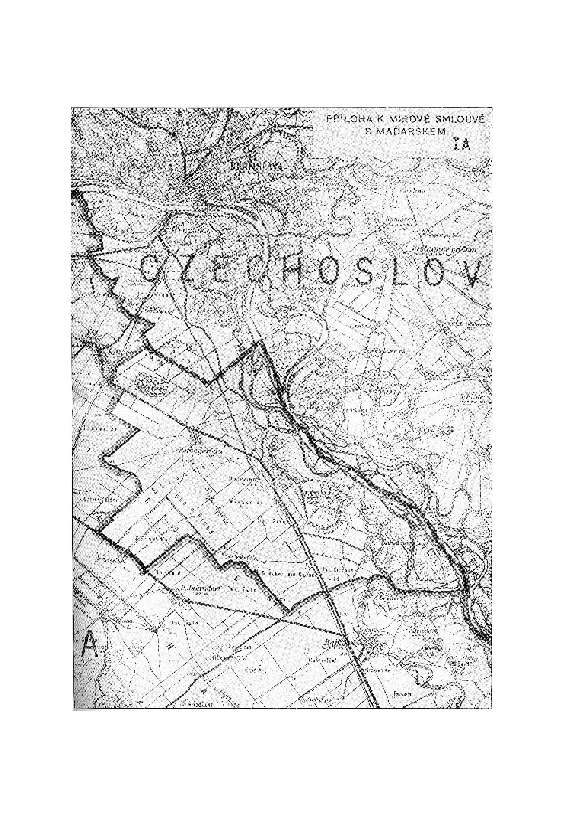

Príloha VI.

- Rozsudky.

  - Maďarská vláda urobí potrebné opatrenia, aby umožnila príslušníkom hocktorého zo Spojených národov dať kedykoľvek v jednoročnej lehote odo dňa, keď táto smluva nadobudne účinnosť, príslušnými maďarskými súdmi previesť revíziu hocktorého rozsudku, vyneseného maďarským súdom v dobe medzi 10. aprílom 1941 a dňom, keď táto smluva nadobudne účinnosť, v hocakom pokračovaní, v ktorom príslušník Spojených národov nebol schopný či už ako žalobca alebo ako žalovaný predniesť riadne svoj prípad súdu. Ak príslušník Spojených národov utrpel újmu v dôsledku akéhokoľvek takého rozsudku, postará sa maďarská vláda, aby bol znovu uvedený do stavu, v ktorom bol pred vynesením rozsudku, alebo aby bol spravodlive a okolnostiam primerane odškodnený. Výraz „príslušníci Spojených národov" zahrňuje právnické osoby alebo sdruženia, zriadené alebo ustanovené podľa zákonov ktoréhokoľvek zo Spojených národov.

- Na svedomie toho podpísaní splnomocnenci túto smluvu podpísali a opatrili svojimi pečaťmi.

- Dané v meste Paríži v ruskom, anglickom, francúzskom a maďarskom jazyku dňa desiateho februára jeden tisíc deväť sto štyridsať sedem.

Za Sväz sovietskych socialistických republík:

В. М. МОЛОТОВ

А. БОГОМОЛОВ

(V. M. MOLOTOV)

(A. BOGOMOLOV)

Za Spojené kráľovstvo Veľkej Británie a Severného Írska:

ERNEST BEVIN

DUFF COOPER

Za Spojené štáty americké:

JAMES E. BYRNES

JEFFERSON CAFFERY

Za Austráliu:

JOHN A. BEASLEY

Za Bieloruskú sovietsku socialistickú republiku:

К. КИСЕЛЕВ

(K. KISELEV)

Za Kanadu:

GEN. V. VANIER

Za Československo:

JAN MASARYK

Dr. V. CLEMENTIS

Za Indiu:

SIR SAMUEL RUNGANADHAN

Za Nový Zéland:

W. J. JORDAN

Za Ukrajinskú sovietsku socialistickú republiku:

И. СЕНИН

(I. SENIN)

Za Juhoagrickú Úniu:

W. C. PARMINTER

Za Ľudovú federatívnu republiku Juhoslávie:

STANCE SV. SIMIČ

RODOLUB ČOLAKOVIČ

GREGORIC

Za Maďarsko:

GYÖNGYÖSSI

SHLÉDNUVŠE A PROZKOUMAVŠE TUTO MÍROVOU SMLOUVU A VĚDOUCE, ŽE ÚSTAVODÁRNÉ NÁRODNÍ SHROMÁŽDĚNÍ REPUBLIKY ČESKOSLOVENSKÉ S NÍ SOUHLASÍ, PROHLAŠUJEME JI ZA SCHVÁLENU, PŘIJATU, POTVRZENU A UTVRZENU A MOCÍ LISTU TOHOTO PODEPSANÉHO NAŠÍ RUKOU VLASTNÍ JI SCHVALUJEME, PŘIJÍMÁME, POTVRZUJEME A UTVRZUJEME, SLIBUJÍCE SLOVEM SVÝM, JMÉNEM REPUBLIKY ČESKOSLOVENSKÉ, ŽE JI PEVNĚ A NEPORUŠITELNĚ ZACHOVÁME A NEDOPUSTÍME, ABY PROTI NÍ JEDNÁNO BYLO Z JAKÉKOLI PŘÍČINY A JAKÝMKOLI VYMYŠLENÝM ZPŮSOBEM.

TOMU NA SVĚDOMÍ JSME TENTO LIST VYHOTOVITI KÁZALI A K NĚMU PEČEŤ REPUBLIKY ČESKOSLOVENSKÉ PŘITISKNOUTI DALI.

JENŽ JEST DÁN NA HRADĚ PRAŽSKÉM, DNE 14. ŘÍJNA LÉTA TISÍCÍHO DEVÍTISTÉHO ČTYŘICÁTÉHO SEDMÉHO.

PRESIDENT REPUBLIKY ČESKOSLOVENSKÉ:

Dr. EDVARD BENEŠ v. r.

STÁTNÍ TAJEMNÍK V MINISTERSTVU ZAHRANIČNÍCH VĚCÍ:

Dr. V. CLEMENTIS v. r.

Vyhlasuje sa bez mapy I prílohy I, do ktorej možno nahliadnuť v archíve Ministerstva zahraničných vecí, s tým, že mierová smluva s Maďarskom nadobudla účinnosť dňa 15. septembra 1947, kedy Sväz sovietskych socialistických republík, Veľká Británia a Spojené štáty americké uložily ratifikačné listiny u vlády Sväzu sovietskych socialistických republík v Moskve.

Československá republika uložila ratifikačné listiny u vlády Sväzu sovietskych socialistických republík dňa 14. októbra 1947, čím táto smluva nadobudla účinnosť i pre Československo (čl. 42 smluvy).

Dr. Clementis v. r.

štátny tajomník v ministerstve zahraničných vecí.

PŘÍLOHA K MÍROVÉ SMLOUVĚ S MAĎARSKEM IA

