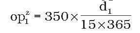
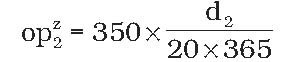

Príloha k zákonu č. 98/1987 Zb. v znení zákona č. 408/2015 Z. z.

- VZORCE NA VÝPOČET SUMY ZVÝŠENIA OSOBITNÉHO PRÍSPEVKU

  - 1. Vzorec na výpočet sumy zvýšenia osobitného príspevku podľa § 5 ods. 4 písm. a)

  - 

    - opz1 = suma zvýšenia osobitného príspevku

    - d1 = počet dní v zamestnaní v baníctve so stálym pracoviskom pod zemou v hlbinných baniach na území Slovenskej republiky ako rubač, lámač, razič alebo hĺbič, ktoré presahujú dobu 15 rokov v zamestnaní v baníctve so stálym pracoviskom pod zemou v hlbinných baniach na území Slovenskej republiky, z toho najmenej 10 rokov ako rubač, lámač, razič alebo hĺbič alebo dobu 20 rokov v zamestnaní v baníctve so stálym pracoviskom pod zemou v hlbinných baniach na území Slovenskej republiky alebo dobu potrebnú na dosiahnutie najvyššej prípustnej expozície zo zamestnania v baníctve so stálym pracoviskom pod zemou v hlbinných baniach na území Slovenskej republiky.

  - 2. Vzorec na výpočet sumy zvýšenia osobitného príspevku podľa § 5 ods. 4 písm. b)

  - 

    - opz2 = suma zvýšenia osobitného príspevku

    - d2 = počet dní v zamestnaní v baníctve so stálym pracoviskom pod zemou v hlbinných baniach na území Slovenskej republiky, ktoré presahujú dobu 15 rokov v zamestnaní v baníctve so stálym pracoviskom pod zemou v hlbinných baniach na území Slovenskej republiky, z toho najmenej 10 rokov ako rubač, lámač, razič alebo hĺbič, alebo dobu 20 rokov v zamestnaní v baníctve so stálym pracoviskom pod zemou v hlbinných baniach na území Slovenskej republiky, alebo dobu potrebnú na dosiahnutie najvyššej prípustnej expozície zo zamestnania v baníctve so stálym pracoviskom pod zemou v hlbinných baniach na území Slovenskej republiky okrem dní, v ktorých oprávnený bol zamestnaný ako rubač, lámač, razič alebo hĺbič.
