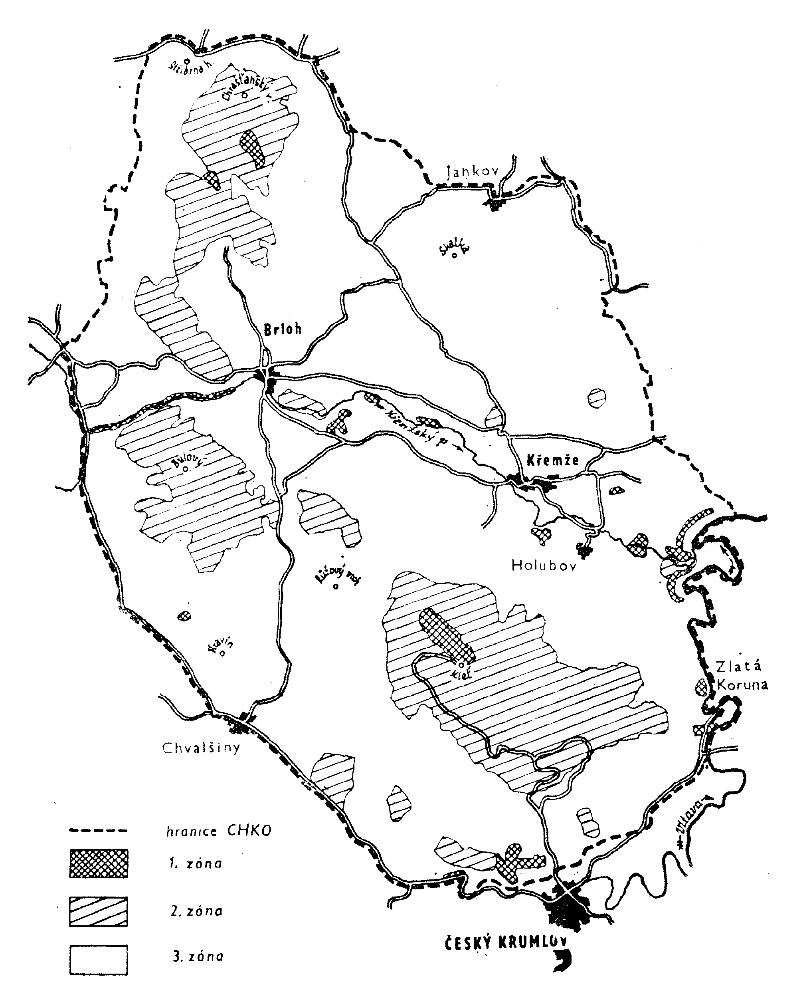

Příl. č. 1 vyhlášky č.197/1989 Sb.

- Popis hranice oblasti Blanský les

  - 1. Hranice oblasti Blanský les je vedena po veřejných komunikacích nebo jiných zřetelných a v terénu i v mapách identifikovatelných liniích.

  - 2. Průběh hranice je následující:

  - Z obce Chvalšiny po silnici směrem severozápadním kolem Střemil do Smědče, odtud po cestě přes Smědeček a Třešňový Újezdec do Votic, dále po silnici směrem severním na křižovatku na silnici Lhenice - Záboří. Od křižovatky směrem východním kolem Dobčic do Lipanovic, Holašovic, Jankova, Čakovce, Kvítkovic a Habří. Z Habří po cestě kolem samoty Vobr a dále do Slavče, odtud po silnici jižním směrem k silnici České Budějovice - Křemže. Zde přechází hranice oblasti na hranice okresu, která je zároveň katastrální hranicí mezi k. ú. Vrábče a k.ú. Křemže a přibližně sleduje tok potoka Němá Struha k Vltavě. Středem řečiště Vltavy proti proudu prochází hranice do obce Rájov, kde přechází na silniční most přes Vltavu a po silnici č. 159 vede k železniční zastávce Domoradice. Zde přechází trať ČSD a po trati směrem jihozápadním vede k silničnímu nadjezdu u Dobrkovic, odtud po silnici do Chvalšin.

  - Rozloha oblasti činí 21 235 ha.

  - 
