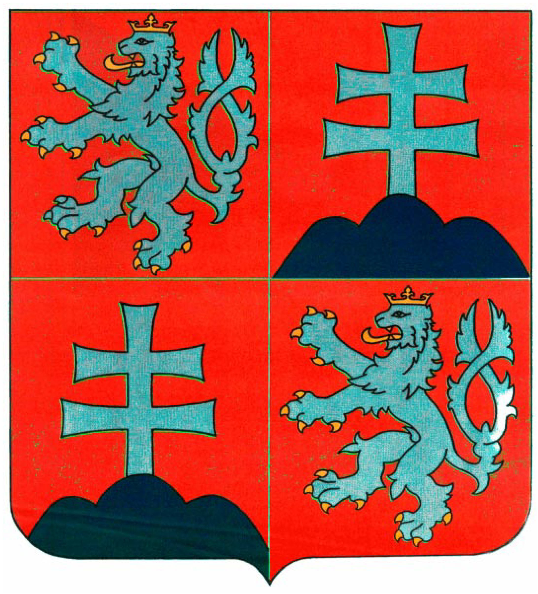

Príloha č. 1 ústavného zákona č. 102/1990 Zb. 

Poznámka: V prílohe č. 1 vo vyobrazení štátneho znaku Českej a Slovenskej Federatívnej Republiky má byť strieborný dvojchvostý ručiaci lev v skoku hľadiaci vpravo umiestnený v prvom červenom poli štátneho znaku Českej a Slovenskej Federatívnej Republiky správne vyobrazený so štyrmi zlatými pazúrmi na pravej zadnej nohe.

[Příloha 02](../assets/c3eff8fae776151378f5f0cfccb9ad8417f42ff22e6e19786fefe24e6d801358.pdf)
