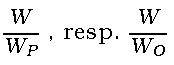

- 1) W = nejvyšší přípustná hodnota ozáření;index P = nejvyšší přípustná hodnota ozáření pro pracovníky;index E = elektrická složka pole;index H = magnetická složka pole;index S = výkonová hustota.

- 2) K1 = 1 pro stacionární antény či zářičeK1 = 2,5 pro mechanicky sektorující antényK1 = 120 pro otáčející se antényK1 = A/3 pro elektronicky rotující antény (A – úhel sektorování ve stupních)Poznámka: Číselné hodnoty K1 jsou všeobecné a platné pouze pro základní hygienické hodnocení. V případě potřeby, při situacích na hranici hygienické únosnosti, stanoví přesnější číselné hodnoty pro konkrétní typy radarů referenční laboratoř pro neionizující elektromagnetické záření, zřízená v Institutu hygieny a epidemiologie v Praze.

- 3) Index O = nejvyšší přípustná hodnota ozáření pro obyvatelstvo.

- 4) K2 = 1 pro stacionární antény či zářičeK2 = 5 pro mechanicky sektorující antényK2= 360 pro otáčející se antényK2 = A pro elektronicky rotující antény (A – úhel sektorování ve stupních)Poznámka: Číselné hodnoty K2 jsou platné ve stejném smyslu jako K1 . 1

- 5) § 4 odst. 3 zákona č. 20/1966 Sb., o péči o zdraví lidu.§ 41 vyhlášky č. 45/1966 Sb., o vytváření a ochraně zdravých životních podmínek.

- 6) § 4 odst. 4 zákona č. 20/1966 Sb.

- 7)  označuje poměr zjištěných průměrných směnových, resp. denních hodnot ozáření k nejvyšším přípustným hodnotám ozáření pracovníků, resp. obyvatelstva stanovený podle bodu 1.3. nebo 3. přílohy a § 4 vyhlášky, L označuje maximální změřenou hodnotu E, H, resp. S; L označuje v § 4 vyhlášky stanovenou mezní hodnotu E , H , resp. S (s indexem „P“ pro pracovníky, s indexem „O“ pro obyvatelstvo).
