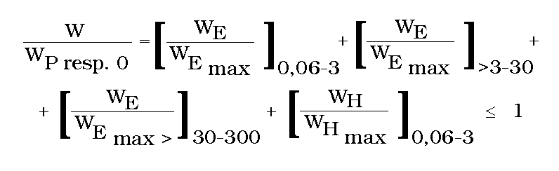
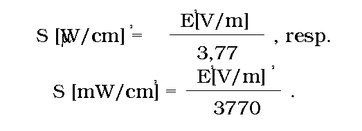
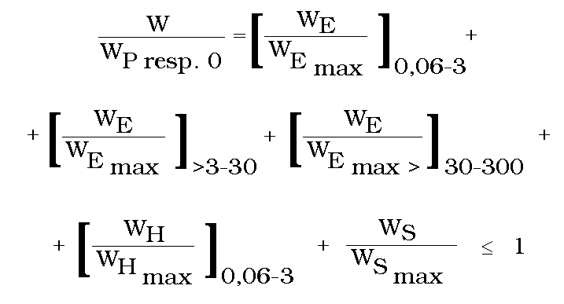
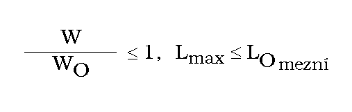
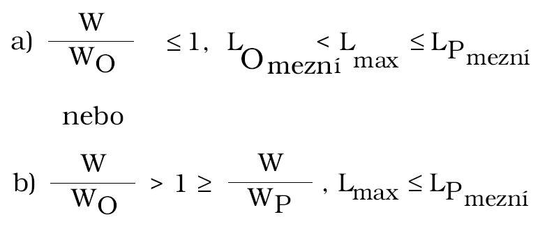
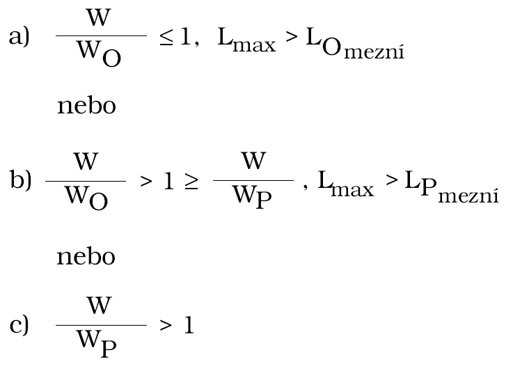

Příloha vyhlášky č. 408/1990 Sb.

- Pokyny

- ke stanovení úrovně pole a ozáření elektromagnetickými vlnami v pásmu vysokých a velmi vysokých frekvencí

- ČÁST I

  - 1. Pásmo vysokých frekvencí (vf)

    - Vysokými frekvencemi se v této vyhlášce rozumí frekvence od 60 kHz do 300 MHz, tj. vlnová délka ve vzduchu 5 km až 1 m. V tomto rozsahu frekvencí se úroveň pole vyjadřuje intenzitou elektrické složky pole [E] ve voltech na metr [V/m], případně v rozsahu od 60 kHz do 3 MHz intenzitou magnetické složky pole [H] v ampérech na metr [A/m]. Ozáření se vyjadřuje součinem E2 ve [V/m]2 , resp. H2 v [A/m]2 a času t v hodinách [h] a označuje se WE ,resp. WH .

  - 1.1. Měřící zařízení

    - Pro měření E i H se používá měřič blízkého pole NFM 1 s příslušnými anténami, popřípadě jiný rovnocenný přístroj schválený hlavním hygienikem ČR. Testování měřiče se provádí jednou za 3 roky. Ozáření WE, i WH se stanoví výpočtem nebo přímým měřením dozimetrem.

  - 1.2. Obecné zásady měření intenzity pole

    - Při měření intenzity pole E nebo H se podle povahy pracoviště (území, objektu) určí místa, na kterých se provede měření, tj. místa, kde se zdržují osoby, jejichž ozáření se stanoví. Měří se především ve výškách 50, 85, 125 a 160 cm nad podlahou, resp. terénem (platí pro střed antény), přičemž pro hodnocení je rozhodující nejvyšší naměřená hodnota v oblasti hlavy nebo trupu s výjimkou případu, kdy v místě končetin je naměřená hodnota vyšší než vyhláškou stanovené Emezní nebo Hmezní . Ve stanovených výškách se anténou pohybuje v horizontální rovině v rozsahu předpokládaných pohybů člověka na daném stanovišti a anténa se natáčí tak, aby byla spolehlivě zjištěna největší výchylka. Toto měření se opakuje v každé poloze nejméně třikrát a největší zjištěná výchylka se zaznamenává. Hodnota zjištěná ve výši hlavy se zaznamenává, i když není větší než hodnoty zjištěné v ostatních výškách. Hodnoty zjištěné v místech končetin se zaznamenávají pouze v případech, kdy jsou větší než mezní. Měří se za obvyklých podmínek (tj. na pracovišti především za přítomnosti obsluhy). Přítomnost jiných osob mimo osoby konající měření, popřípadě obsluhu, je nutno z bezprostředního okolí vyloučit. Osoba konající měření se nesmí nacházet mezi zdrojem záření a měřící anténou. Měří se za nejnepříznivějšího, případně pravděpodobně nejnepříznivějšího režimu, který může při běžném provozu nastat. Určení tohoto režimu je nutno projednat s příslušným orgánem hygienické služby. Pokud ho nelze předem stanovit měřením, měří se při každém pracovním režimu daného zařízení. V případě zjištění hodnoty intenzity pole přesahující možnosti měřiče se měří při definovaně sníženém výkonu příslušného zdroje a změřená hodnota se přepočítá na plný výkon s uvážením, že výkonu je úměrná hodnota E2.

    - Doba expozice či pobytu se změří nebo zjistí podle účelu pobytu z pracovních výkazů, z údajů pracovních norem, technologických postupů, popřípadě popisu pracovní činnosti s přihlédnutím k vyjádření vedoucího pracovníka.

    - Protokol musí obsahovat:

  - – datum a místo měření;

  - – charakteristiku zařízení (název, typ, výkon, kmitočet, režim a dobu provozu, popřípadě druh vyzařujícího prvku a jeho další parametry) s vyznačením případného předchozího projednání výběru režimu s orgánem hygienické služby;

  - – jednoduchý náčrtek s označením míst měření, vzdáleností, výšek a zaznamenáváním přítomnosti či nepřítomnosti obsluhy během měření;

  - – maximální hodnoty E, případně H a hodnoty ve výši hlavy; doba expozice, ozáření směnové, denní, průměrné (s uvážením případného ozáření pracovníka mimo pracovní dobu);

  - – použité měřící přístroje (s uvedením výrobního čísla a data posledního testování);

  - – závěry (s hodnocením a v případě pracoviště s návrhem na zařazení do příslušné kategorie podle části II přílohy).

  - 1.3 Stanovení ozáření

    - Ozáření člověka v daném místě je charakterizováno součinem čtverce intenzity pole v tomto místě E2 ve [V/m]2 nebo H2 v [A/m]2 a doby t, po kterou na něho toto pole působí (v hodinách). Celkové ozáření člověka za 1 směnu, resp. den je dáno součtem ozáření v jednotlivých místech, kde se zdržoval. V případě pracovníka se bere v úvahu také případné ozáření mimo pracovní dobu. Součet se stanoví samostatně pro E a případně též pro H a v případě E se ještě odliší součty pro jednotlivá frekvenční pásma. (Pokud toto odlišení není proveditelné, musí se v dalším vycházet z hodnocení v tom pásmu, pro něž jsou stanoveny přísnější hygienické požadavky.) Takto se stanoví směnové, resp. denní ozáření v každém pracovním, resp. kalendářním dnu. Průměrné směnové, resp. denní ozáření se stanoví sečtením směnových, resp. denních hodnot (u pracovníků za celý cyklus, tj. většinou za 5 pracovních dnů, u obyvatelstva za kalendářní týden, tj. za 7 dní) a dělením počtem pracovních dnů, resp. směn (tj. většinou 5) u pracovníků, popřípadě počtem kalendářních dnů (tj. 7) u obyvatelstva. U pracovníků se v případě ozařování i mimo pracovní dobu (směnu) ke směnovému ozáření přičítá též ozáření ve zbývající části dne a až z tohoto součtu v jednotlivých dnech pracovního cyklu se stanoví průměrné směnové ozáření. Pro vlastní hodnocení se však v takovém případě použije teprve součet takto zjištěného průměrného směnového ozáření a průměrného denního ozáření za období nepracovních dnů.

    - Při hodnocení se kontroluje, je-li při uvažování průměrných směnových, resp. denních hodnot ozáření splněna podmínka

    - 

    - kde hodnoty označené indexem max jsou stanovené nejvýše přípustné hodnoty ozáření pro pracovníky (WEP resp. WHP ) nebo obyvatelstvo (WEO resp. WHO). Současně se porovnává velikost nejvyšších zjištěných hodnot E, resp. H se stanovenými mezními hodnotami Emezní, Hmezní pro pracovníky nebo obyvatelstvo. Závěry s hodnocením se zapíší do protokolu. Nejvyšší přípustné hodnoty a mezní úrovně pole pro pracovníka a obyvatelstvo – viz též tabulka č. 1 a 2.

  - 2. Pásmo velmi vysokých frekvencí (vvf)

    - 1000 mW/cm2 = 10 W/m2. Ozáření se vyjadřuje součinem S v mW/cm2 a času t v hodinách [h] a označuje se WS.

  - 2.1 Měřící zařízení

    - Do doby, než bude zavedeno používání jednotného měřiče výkonové hustoty, lze používat libovolný měřič, pokud je zaručena přesnost měření S do 30 procent a pokud je schválen hlavním hygienikem ČR. Testování měřiče se provádí jednou za tři roky. Ozáření WS se stanoví výpočtem nebo přímým měřením dozimetrem.

  - 2.2 Obecné zásady měření výkonové hustoty

    - Platí obdobně ustanovení bodu 1.2. s těmito odchylkami:

  - – pokud není k dispozici izotropní širokopásmový měřič, provádí se v daném místě měření na všech pro posouzení důležitých kmitočtech (pásmech), vyskytujících se v dané oblasti a výsledky se aritmeticky sčítají, a to pro horizontální i vertikální polohu měřící antény (jde-li o anténu s převážně lineární polarizací). V případě rotujících primárních zářičů se zjišťuje pouze maximální hodnota (vhodným natáčením měřící antény);

  - – v případě pulsní modulace je rozhodující střední výkonová hustota, v protokolu je však nutno zaznamenat parametry pulsního režimu (šířka pulsu, opakovací kmitočet);

  - – v okolí zdrojů s otáčejícími se nebo sektorujícími anténami (vyzařovacími diagramy) se při hodnocení vychází z výsledků měření v zastaveném stavu s uvážením koeficientů K1 (pro (pro pracovníky), resp. K2 (pro obyvatelstvo), které jsou stanoveny touto vyhláškou. Do protokolu se zaznamenává i typ vysílací antény, její zisk, šířka svazku, polarizace a druh pohybu;

  - – pokud obsluha není nucena trvale stát nebo sedět přesně ve stejném místě nebo poloze vzhledem ke zdroji záření a pohybuje se ve výrazně nehomogenním poli (tedy blízko zdroje, např. u generátorů pro mikrovlnný di-elektrický ohřev apod.), vychází se při hodnocení daného místa z průměrné hodnoty S získané alespoň z pěti měření (v daném místě, nad i pod ním, vlevo a vpravo od něj), avšak do protokolu se zaznamenává také maximální hodnota;

  - – je-li měřič NFM 1 vybaven zvláštní anténou pro měření E v pásmu vvf, lze jej použít s tím, že odpovídající výkonová hustota se stanoví buď z grafu či tabulky, dodaných s anténou, nebo pomocí vztahu

  - 

  - 2.3. Stanovení ozáření

    - Pro stanovení ozáření WS platí přiměřeně ustanovení bodu 1.3. s tím rozdílem, že čas t se násobí výkonovou hustotou S. Pro hodnocení je rozhodující vztah WS k nejvýše přípustným hodnotám ozáření pro pracovníky (WSP) nebo obyvatelstvo (WSO) a dodržení stanovených mezních hodnot Smezní . Nejvyšší přípustné hodnoty a mezní úrovně pole pracovníka a obyvatelstva – viz též tabulka č. 1. a 2.

  - 3. Kombinace pásem vf a vvf

    - V případě působení pole v místě, kde byly zjištěny úrovně příslušející pásmu vf a vvf, kontroluje se při hodnocení, je-li při uvažování průměrných směnových, popř. denních hodnot ozáření splněna podmínka:

    - 

    - Hodnoty označené indexem max jsou stanovené nejvýše přípustné hodnoty ozáření pro pracovníky (WEP, WHP, resp. WSP) nebo obyvatelstvo (WSO , WHO, resp. WSO ). Současně se porovnává velikost nejvyšších zjištěných hodnot E, H, resp. S se stanovenými mezními hodnotami Emezní, Hmezní, resp. Smezní pro pracovníky nebo obyvatelstvo.

- ČÁST II Kategorizace prací

  - Elektromagnetické záření (v pásmu vysokých a velmi vysokých frekvencí)

  - KATEGORIE 1 - Nejsou překračovány hygienicky únos-né hodnoty platné pro obyvatelstvo.

  - Musí současně platit7)

  - 

  - KATEGORIE 2 - Nejsou překračovány hygienicky únosné hodnoty platné pro pracovníky.

  - Musí současně platit buď

  - 

  - KATEGORIE 3 - Hygienicky únosné hodnoty platné pro pracovníky jsou překračovány – RIZIKOVÁ PRÁCE.

  - Musí současně platit buď

  - 

- [Příloha 01](../assets/22d7614c2afa33d61bab62c6f10cd9e7e40fb24fb3b4feda336411da72050298.pdf)
