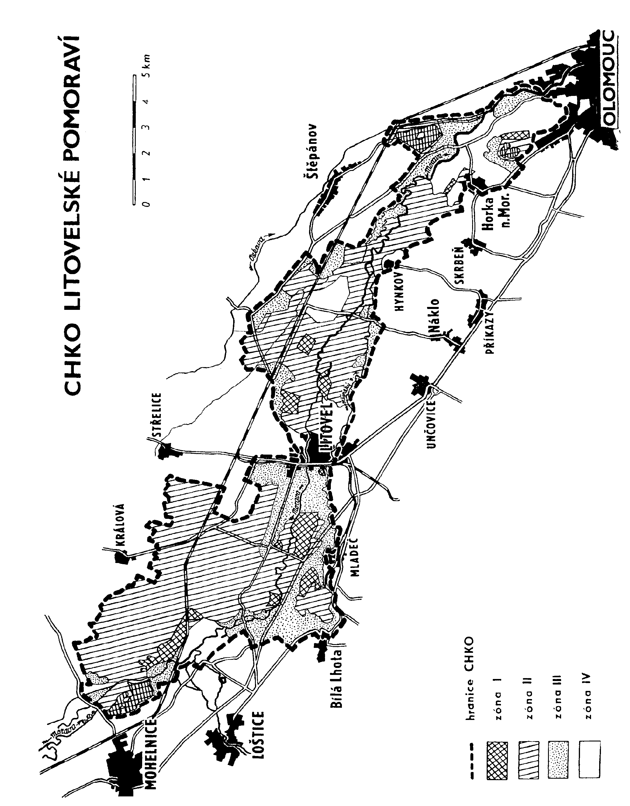

Příloha č. 1 vyhlášky č. 464/1990 Sb.

- Popis hranice oblasti Litovelské Pomoraví

- 1. Hranice oblasti Litovelské Pomoraví je vedena po veřejných komunikacích nebo jiných zřetelných a v terénu i v mapách identifikovatelných liniích.

- 2. Průběh hranice je následující:

- V Olomouci – Černovíře začíná hranice na mostě přes řeku Moravu a pokračuje proti proudu na levém břehu Moravy až po soutok s Oskavou, dále po levém břehu Oskavy proti proudu až ke křížení se železniční tratí Olomouc – Zábřeh n. M. Dále po železniční trati až ke křížení se silnicí III/446-8 na okraji Březců, po této silnici jižním směrem až ke křížení se silnicí II/446 a po ní severozápadním směrem až k ochranné protipovodňové hrázi, která sleduje severní okraj lužního lesa. Dále hranice vede severozápadním směrem po této hrázi až k polní cestě, která vede k železničnímu mostku na trati Olomouc – Zábřeh n. M. Po této polní cestě až k železniční trati a mostku na kótě 225 m n. m. a dále po železniční trati severozápadním směrem až po křížení se silnicí III/446-19 a po této silnici severovýchodním směrem na křižovatku se silnicí II/446. Po této silnici vede hranice severozápadním směrem až na křižovatku se silnicí II/447 na jižním okraji Pňovic, po silnici II/447 západním směrem až k okraji lesa a dále na sever po okraji lesa zpět na silnici II/447, po níž vede hranice přes Tři Dvory do Litovle až na křižovatku se silnicí II/449. Po silnici II/449 se hranice stáčí k severu a vede až ke křižovatce se silnicí II/449-6 v Července a po silnici III/449-6 západním směrem k polní cestě vedoucí k hájence Čerlinka. Po této polní cestě až k hájence a dále podél severního okraje lesa „Doubrava“ až k toku Doubravky jihozápadně od Úsova. Dále po pravém břehu Doubravky po proudu až k silnici II/444 ve Stavenicích. Po silnici II/444 západním směrem až k účelové komunikaci Moravských štěrkoven, po které jde hranice jihovýchodním směrem kolem západního okraje štěrkopískového jezera a dále po západním okraji jezera až k jeho jižnímu okraji. Zde se hranice stáčí k východu a prochází kolem jižního okraje dvou lesíků až k vodnímu příkopu po jehož pravém břehu jde jižním směrem až k železniční trati Olomouc – Zábřeh n. M., odkud pokračuje jihovýchodním směrem po trati až k železničnímu mostu přes řeku Moravu. Dále po pravém břehu Moravy jižním směrem až k hospodářskému mostu přes Moravu a dále k odlehčovacímu kanálu Třebůvky a k severnímu okraji Doubravice, přes Doubravici severovýchodním směrem po místní komunikaci. Od Doubravice jihovýchodním směrem po polní komunikaci k východnímu okraji Mitrovic a dále stejným směrem po polní komunikaci k východnímu konci hrázky s kótou 243 m n. m. a odtud jižním směrem přímo ke křížení Palonínského potoka se silnicí Palonín – Nové Mlýny u vodní elektrárny N. Mlýny. Po silnici N. Mlýny – Palonín západním směrem až na křižovatku se silnicí III/444-1 a dále po této silnici jižním směrem přes Řimice na křižovatku se silnicí II/635. Dále vede hranice po silnici II/635 přes Měník až ke konečné stanici ČSD Mladeč – jeskyně a po železniční trati ke křížení se silnicí III/449-9, a po této silnici severovýchodním směrem do Mladče na most přes Mlýnský potok. Dále po pravém břehu Mlýnského potoka po proudu přes Sobáčov, Vísku, Litovel, Chořelice do Březové a odtud jihovýchodním směrem po ochranné protipovodňové hrázi kolem jižního okraje lesa na silnici III/446-20 ve Lhotě n. M., k budově polesí Střeň a dále po ochranné protipovodňové hrázi kolem jižního okraje lesa do Hynkova. Hynkovem po místní komunikaci na náves a kolem hostince na polní cestu vedoucí jihovýchodním směrem k okraji lesa a kolem západního okraje lesa a východním směrem kolem jižního okraje lesa k pravému břehu Mlýnského potoka a po pravém břehu k silničnímu mostu na silnici III/446-5 v Horce n. M. Po silnici III/446-5 obcí Horky n. M. na křižovatku se silnicí III/446-3 jihozápadně od Horky n. M. a po této silnici jihovýchodním směrem až k odbočce místní cesty k parkovišti u koupaliště Poděbrady a po této místní cestě severovýchodním směrem až k mostku s melioračním příkopem a po jeho pravém břehu jihovýchodním směrem až po soutok s Mlýnským potokem. Po pravém břehu Mlýnského potoka až k silničnímu mostu na silnici spojující předměstské čtvrtě Hejčín a Černovír v Olomouci a po této silnici severním směrem na výchozí bod – silniční most přes řeku Moravu v Olomouci – Černovíře.

- 3. Celková rozloha oblasti činí 96 km2.

- 
