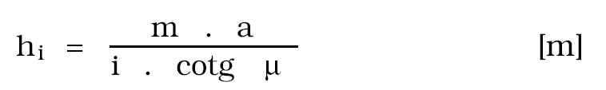
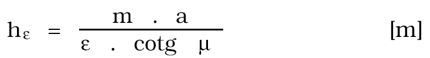
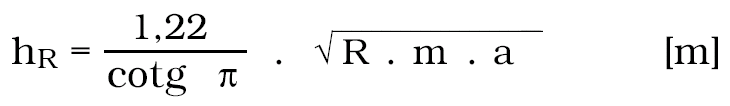
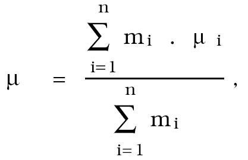

Příloha č. 1 vyhlášky č. 415/1991 Sb.

- Stanovení bezpečné hloubky pro chráněné objekty

  - (1) Bezpečná hloubka se stanoví pro jednotlivý objekt (zařízení) podle stupně ochrany, do něhož byl zařazen. Stupněm ochrany se v tomto případě rozumí přípustné parametry přetvoření terénu, při jejichž dosažení je možno chráněný objekt udržovat v provozuschopném stavu; jedná se o naklonění, vodorovné přetvoření terénu, poloměr zakřivení a v některých případech o pokles (v souvislosti se zvýšením hladiny podzemní vody, průjezdním nebo plavebním profilem pod mostními objekty apod.).

  - (2) Bezpečná hloubka se zjišťuje pro jednotlivé parametry spojitého přetvoření terénu nebo pro ten, který je rozhodující z hlediska citlivosti objektu (zařízení). Jako bezpečnou hloubku je třeba určit největší takto vypočtenou hloubku dobývání.

  - (3) S ohledem na dynamický vývoj poklesové kotliny vychází se při výpočtu bezpečné hloubky z parametrů spojitého přetvoření terénu, které ji charakterizují, bez ohledu na umístění objektu (zařízení) v jejím plošném rozsahu. Pokud budou chráněné objekty ovlivněny dobýváním ložiska v rozsahu menším než je tzv. plně účinná plocha, je možno zmenšit hodnotu bezpečné hloubky na základě báňského znaleckého posudku. Pro stanovení bezpečné hloubky při šikmém nebo strmém uložení ložiska nebo při dobývání více než dvou slojí se určuje bezpečná hloubka vždy na základě báňského znaleckého posudku.

  - (4) Hodnoty bezpečné hloubky z hlediska nejnepříznivějších parametrů přetvoření terénu se určují pro ploché uložení slojového ložiska při dobývání nejvíce dvou slojí z těchto vztahů:

    - Z hlediska maximálního naklonění

    - 

    - [m]

    - Z hlediska maximálního vodorovného přetvoření terénu

    - 

    - [m]

    - Z hlediska minimálního poloměru zakřivení

    - 

    - hR = [m]

    - V předešlých vztazích znamená

    - hi .................. bezpečná hloubka pro přípustné

    - naklonění [i],

    - .................. bezpečná hloubka pro přípustné

    - vodorovné přetvoření []

    - hR ................ bezpečná hloubka pro přípustný

    - poloměr zakřivení [R],

    - m ................ mocnost ložiska,

    - a ................ dobývací faktor

    - stěnování na zával a = 0,85 – 0,95

    - částečná základka a = 0,65 – 0,75

    - foukaná základka a = 0,55 – 0,65

    - plavená základka a = 0,25 – 0,35

    - ................ mezný úhel

    - 

    - kde

    - jsou mezné úhly hornine jednotlivých vrstev,

    - mi jsou mocnosti těchto vrstev

    - pokryvné horniny mokré = 4Oo – 45o

    - pokryvné horniny suché = 50o

    - karbonské horniny nepevné = 65o

    - karbonské horniny střední

    - pevnosti = 70o – 75o

    - karbonské horniny pevné = 80o – 90o

    - OKR – karbon = 65o

    - OKR – terciér = 55o
