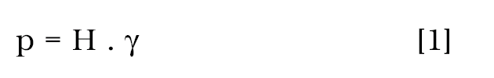
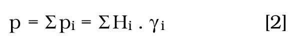
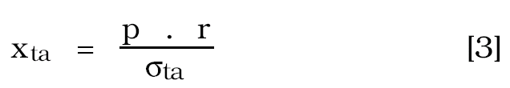
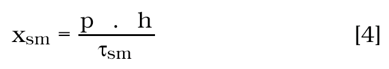

Příloha č. 2 vyhlášky č. 415/1991 Sb.

- Výpočet rozměrů ochranného celíku zatopené jámy v třetihorním souvrství

  - Ochranné celíky zatopených jam se konstruují podle celkového hydrostatického tlaku, vypočteného s ohledem na hustotu složek náplně jámy. Pro jámy třetihorního souvrství (zejména u lignitových dolů) lze použít následujících výpočtů.

  - Rozměry ochranného celíku se určí z pevnostních parametrů horniny (zemin).

  - Hydrostatický tlak [p] se stanoví jako součin hustoty [] a výšky sloupce kapaliny [H] ze vzorce

  - 

  - p = H . [1]

  - Při více kapalinách o různé hustotě [Yi] a výšce sloupce [Hi] je celkový tlak součtem dílčích tlaků [pi]

  - 

  - p = pi = Hi . i [2]

  - Šířka prstence [x] ochranného celíku, obepínajícího jámu o poloměru [r] se vypočte:

  - Z pevnosti v tahu

  - 

  - [3]

  - kde ta ............... dovolené namáhání na tah,

  - p ............... výsledný hydrostatický tlak,

  - r ............... poloměr průřezu jámy,

  - Z pevnosti ve smyku

  - 

  - xsm = [4]

  - kde sm ............... pevnost ve smyku,

  - p ............... výsledný hydrostatický tlak,

  - h ............... poloviční výška uvolněného

  - prostoru (důlního díla),

  - Pevnost ve smyku [ sm] lze určit jako 0,01 až 0,02 pevnosti na tlak [ t1].

  - Pozn. 1:

  - Z rozdílných rozměrů prstence ochranného celíku [xt1] a [xsm] se bere jako bezpečnější větší hodnota z obou.

  - Pozn. 2:

  - Při vedení důlních děl v okolí celíku se použije zabezpečovacích vrtů ve směru vedení na bezpečnou vzdálenost se zajištěním vrtu pro případ navrtání tlakového horizontu (průnik tlakové kapaliny podél střihů).
