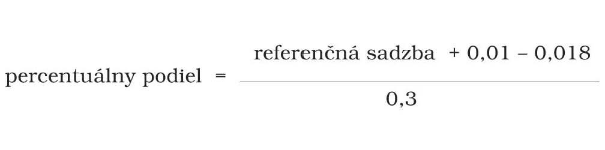

Príloha k zákonu Slovenskej národnej rady č. 310/1992 Zb.

- Vzorec na výpočet percentuálneho podielu pre nasledujúci kalendárny rok 

  - kde referenčná sadzba sa rovná jednoduchému aritmetickému priemeru za rozhodujúce obdobie priemerných výnosov do splatnosti štátnych dlhopisov, ktoré tvoria bázu dlhopisového indexu pre štátne dlhopisy počítaného a zverejneného v obchodných dňoch Burzou cenných papierov v Bratislave; ak údaje neboli zverejnené touto burzou počas viac ako 30 po sebe nasledujúcich dní, referenčná sadzba za rozhodujúce obdobie sa určí obdobným spôsobom z údajov o fixingu úrokových sadzieb na medzibankovom trhu depozít (12-mesačný BRIBOR) zverejňovaných Národnou bankou Slovenska; rozhodujúcim obdobím sa rozumie obdobie od 1. júla predchádzajúceho kalendárneho roka do 30. júna aktuálneho kalendárneho roka.
