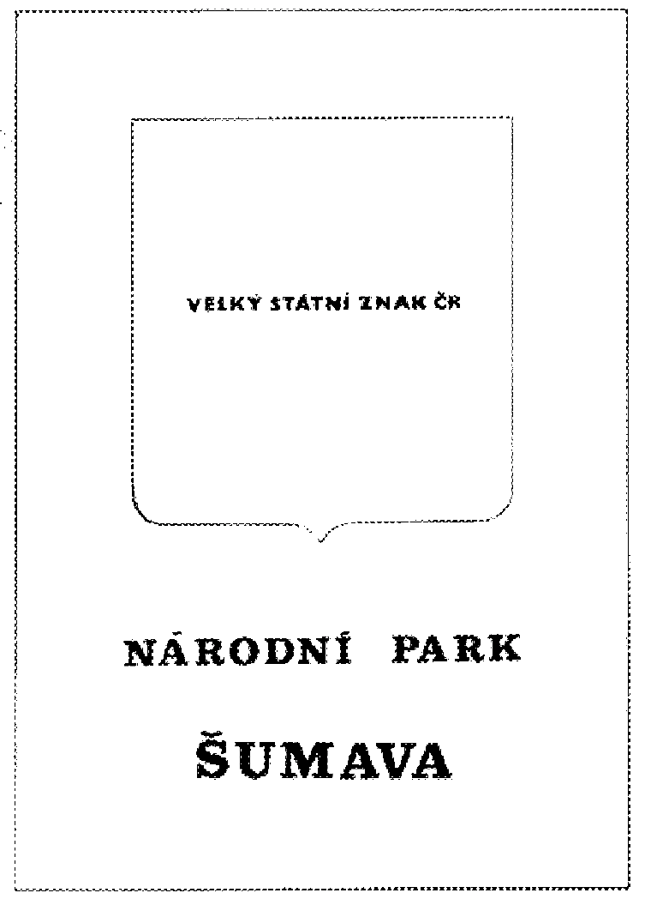
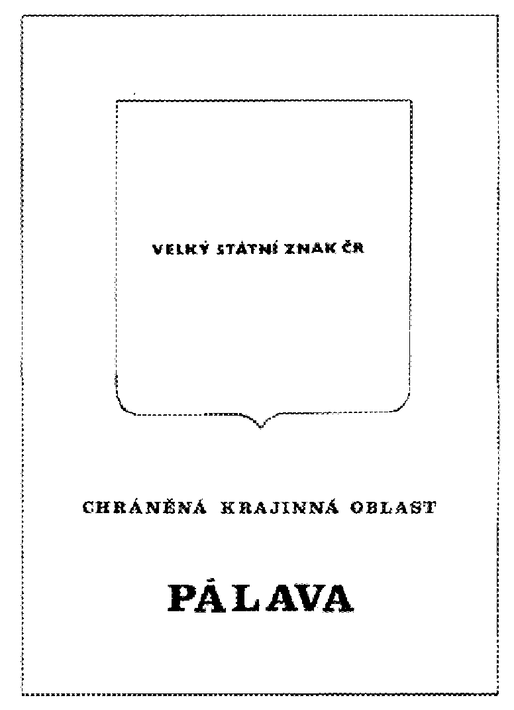
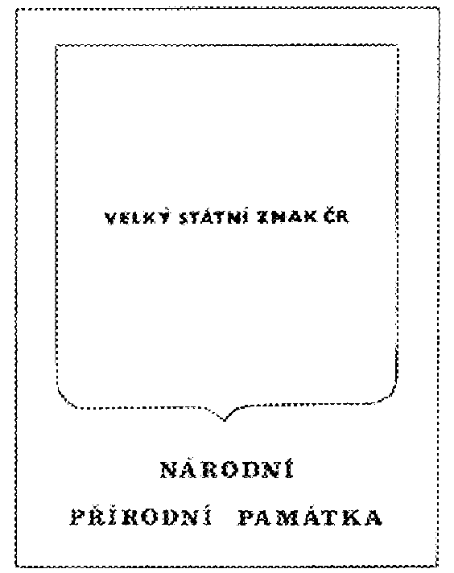
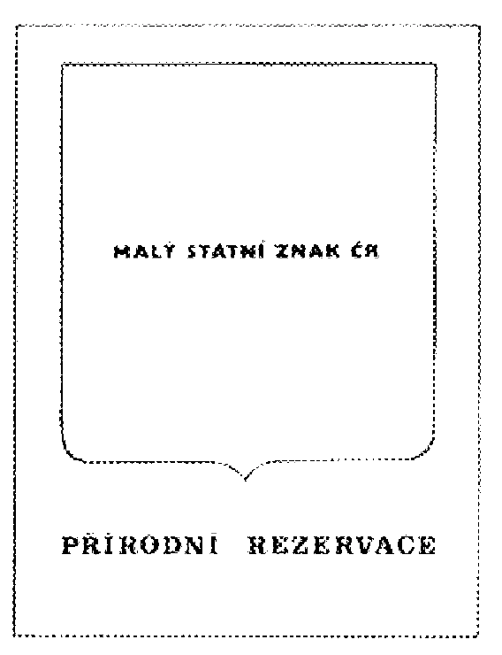
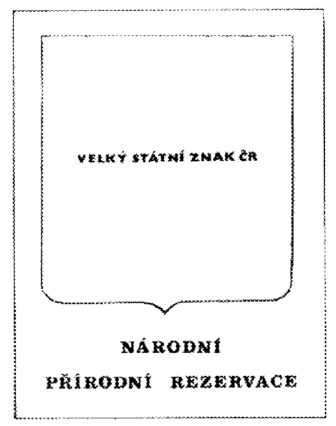
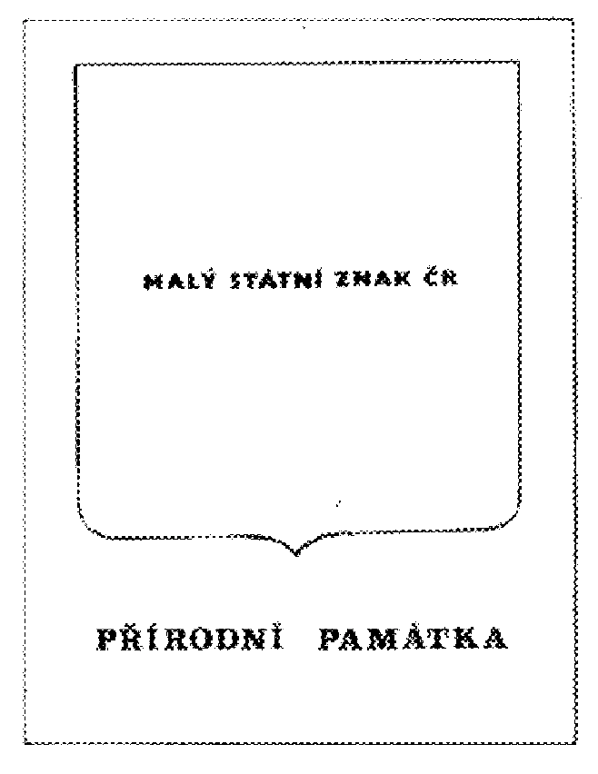
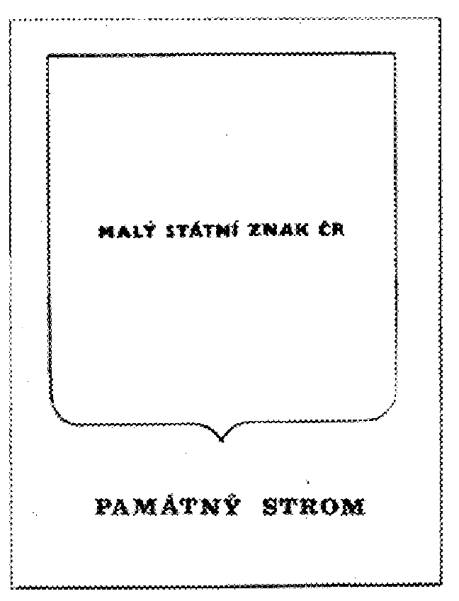

Příloha č. I vyhlášky ministerstva životního prostředí ČR č. 395/1992

- Závazné vzory označení zvláště chráněných území a památných stromů

  - všechny tabule jsou tmavozelené, písmo je bílé

- 

  - rozměry tabule: 56,5 x 39

- 

  - rozměry tabule: 56,5 x 39

- 

  - rozměry tabule: 40 x 30

- 

  - rozměry tabule: 40 x 30

- 

  - rozměry tabule: 40 x 30

- 

  - rozměry tabule: 40 x 30

- 

  - rozměry tabule: 40 x 30
