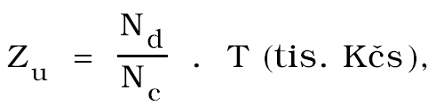
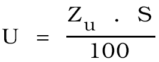

Příloha 2

- Způsob výpočtu základu a výše úhrady (k § 5 vyhlášky)

  - 1. Způsob výpočtu základu úhrady vyjadřuje vzorec

- 

- kde Zu = Základ pro stanovení výše úhrady (tis. Kčs),

- Nc = náklady na výrobu finální produkce

- (tis. Kčs),

- Nd = náklady na dobývání (tis. Kčs),

- T = tržní cena (tržby organizace) za finální produkci z vydobytých nerostů v místě výrobního závodu (tis. Kčs).

- Organizace, která nesleduje přímé náklady na dobývání, odvodí tyto náklady ve vztahu Nd = Nc- Nf, kde Nf = náklady na finalizaci vydobytých nerostů.

  - 2. Způsob výpočtu výše úhrady vyjadřuje vzorec

- 

  - kde U = výše úhrady

  - Zu = základ úhrady

  - S = sazba úhrady
