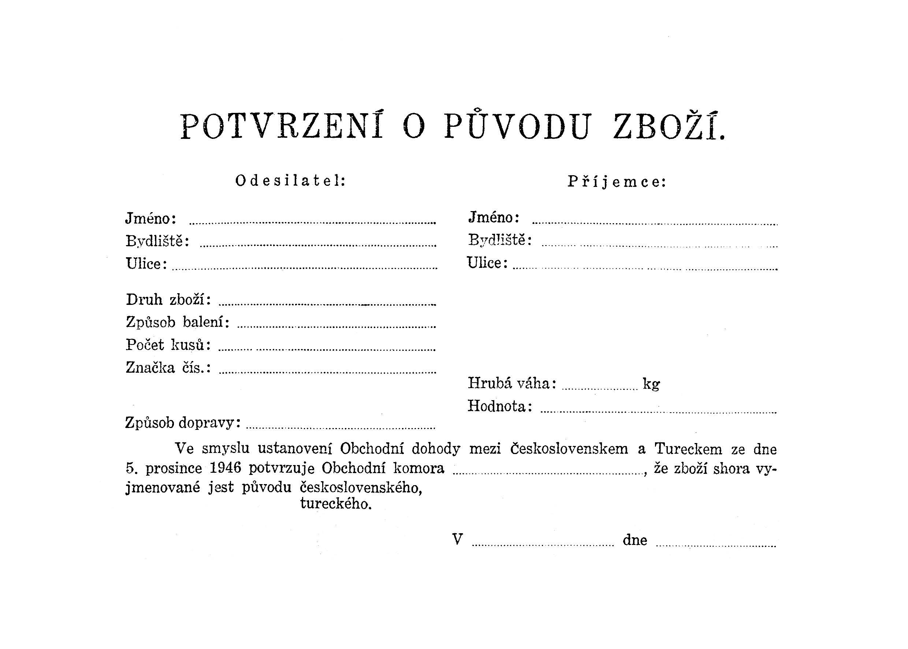

(Překlad.)

- Obchodní dohoda mezi Československem a Tureckem. Vláda československá a vláda turecká, přejíce si rozvinouti výměnu zboží a usnadniti platební styk mezi oběma státy, dohodly se na základě modu vivendi, jenž byl mezi Československem a Tureckem podepsán dne 30. dubna 1934 a jenž byl znovu uveden v účinnost obchodní a platební dohodou mezi oběma zeměmi z 22. června 1945, na těchto ustanoveních:

  - Článek 1.

    - Výměna zboží mezi Československem a Tureckem se bude díti podle všeobecných předpisů, platných v obou zemích pro dovoz a vývoz.

  - Článek 2.

    - Způsob úhrady plynoucí z transakcí schválených během platnosti této dohody příslušnými úřady obou států bude upraven podle ustanovení platební dohody, sjednané dnešního dne.

  - Článek 3.

    - Ode dne, kdy tato dohoda nabude účinnosti, zboží, zaslané jednou i druhou stranou musí býti opatřeno osvědčením o původu, podle připojeného vzoru, vystaveným příslušnými úřady vývozního státu.

    - U zásilek, jejichž hodnota nepřesahuje 100 tureckých liber nebo jim odpovídající hodnotu v jiné měně, se osvědčení o původu nevyžadují.

  - Článek 4.

    - Transakce, schválené příslušnými úřady obou států podle ustanovení dohody podepsané dne 7. června 1946 a k ní připojeného dopisu, týkajících se dodávek československého těžkého průmyslu, budou likvidovány podle smluv sjednaných mezi dovozci a vývozci obou států.

    - Kompensační obchody soukromé, jakož i obchody ve volných devisách, započaté před tím než tato dohoda nabyla účinnosti, budou likvidovány podle všeobecných předpisů, platných v každém z obou států v době, kdy tyto obchody byly schváleny dotčenými příslušnými úřady.

  - Článek 5.

    - Transakce, schválené příslušnými úřady obou států v době účinnosti této dohody a nedokončené před tím, než účinnosti pozbude, budou likvidovány podle všeobecných předpisů, platných v každém z obou států v době, kdy transakce byly schváleny.

  - Článek 6.

    - Za účelem rozvíjení hospodářských styků mezi oběma státy a předkládání návrhů všeho druhu na jejich usnadnění bude zřízena smíšená komise, složená ze zástupců československých a tureckých, jež se sejde na žádost příslušných úřadů obou států.

  - Článek 7.

    - Tato dohoda nabude účinnosti dne 15. prosince 1946 a zůstane v platnosti do 1. dubna 1948.

    - Nebude-li vypovězena dva měsíce přede dnem, kdy pozbude platnosti, bude považována za mlčky prodlouženou do 31. března 1949.

  - Vyhotoveno v Ankaře, ve dvou exemplářích, ve francouzském znění, dne 5. prosince 1946.

- Za vládu československou:

- STANISLAV MIŇOVSKÝ v. r.

- Za vládu tureckou:

- B. SANUS v. r.

- 
