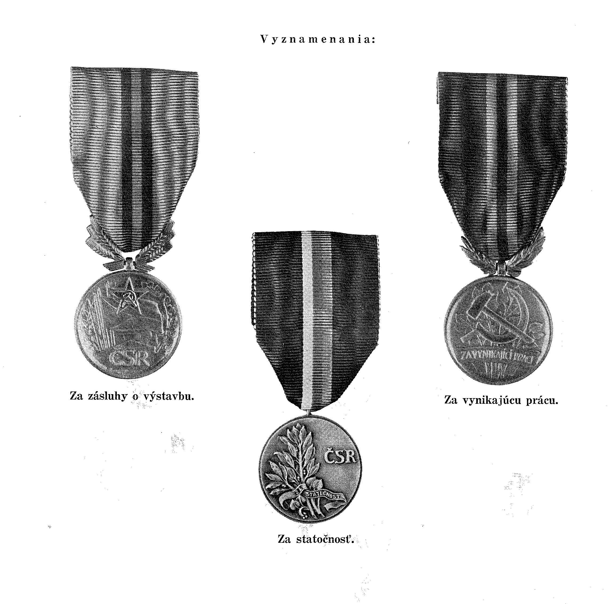

Príloha k vládnemu nariadeniu č. 30/1951 Sb.

- Stanovy čestného titulu „Hrdina práce", Radu Socializmu, Radu Republiky, Radu Práce a vyznamenaní Za zásluhy o výstavbu, Za vynikajúcu prácu, a Za statočnosť.

  - Čl. I. Čestný titul „Hrdina práce".

    - (1) Čestný titul „Hrdina práce" sa udeľuje tomu, kto si obzvlášť vynikajúcou priekopníckou činnosťou, najmä v priemysle, pôdohospodárstve, doprave alebo obchode, alebo vedeckými objavmi či technickými vynálezmi získal výnimočné zásluhy o víťazstvo socializmu v Československej republike a prispel k zveľadeniu národného hospodárstva, kultúry alebo vedy alebo k posilneniu obrannej schopnosti štátu.

    - (2) Čestný titul „Hrdina práce" udeľuje na návrh vlády prezident republiky, ktorý zároveň udelí Hrdinovi práce Rad Socializmu.

    - (3) Hrdina práce dostane diplom o svojej pocte, zlatú hviezdu Hrdinu práce a s ňou radovú knižku ako doklad na nosenie hviezdy.

    - (4) Zlatá hviezda Hrdinu práce má tvar plastickej päťcípej hviezdy s rozpätím hrotov 29 mm. Líc hviezdy je zdobený piatimi lúčmi, vybiehajúcimi z jej stredu. Na rube sú písmená ČSR, nad nimi kosák a kladivo a dole matričné číslo. Hviezda je razená zo zlata, jej povrch je leštený. Zlatým závesným krúžkom je zavesená na tmavočervenej stuhe 38 mm širokej a 30 mm dlhej, zasadenej horným jej koncom do zlatej pravouhlej svorky 3 mm širokej a 38 mm dlhej, zdobenej pozdĺžnymi rýhami. Vyobrazenie je pripojené.

    - (5) Zlatá hviezda Hrdinu práce sa nosí na ľavej strane pŕs nad všetkými československými radmi a vyznamenaniami, poprípade nad stuhami československých radov a vyznamenaní. Nosí sa vždy vcelku.

  - Čl. II Rad Socializmu.

    - (1) Rad Socializmu sa udeľuje za celkom výnimočné zásluhy o víťazstvo socializmu v Československej republike, získané v budovaní, v boji s reakciou alebo pri obrane štátu.

    - (2) Rad Socializmu udeľuje prezident republiky na návrh vlády.

    - (3) Zároveň s radom dostane vyznamenaný diplom a radovú knižku ako doklad na nosenie radu.

    - (4) Rad Socializmu tvorí vavrínový veniec priemeru 37 mm so stuhou, voľné konce ktorej sú shrnuté pod jeho dolnou časťou. Vnútri venca je v dolnej polovici panoráma Hradčian. Na modro smaltovanej oblohe vybieha za Hradčanmi päť lúčov, ktoré zčasti presahujú veniec; na strednom lúči spočíva tmavočervená päťcípa hviezda. Okolo venca medzi lúčmi je vsadené 20 českých granátov. Na rube radu je kosák a kladivo, pod nimi vavrínová ratolesť a matričné číslo. Rad je razený zo zlata, panoráma Hradčian je z bieleho zlata. Zlatým závesom vytvoreným lipovými ratolesťami a stužkou s písmenami ČSR je zavesený na stuhe 38 mm širokej a 55 mm dlhej; stuha je tmavočervená s 15 mm širokým silne tmavočerveným pruhom uprostred. Vyobrazenie je pripojené. Ak sa nosí len stužka radu, je napätá na pravouhlej lište 10 mm širokej a 38 mm dlhej.

    - (5) Rad Socializmu sa nosí na ľavej strane pŕs pred všetkými československými radmi a vyznamenaniami. Ak sa nosí len stužka radu, je napätá na pravouhlej lište 10 mm širokej a 38 mm dlhej.

  - Čl. III Rad Republiky.

    - (1) Rad Republiky sa udeľuje za mimoriadne zásluhy o budovanie Československej republiky, najmä o jej mierové budovateľské úsilie vo výrobe alebo pri kultúrnej alebo vedeckej činnosti, alebo o zvyšovanie schopnosti obrany štátu.

    - (2) Rad Republiky udeľuje prezident republiky na návrh vlády.

    - (3) Zároveň s radom dostane vyznamenaný diplom a radovú knižku ako doklad na nosenie radu.

    - (4) Rad republiky má tvar červeného, striebrom rámovaného štvorca, ktorého strana má 40 mm. Do stredu koso položeného štvorca je umiestnená pozlátená modro lemovaná päťcípa hviezda s farebným znakom ČSSR v pravidelnom päťuholníku. Medzi cípami hviezdy sú pozlátené lipové trojlístky. Hviezda je podložená desiatimi striebornými lúčmi s useknutými hrotmi, z ktorých štyri horné a štyri dolné presahujú okraj odznaku. Na červenej ploche sú úzke strieborné medzilúče. Horný roh štvorca je spojený lichobežníkovým strieborným uškom s tmavomodrou 38 mm širokou prievlečnou stuhou, na dolnej časti ktorej je kovový pozlátený vlys z desiatich lipových lístkov. Nad vlysom je vodorovný biely a červený prúžok. Biely prúžok je široký 2,5 mm, červený 2,5 mm a vlys 5 mm. Rub štvorca je hladký s vyrytým matričným číslom hore.

    - (5) Ak sa nosí iba stužka radu, je napnutá na pravouhlej lište rozmeru 38 x 10 mm. Tvorí ju vodorovný prúžok biely, červený a modrý v pomere 2,5 : 2,5 : 5. Modrý prúžok je prekrytý kovovým pozláteným vlysom z desiatich lipových lístkov.

  - Čl. IV Rad Práce.

    - (1) Rad Práce sa udeľuje za významné pracovné výsledky na poli hospodárskom, najmä v priemysle, pôdohospodárstve, doprave alebo obchode, v štátnej alebo inej verejnej službe, za osobitné úspechy vo vedeckej, výskumnej alebo inej kultúrnej činnosti alebo za technické zlepšenia a vynálezy veľkého hospodárskeho významu alebo za zásluhy o zvýšenie obrannej schopnosti armády.

    - (2) Rad Práce udeľuje prezident republiky na návrh vlády.

    - (3) Zároveň s radom dostane vyznamenaný diplom a radovú knižku ako doklad na nosenie radu.

    - (4) Rad Práce je päťcípa tmavočerveno smaltovaná hviezda priemeru 48 mm, položená na ozubenom kolese priemeru 40 mm. Uprostred hviezdy je nesmaltovaný terč priemeru 18 mm a na ňom nápis „Česť práci", dve lipové ratolesti a za nimi vychádzajúce slnce. Na obvode ozubeného kolesa je plasticky znázornený veniec z klasov. Na rube radu sú uprostred hviezdy na terči, lemovanom vavrínovými ratolesťami, kosák a kladivo, písmená ČSR a matričné číslo. Rad je razený zo striebra. Strieborným závesným krúžkom je zavesený na stuhe 38 mm širokej a 55 mm dlhej; stuha je modrá (farby pracovného obleku) s 15 mm širokým svetlomodrým pruhom uprostred. Vyobrazenie je pripojené.

    - (5) Rad Práce sa nosí na ľavej strane pŕs. Ak sa nosí len stužka radu, je napätá na pravouhlej lište 10 mm širokej a 38 mm dlhej.

  - Čl. V Vyznamenanie Za zásluhy o výstavbu.

    - (1) Vyznamenanie Za zásluhy o výstavbu sa udeľuje osobám, ktoré svojou vynikajúcou prácou sú prednými bojovníkmi za socialistickú výstavbu, ďalej tým, ktorí sú vzormi úderníckeho využitia technických možností a podstatne prispievajú k zvýšeniu výrobnosti práce, alebo tým, ktorí sa osobitne zaslúžili o rozvoj vedy, kultúry alebo techniky.

    - (2) Vyznamenanie Za zásluhy o výstavbu udeľuje prezident republiky na návrh vlády.

    - (3) Zároveň s vyznamenaním dostane vyznamenaný diplom a preukázku ako doklad na nosenie vyznamenania.

    - (4) Vyznamenanie Za zásluhy o výstavbu má tvar kruhu priemeru 33 mm. V dolnej časti vystupuje do popredia stavba z kvádrov, na ktorej sú písmená ČSR. Nad stavbou je päťcípa hviezda s kosákom a kladivom a za ňou štyri vlajúce prápory. V pozadí sú po oboch okrajoch dve lipové ratolesti. Na rube vyznamenania je nápis „Za zásluhy o výstavbu", nad ním lipová ratolesť a dole matričné číslo. Vyznamenanie je razené zo striebra. Strieborným závesom vytvoreným dvoma sväzkami klasov je zavesené na stuhe 38 mm širokej a 55 mm dlhej; stuha je tmavočervená s dvoma 3 mm širokými modrými prúžkami uprostred. Vyobrazenie je pripojené.

    - (5) Vyznamenanie Za zásluhy o výstavbu sa nosí na ľavej strane pŕs. Ak sa nosí len stužka vyznamenania, je napätá na pravouhlej lište 10 mm širokej a 38 mm dlhej.

  - Čl. VI Vyznamenanie Za vynikajúcu prácu.

    - (1) Vyznamenanie Za vynikajúcu prácu sa udeľuje osobám, ktoré vynikajúcou úderníckou prácou a trvalými mimoriadnymi výkonmi sa staly vzorom v plnení pracovných úloh a získaly ďalších pracovníkov na nasledovanie, alebo tým, ktorí svojou vynikajúcou činnosťou prispeli k rozvoju vedy, kultúry alebo techniky.

    - (2) Vyznamenanie Za vynikajúcu prácu udeľuje prezident republiky na návrh vlády.

    - (3) Zároveň s vyznamenaním dostane vyznamenaný diplom a preukázku ako doklad na nosenie vyznamenania.

    - (4) Vyznamenanie Za vynikajúcu prácu má tvar kruhu priemeru 33 mm. Na líci vyznamenania spočíva na lipových ratolestiach stuha s nápisom „Za vynikající práci" a nad ňou kosák a kladivo. Na rube vyznamenania, lemovanom lipovými ratolesťami, sú písmená ČSR, nad nimi päťcípa hviezda a dole matričné číslo. Vyznamenanie je razené z bronzu. Bronzovým závesom, vytvoreným dvoma vavrínovými ratolesťami, je zavesené na stuhe 38 mm širokej a 55 mm dlhej; stuha je modrá (farby pracovného obleku) s dvoma 3 mm širokými tmavočervenými prúžkami uprostred. Vyobrazenie je pripojené.

    - (5) Vyznamenanie Za vynikajúcu prácu sa nosí na ľavej strane pŕs. Ak sa nosí len stužka vyznamenania, je napätá na pravouhlej lište 10 mm širokej a 38 mm dlhej.

  - Čl. VII Vyznamenanie Za statočnosť.

    - (1) Vyznamenanie Za statočnosť sa udeľuje tým, ktorí preukázali statočnosť alebo obetavosť v zápase s rozvratníkmi a inými nepriateľmi štátu alebo pri obrane nedotknuteľnosti štátnych hraníc, alebo za iné vynikajúce prejavy občianskej statočnosti a odvahy.

    - (2) Vyznamenanie Za statočnosť udeľuje prezident republiky na návrh vlády.

    - (3) Zároveň s vyznamenaním dostane vyznamenaný diplom a preukázku ako doklad na nosenie vyznamenania.

    - (4) Vyznamenanie Za statočnosť má tvar kruhu priemeru 33 mm. V ľavej polovici vyznamenania sú dve ratolesti, vavrínová a lipová, sviazané dole stuhou s nápisom „Za statečnost"; vpravo od ratolestí sú písmená ČSR. Na rube sú vavrínové a lipové ratoliestky a uprostred štítok s matričným číslom. Vyznamenanie je razené zo striebra. Strieborným závesným krúžkom je zavesené na stuhe 38 mm širokej a 55 mm dlhej; stuha je modrá s 9 mm širokým pruhom v štátnych farbách uprostred. Vyobrazenie je pripojené.

    - (5) Vyznamenanie Za statočnosť sa nosí na ľavej strane pŕs. Ak sa nosí len stužka vyznamenania, je napätá na pravouhlej lište 10 mm širokej a 38 mm dlhej.

  - Čl. VIII Poradie radov a vyznamenaní.

    - (1) Rad Socializmu, Rad Republiky, Rad Práce a vyznamenania Za zásluhy o výstavbu, Za vynikajúcu prácu a Za statočnosť sa nosia na ľavej strane pŕs. Doterajšie rady a vyznamenania sa nosia na tej strane pŕs, ktorú určily vlastné stanovy, s výnimkou striebornej hviezdy Radu 25. februára 1948, ktorá sa nosí na pravej strane pŕs.

    - (2) Rady a vyznamenania sa radia

      - a) na ľavej strane pŕs zprava doľava v tomto poradí: Rad Socializmu, Rad Republiky, Rad Práce, strieborná medaila Radu 25. februára 1948, bronzová medaila Radu 25. februára 1948, kríž Československého vojenského radu Bieleho leva „Za víťazstvo", Československý vojnový kríž z r. 1914-1918, Československý vojnový kríž z r. 1939, I. trieda Radu slovenského národného povstania, zlatá medaila Československého vojenského radu Bieleho leva „Za víťazstvo", strieborná medaila Československého vojenského radu Bieleho leva „Za víťazstvo", II. trieda Radu slovenského národného povstania, medaila Československého veliteľského radu Jána Žižku z Trocnova, vyznamenanie Za zásluhy o výstavbu, vyznamenanie Za vynikajúcu prácu, zlatá medaila Československého vyznamenania práce, strieborná medaila Československého vyznamenania práce, bronzová medaila Československého vyznamenania práce, vyznamenanie Za statočnosť, Československá medaila za chrabrosť pred nepriateľom, Československá Jánošíkova medaila, pamätná medaila Radu slovenského národného povstania, Strieborná medaila československého vojenského radu „Za slobodu", strieborná Československá vojenská medaila za zásluhy, Bronzová medaila československého vojenského radu „Za slobodu", bronzová Československá vojenská medaila za zásluhy;

      - b) na pravej strane pŕs zľava doprava v tomto poradí: strieborná hviezda Radu 25. februára 1948, hviezda I. stupňa Československého vojenského radu Bieleho leva „Za víťazstvo", zlatá hviezda Československého veliteľského radu Jána Žižku z Trocnova, hviezda II. stupňa Československého vojenského radu Bieleho leva „Za víťazstvo", strieborná hviezda Československého veliteľského radu Jána Žižku z Trocnova a Zlatá hviezda československého vojenského radu „Za slobodu".

    - (3) Ak sa nosia len stužky radov a vyznamenaní, nosia sa vždy na ľavej strane pŕs a radia sa zprava doľava v tomto poradí: stužka Radu Socializmu, striebornej hviezdy Radu 25. februára 1948, hviezdy I. stupňa Československého vojenského radu Bieleho leva „Za víťazstvo", zlatej hviezdy Československého veliteľského radu Jána Žižku z Trocnova, Radu Republiky, Radu Práce, striebornej medaily Radu 25. februára 1948, hviezdy II. stupňa Československého vojenského radu Bieleho leva „Za víťazstvo", striebornej hviezdy Československého veliteľského radu Jána Žižku z Trocnova, bronzovej medaily Radu 25. februára 1948, kríža Československého vojenského radu Bieleho leva „Za víťazstvo", Zlatej hviezdy československého vojenského radu „Za slobodu" a stužky ostatných radov a vyznamenaní v rovnakom poradí ako rady a vyznamenania in natura [odsek 2 písm. a)].

  - Spoločné ustanovenia.

    - Čl. IX

      - Čestný titul „Hrdina práce" a Rad Socializmu, Rad Republiky, Rad Práce (ďalej len „rady") alebo vyznamenania Za zásluhy o výstavbu, Za vynikajúcu prácu a Za statočnosť (ďalej len „vyznamenanie") možno udeliť i po smrti; v takom prípade sa zlatá hviezda Hrdinu práce, rad alebo vyznamenanie a doklady doručia rodine vyznamenaného.

    - Čl. X

      - Ak zomrie vyznamenaný, ponechávajú sa zlatá hviezda Hrdinu práce, rad alebo vyznamenanie a doklady ako pamiatka jeho rodine; nikto z rodiny ich však nesmie nosiť. Ak niet nikoho z rodiny zosnulého, treba zlatú hviezdu Hrdinu práce, rad alebo vyznamenanie a doklady vrátiť Úradu Predsedníctva vlády.

    - Čl. XI

      - (1) Ak sa dopustí vyznamenaný konania, ktoré ho robí nehodným čestného titulu „Hrdina práce", radu alebo vyznamenania, alebo ak vyšly dodatočne najavo skutočnosti, svedčiace o tom, že mu čestný titul „Hrdina práce", rad alebo vyznamenanie boly udelené nezaslúžene, čestný titul „Hrdina práce", rad alebo vyznamenanie stráca.

      - (2) Len čo stratu vysloví komisia zriadená podľa § 9 ods. 2 zák. č. 247/1949 Sb., treba zlatú hviezdu Hrdinu práce, rad alebo vyznamenanie a doklady ihneď vrátiť Úradu Predsedníctva vlády.

      - (3) Úradu Predsedníctva vlády treba vrátiť zlatú hviezdu Hrdinu práce, rad alebo vyznamenanie a doklady, ktoré stratil odsúdený pri strate čestných práv občianskych, vyslovenej súdom.

    - Čl. XII

      - (1) V prípade straty, odcudzenia a pod. môže Úrad Predsedníctva vlády vydať náhradnú zlatú hviezdu Hrdinu práce, rad alebo vyznamenanie a doklady za úhradu, ktorú sám určí.

      - (2) Stratu a odcudzenie je vyznamenaný povinný ohlásiť bez meškania Úradu Predsedníctva vlády.

      - (3) Zlatá hviezda Hrdinu práce, rady a vyznamenania sú nescudziteľné.

    - Čl. XIII

      - (1) Rad alebo vyznamenanie možno udeliť aj

        - a) súboru osôb, ktoré tvoria pracovný alebo iný kolektív. Na prevzatie radu alebo vyznamenania a dokladov zvolí kolektív zo svojho stredu delegáciu;

        - b) vojenskému útvaru, útvaru Sboru národnej bezpečnosti alebo inému podobnému útvaru. Na prevzatie radu alebo vyznamenania a dokladov určí delegáciu veliteľstvo útvaru; dekorovanie sa koná zpravidla pred nastúpeným útvarom;

        - c) podnikom, ústavom a štátnym orgánom alebo ich symbolom. Na prevzatie radu alebo vyznamenania a dokladov určí delegáciu kompetentný orgán.

      - (2) Pri zániku vyznamenaného súboru osôb alebo vyznamenaného útvaru, podniku alebo ústavu treba rad alebo vyznamenanie a doklady vrátiť Úradu Predsedníctva vlády.

    - Čl. XIV

      - Veci čestného titulu „Hrdina práce" a radov a vyznamenaní spravuje predseda vlády.

- Vyobrazenie k vládnemu nariadeniu č. 30/1951 Sb.

  - Zlatá hviezda Hrdinu práce.

  - [Obrázok 01](../assets/af4b05affdbfac1bcaaf73d6c0ab3d49d948260df45d140e05d015547f631296.pdf)

  - Vyznamenia:

  - Obrázok 03
