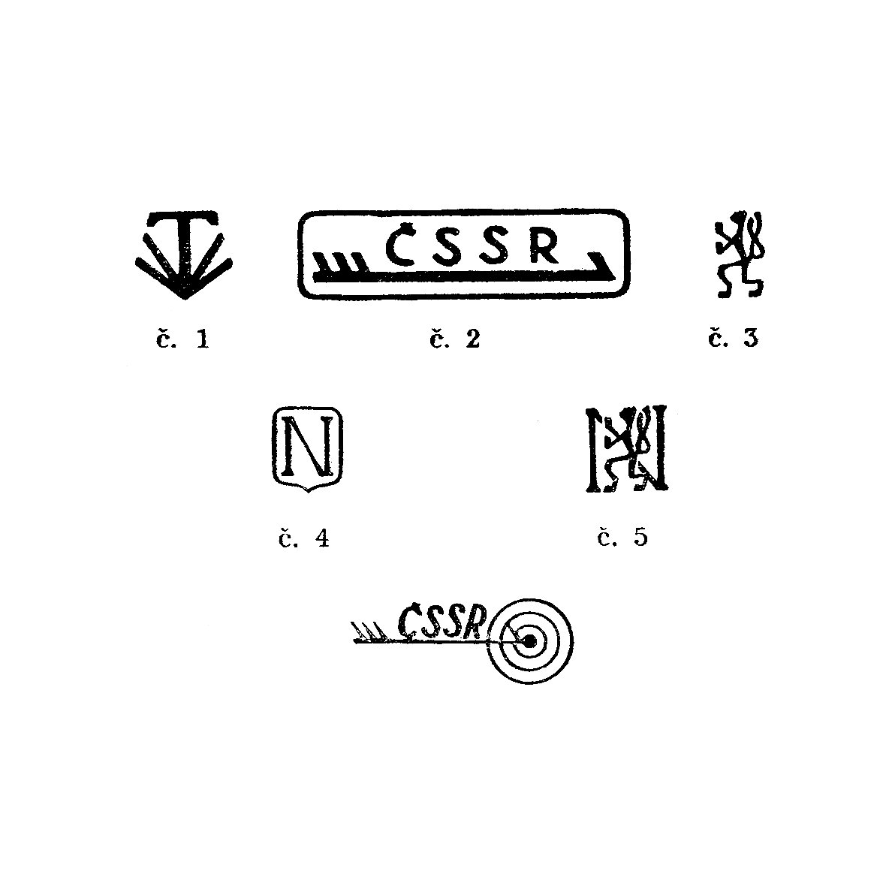

# § 4 Skúšobné značky

(1) Skúšobnú značku možno udeliť len zbraniam, strelivu a ich hlavným častiam, ktoré vyhoveli pri skúške vykonanej skúšobňou.

(2) Skúšobné značky sú:

(3) Skúšobnými značkami sa overujú:

značkou č. 1: expanzné prístroje a samostatne dodávané hlavne a závery k týmto zbraniam;

značkou č. 2: ručné plynové zbrane a strelivo pre tieto zbrane;

značkou č. 3: polotovary hlavní brokovníc;

značkou č. 4: brokovnice, flóbertky a ostatné zbrane na flóbertkové náboje, pušky pre streľbu v miestnostiach, pištole na brokové náboje alebo pre streľbu v miestnostiach a samostatne dodávané hlavne a závery k týmto zbraniam;

značkou č. 5: guľovnice, malokalibrovky, pištole a revolvery, s výnimkou druhov overovaných značkou č. 4, a samostatne dodávané hlavne a závery k týmto zbraniam;

značkou č. 4 i 5: pušky guľobrokové a samostatne dodávané hlavne a závery k týmto zbraniam;

značkou č. 6: náboje, nábojky a samostatne dodávané strely, nábojnice a zápalky.

(4) Balistické zbrane a ich samostatne dodávané hlavne a závery sa overujú skúšobnými značkami č. 1, 2, 4 alebo 5, prípadne č. 4 i 5, podľa toho, ktorému z ostatných druhov takto overovaných zbraní (hlavní, záverov) zodpovedá príslušná balistická zbraň (jej hlaveň, záver).

(5) Pri zbraniach sa skúšobná značka vyrazí na hlaveň a záver; tak isto sa vyrazí aj na samostatne dodávané hlavne a závery. Pri strelive a samostatne dodávaných strelách, nábojniciach a zápalkách sa skúšobná značka vytlačí na najmenšom spotrebiteľskom obale.

(6) Výška skúšobných značiek č. 3 a 4 je vždy 5 mm, výška značiek 1, 2 a 5 je 3 alebo 5 mm, podľa veľkosti hlavní a záverov.

(7) Výrobné, továrenské alebo obchodné značky na zbraniach, strelive a ich hlavných častiach sa nesmú podobať predpísaným skúšobným značkám.
