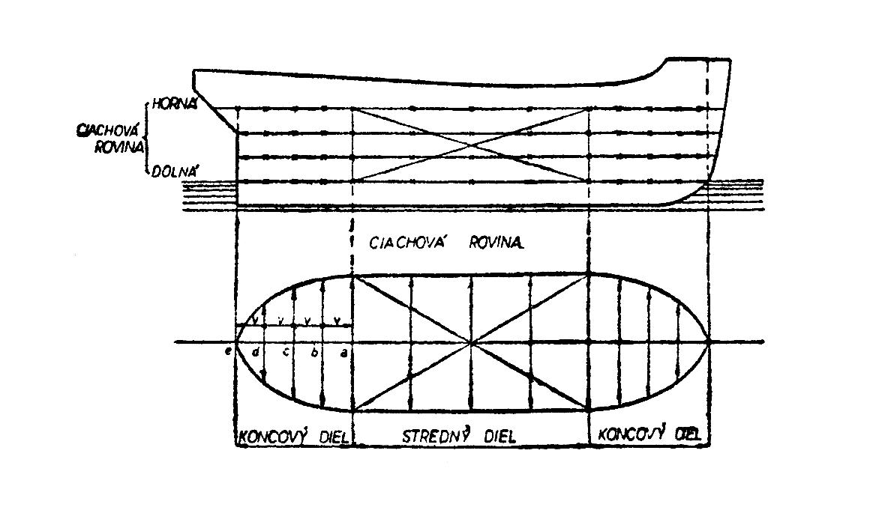
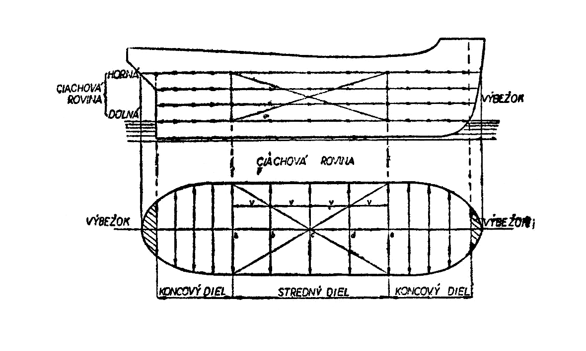

## Ciachovanie lodí, ktoré sú určené na dopravu tovaru

# § 4

(1) Na určenie objemu ciachového priestoru rozdelí sa tento priestor ponornými rovinami na ciachové vrstvy spravidla o výške 1 dm.

(2) Dvomi priečnymi rezmi, poloha ktorých sa spravuje podľa tvaru lode, vedenými kolmo k pozdĺžnej osi lode a k vodnej hladine, rozdelia sa roviny obmedzujúce ciachové vrstvy na koncové a stredné diely tak, aby stredné diely boli ohraničené približne priamkami. Koncové diely týchto rovín sú potom ohraničené krivkami. Dĺžka každého dielu týchto rovín rozdelí sa na 4 časti a v deliacich bodoch sa odmerajú ich šírky.

(3) Na výpočet plošného obsahu plôch obmedzených krivkami sa použije Simpsonovo pravidlo:

v/3 (1a + 4b + 2c + 4d + 1e). (Pozri obr. 1.)

Ostatné plochy sa vypočítavajú podľa lichobežníkového pravidla:

v (a/2 + b + c + d + e/2). (Pozri obr. 2.)

Pri stredných dieloch postačí súčin dĺžky a strednej šírky.

(4) Ak sú dĺžky koncových dielov jednotlivých ponorných rovín nerovnaké (obr. 2), môžu sa rozdeliť rovnakým spôsobom ako bola rozdelená najkratšia ponorná rovina, ktorou je obyčajne rovina ponoru prázdnej lode a najkrajnejšie výbežky na čele a korme lodi sa vypočítajú samostatne. Tieto najkrajnejšie výbežky nesmú byť dlhšie ako dĺžky časti priliehajúcich koncových dielov.

(5) Objem jednej ciachovej vrstvy sa rovná polovičnému súčtu plôch hornej a dolnej ponornej roviny, ohraničujúcich ciachovú vrstvu, násobenému výškou ciachovej vrstvy. Súčet ciachových vrstiev je potom objem ciachového priestoru.
