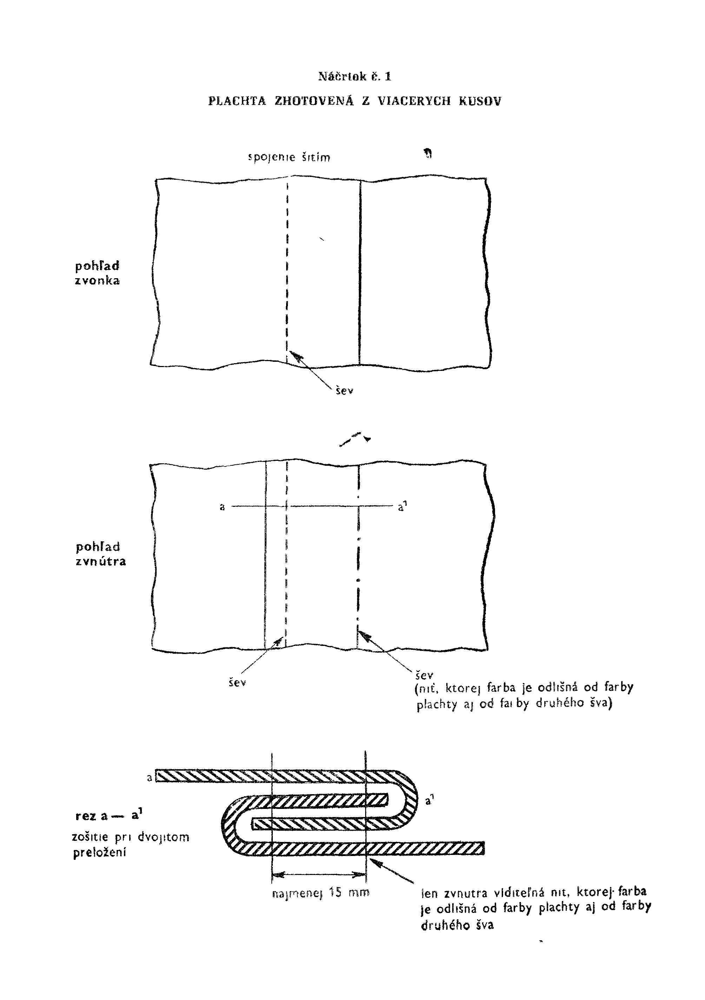
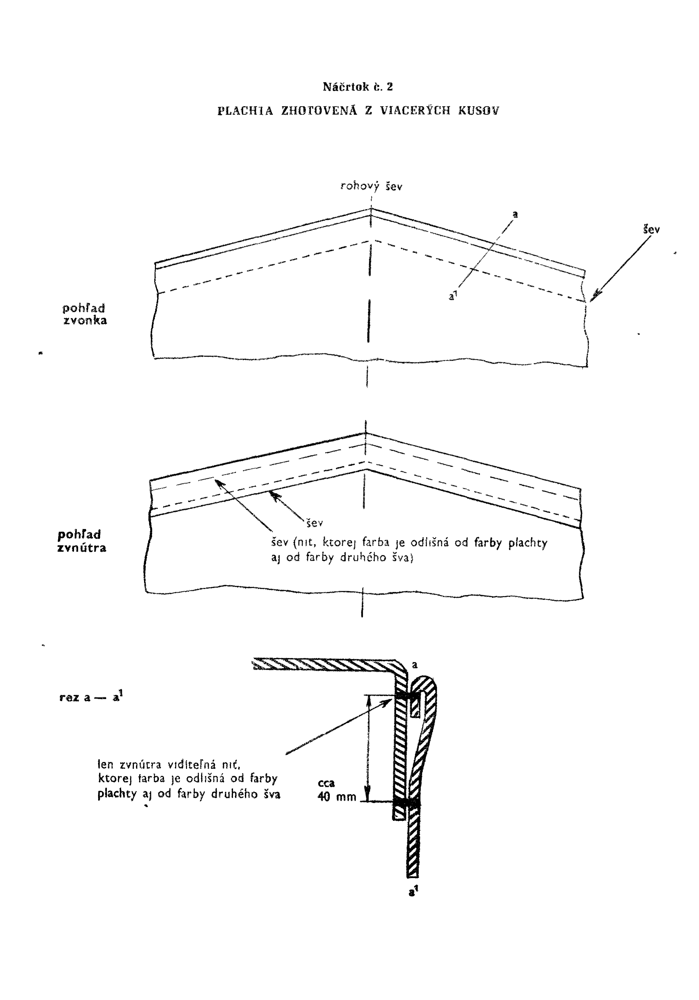
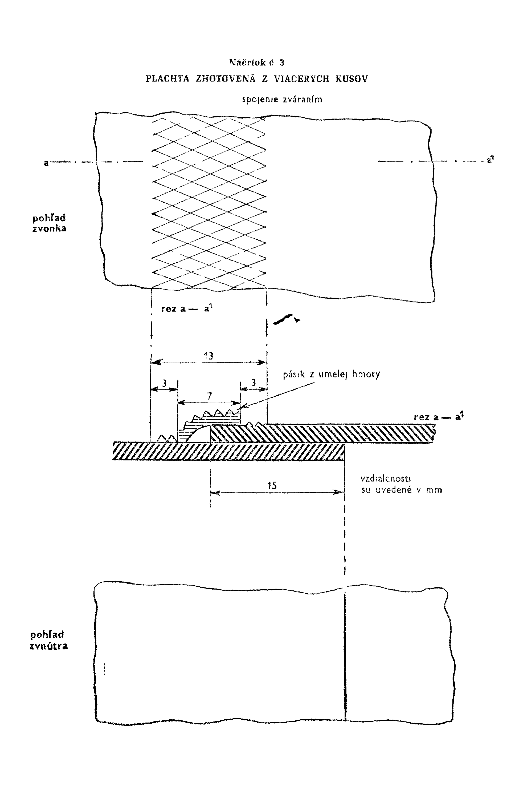
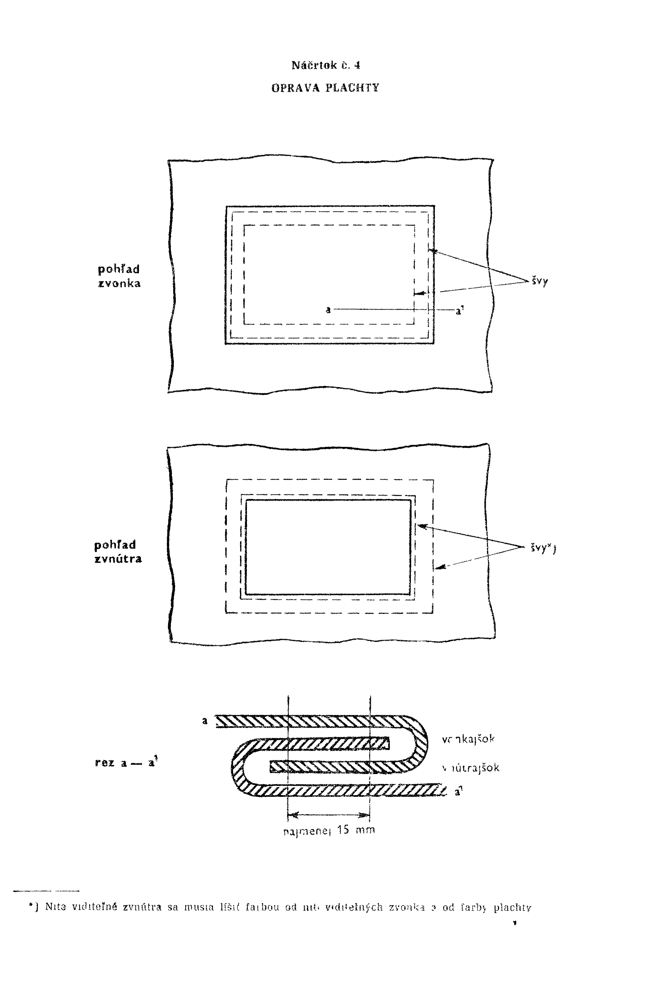
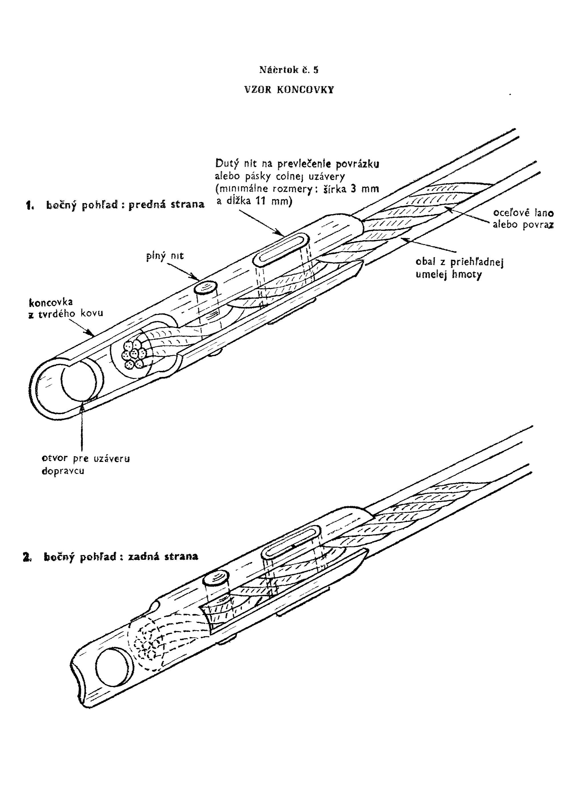

PRÍLOHA 4

- PORIADOK O TECHNICKÝCH PODMIENKACH PLATNÝCH PRE KONTEJNERY, KTORÉ SA MÔŽU SCHVÁLIŤ NA MEDZINÁRODNÚ PREPRAVU POD COLNOU UZÁVEROU

  - Článok 1 Hlavné zásady

    - Na medzinárodnú prepravu tovaru pod colnou uzáverou sa môžu schváliť len kontejnery konštruované a vybavené tak, aby

      - a) z colne uzavretej časti kontejnera nebolo možné tovar vybrať ani do nej vložiť bez zanechania viditeľných stôp vlámania alebo bez porušenia colnej uzávery;

      - b) bolo možné ľahko a účinne priložiť na ne colnú uzáveru;

      - c) nemali žiadny priestor na ukrytie tovaru;

      - d) všetky priestory, v ktorých sa môže umiestniť tovar, boli pri colnej prehliadke ľahko prístupné.

  - Článok 2 Konštrukcia kontejnerov

    - 1. Aby vyhovovali ustanoveniam článku 1 tohto Poriadku:

      - a) musia byť konštrukčné prvky kontejnera (steny, podlaha, dvere, strecha, stĺpiky, rámy, traverzy atď.) spojené takými zariadeniami, ktoré sa nedajú zvonka vybrať a opäť dať na miesto bez zanechania viditeľných stôp, alebo takými metódami, ktorými sa vytvorí celok, ktorý sa nemôže zmeniť bez zanechania viditeľných stôp. Ak sú steny, podlaha, dvere a strecha zhotovené z rôznych prvkov, musia zodpovedať rovnakým požiadavkám a byť dostatočne pevné;

      - b) dvere a všetky iné uzavieracie systémy (včítane kohútov, prielezových alebo postranných otvorov atď.) musia mať zariadenie umožňujúce priložiť colnú uzáveru. Je neprípustné, aby toto zariadenie bolo možné zvonka odstrániť a opäť dať na miesto bez zanechania viditeľných stôp, a aj dvere alebo uzáverové zariadenie otvoriť bez porušenia colnej uzávery. Toto zariadenie sa musí vhodným spôsobom chrániť. Strechy môžu mať otváracie otvory;

      - c) vetracie a výpustné otvory musia mať zariadenie, ktoré bráni prístupu do vnútra kontejnera. Toto zariadenie musí byť konštruované tak, aby sa nedalo zvonka odstrániť a opäť dať na miesto bez zanechania viditeľných stôp.

    - 2. Nehľadiac na ustanovenie článku 1 písm. c) tohto Poriadku, základné prvky kontejnera, ktoré z praktických dôvodov musia obsahovať prázdne priestory (napríklad dvojité steny medzi priečkami), sú prípustné. Aby sa tieto priestory nedali použiť na ukrytie tovaru:

      - i) vnútorné obloženie kontejnera musí byť pripevnené tak, aby sa nedalo odstrániť a opäť dať na miesto bez zanechania viditeľných stôp, alebo

      - ii) počet uvedených priestorov musí byť čo najmenší a tieto priestory musia byť ľahko prístupné pri colných prehliadkach.

  - Článok 3 Skladacie alebo rozoberateľné kontejnery

    - Skladacie alebo rozoberateľné kontejnery podliehajú ustanoveniam článkov 1 a 2 tohto Poriadku; okrem toho musia mať systém uzáverov, ktoré blokujú jednotlivé časti zmontovaného kontejnera. Ak sa tento systém uzáverov nachádza na vonkajších stranách kontejnera, musí byť zkonštruovaný tak, aby sa v prípade zmontovaného kontejnera dali na tento systém uzáverov priložiť colné uzávery.

  - Článok 4 Kontejnery kryté plachtou

    - 1. Kontejnery kryté plachtou musia vyhovovať podmienkam uvedeným v článkoch 1, 2 a 3 tohto Poriadku, pokiaľ sa tieto články môžu na ne vzťahovať, okrem toho musia byť v súlade s ustanoveniami tohto článku.

    - 2. Plachta musí byť vyrobená buď z pevného plátna, alebo z neroztiahnuteľnej a dostatočne pevnej tkaniny potiahnutej umelou hmotou alebo pogumovanej. Plachta musí byť v dobrom stave a zhotovená tak, aby po priložení uzavieracieho zariadenia nebol možný prístup k nákladu bez zanechania viditeľných stôp.

    - 3. Ak je plachta zhotovená z niekoľkých kusov, musia byť ich okraje prehnuté jeden do druhého a zošité dvoma švami vzdialenými od seba aspoň 15 mm. Tieto švy musia byť urobené podľa náčrtku č. 1, priloženého k tomuto Poriadku, ak sa však niektoré časti plachty (napr. zadná záložka a zosilnené rohy) nedajú takto spojiť, stačí prehnúť hornú časť a zošiť okraje, ako sa znázorňuje na náčrtku č. 2, priloženom k tomuto Poriadku. Jeden zo švov môže byť viditeľný zvnútra a farba nite použitej na tento šev sa musí zreteľne líšiť od farby plachty, ako aj od farby nite použitej na druhý šev. Všetky švy musia byť šité na stroji.

    - 4. Ak je plachta zhotovená z tkaniny potiahnutej umelou hmotou, a to z niekoľkých kusov, môžu sa tieto kusy spojiť aj zvarom podľa náčrtku č. 3, priloženého k tomuto Poriadku. Okraj jedného kusa musí prekrývať okraj druhého v šírke najmenej 15 mm. Spojenie kusov sa musí zabezpečiť po celej šírke. Vonkajší okraj spoja musí byť zakrytý páskou z umelej hmoty šírky najmenej 7 mm, ktorá musí byť tiež pripevnená zvarom. Na tejto páske, ako aj v šírke najmenej 3 mm na každej jej strane musí byť vyrytý jednotný a výrazný reliéf. Zvar sa musí urobiť tak, aby sa kusy nedali od seba oddeliť a opäť spojiť bez zanechania viditeľných stôp.

    - 5. Opravy treba robiť spôsobom znázorneným na náčrtku č. 4, priloženom k tomuto Poriadku, pričom okraje sa musia prehnúť jeden do druhého a spojiť dvoma viditeľnými švami vzdialenými od seba najmenej 15 mm; farba nite viditeľnej zvnútra sa musí líšiť od farby nite viditeľnej zvonku, ako aj od farby plachty; všetky švy sa musia šiť na stroji. Ak je nevyhnutné urobiť opravu poškodenej plachty na jej okrajoch, treba nahradiť zničenú časť jedným kusom a prišiť ho tiež podľa ustanovenia odseku 3 tohto článku a podľa náčrtku č. 1, priloženého k tomuto Poriadku. Opravy plachiet z tkaniny potiahnutej umelou hmotou možno tiež robiť spôsobom opísaným v odseku 4 tohto článku, ale v tom prípade sa musí zvar urobiť na obidvoch stranách plachty a záplata sa musí priložiť zvnútra.

      - 6.

      - a) Plachta musí byť ku kontejneru pripevnená presne v zhode s podmienkami určenými v článku 1 písm. a) a b) tohto Poriadku. Pripevňovanie sa musí zabezpečiť:

      - i) kovovými krúžkami pripevnenými na kontejner;

      - ii) šnurovacími dierkami na okraji plachty;

        - iii) viazacím prostriedkom prechádzajúcim cez krúžky nad plachtou a viditeľným zvonka po celej jeho dĺžke.

          - Plachta musí kryť pevné časti kontejnera na vzdialenosť najmenej 250 mm merané od stredu pripevňovacích krúžkov, okrem prípadov, keď už systém konštrukcie kontejnera bráni akémukoľvek prístupu k tovaru.

      - b) Ak je nevyhnutné, aby okraj plachty bol ku kontejneru trvale pripojený, musí byť spojenie súvislé a urobené pevnými prostriedkami.

    - 7. Vzdialenosť medzi krúžkami a medzi šnurovacími dierkami nesmie byť väčšia ako 200 mm. Šnurovacie dierky sa musia vystužiť.

    - 8. Ako viazacie prostriedky treba používať:

      - a) oceľové laná priemeru najmenej 3 mm; alebo

      - b) konopné alebo sisalové povrazy priemeru najmenej 8 mm, obalené plášťom z priehľadnej a nerozťažnej umelej hmoty. Laná môžu mať plášť z priehľadnej a nepružnej umelej hmoty.

    - 9. Každé lano alebo povraz musí byť z jedného kusa a mať koncovku z tvrdého kovu na obidvoch koncoch. Každá kovová koncovka sa musí pripevniť dutým nitom prechádzajúcim lanom alebo povrazom a umožňujúcim pretiahnuť viazací prostriedok colnej uzávery. Lano alebo povraz musí zostať viditeľný z obidvoch strán dutého nitu, aby bolo možné presvedčiť sa, že lano alebo povraz je skutočne z jedného kusa (pozri náčrtok č. 5, priložený k tomuto Poriadku).

    - 10. Na miestach, kde sú v plachte otvory slúžiace pri nakládke a vykládke, sa musia obidva okraje plachty dostatočne prekrývať. Ich uzavretie sa musí tiež zaistiť:

      - a) šitou alebo zváranou záložkou podľa odsekov 3 a 4 tohto článku;

      - b) krúžkami a šnurovacími dierkami vyhovujúcimi podmienkam uvedeným v odseku 7 tohto článku a

      - c) remienkom zhotoveným z jedného kusa vhodného nepružného materiálu, najmenej 20 mm širokým a 3 mm hrubým, prevlečeným krúžkami a spojujúcim obidva okraje plachty aj záložku; tento remienok musí byť pripevnený na vnútornej strane plachty a mať šnurovaciu dierku na lano alebo povraz uvedené v odseku 8 tohto článku. Ak existuje osobitné zariadenie (priečka a pod.) brániace prístupu k nákladu bez zanechania viditeľných stôp, nie je záložka potrebná.

    - 11. Identifikačné značky, ktoré musia byť na kontejneri uvedené podľa prílohy 1, ako aj schvaľovací štítok podľa prílohy 5 nesmú byť v žiadnom prípade zakryté plachtou.

  - Článok 5 Prechodné ustanovenia

    - Až do 1. januára 1977 bude dovolené používať koncovky zodpovedajúce náčrtku č. 5, priloženému k tomuto Poriadku, aj keď ich dutý nit skôr schváleného typu má otvor, ktorého rozmery sú menšie, ako rozmery na uvedenom náčrtku.

  - Náčrtok č.1

  - PLACHTA ZHOTOVENÁ Z VIACERÝCH KUSOV

- 

- Náčrtok č.2

- PLACHTA ZHOTOVENÁ Z VIACERÝCH KUSOV

- 

- Náčrtok č.3

- PLACHTA ZHOTOVENÁ Z VIACERÝCH KUSOV

- 

- Náčrtok č.4

- OPRAVA PLACHTY

- 

- Náčrtok č.5

- VZOR KONCOVKY

- 
