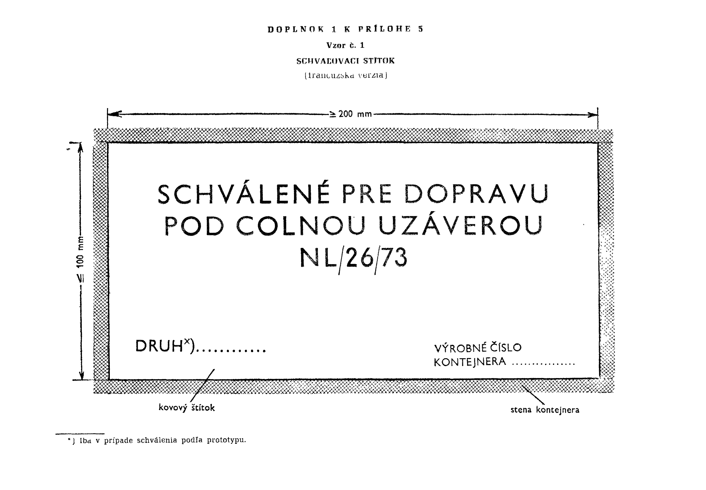
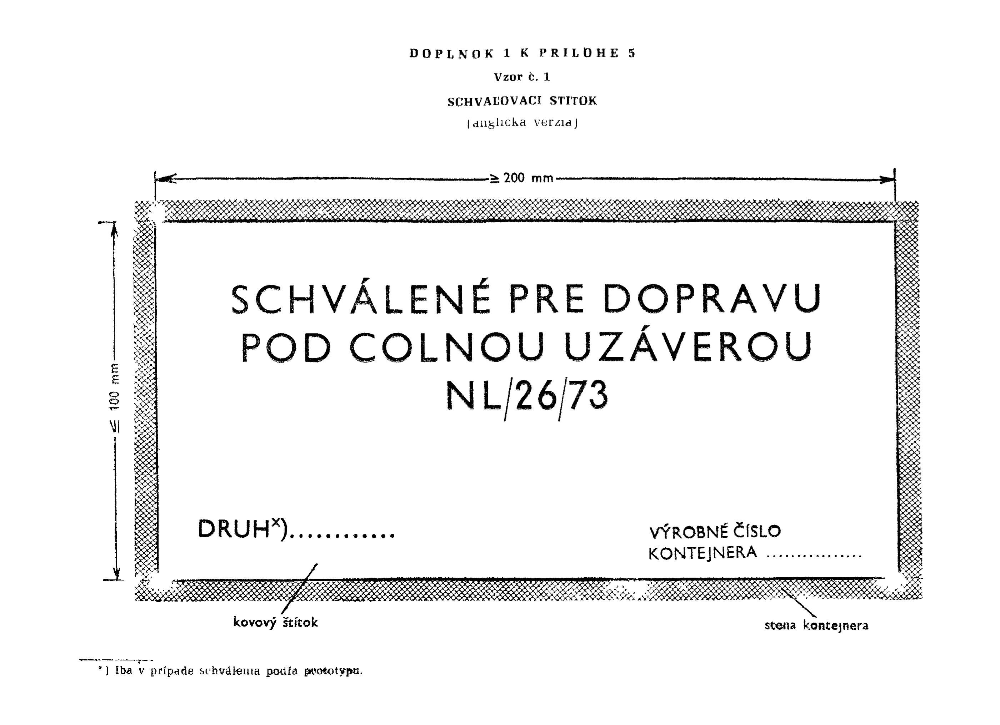

PRÍLOHA 5

- POSTUP PRI SCHVAĽOVANÍ KONTEJNEROV ZODPOVEDAJÚCICH TECHNICKÝM PODMIENKAM UVEDENÝM V PRÍLOHE 4

  - Všeobecné ustanovenia

  - 1. Kontejnery môžu byť schválené na dopravu tovaru pod colnou uzáverou:

    - a) buď na základe prototypu v priebehu jeho výroby (schvaľovanie vo výrobnom štádiu);

    - b) alebo po skončení výroby - jednotlivo alebo v určitom počte kontejnerov toho istého typu (schvaľovanie po skončení výroby).

      - Spoločné ustanovenia pre obidva spôsoby schválenia

  - 2. Príslušný schvaľovací orgán vydáva po schválení žiadateľovi platné schvaľovacie osvedčenie podľa daných okolností pre neobmedzený rad kontejnerov schváleného typu alebo pre určitý počet kontejnerov.

  - 3. Skôr, ako majiteľ schvaľovacieho osvedčenia použije schválený kontejner na dopravu tovaru pod colnou uzáverou, je povinný pripevniť naň schvaľovací štítok.

  - 4. Schvaľovací štítok musí byť trvale pripevnený na dobre viditeľnom mieste vedľa ďalšieho schvaľovacieho štítku vydaného na úradné účely.

  - 5. Schvaľovací štítok, zodpovedajúci vzoru č. 1, vyobrazenému v dodatku 1 tejto prílohy, tvorí kovová doštička rozmerov aspoň 20x10 cm. Na jej povrchu musia byť vyryté, vyrazené alebo iným trvale čitateľným spôsobom uvedené údaje najmenej vo francúzštine alebo angličtine:

    - a) nápis „Schválené pre dopravu pod colnou uzáverou“;

    - b) názov krajiny, v ktorej bol kontejner schválený, a to slovami alebo rozlišovacím znakom používaným na označenie krajiny pri registrácii cestných vozidiel v medzinárodnej cestnej doprave a číslo schvaľovacieho osvedčenia (číslice, písmená atď.), ako aj rok schválenia (napríklad „NL/26/73“ znamená: Holandsko, schvaľovacie osvedčenie č. 26, vydané v r. 1973);

    - c) poradové číslo kontejnera pridelené výrobcom (výrobné číslo);

    - d) ak kontejner bol schválený na základe prototypu, poznávacie čísla alebo písmená prototypu kontejnera.

  - 6. Ak kontejner už nevyhovuje technickým podmienkam požadovaným na jeho schválenie, musí byť pred svojím ďalším použitím na dopravu tovaru pod colnou uzáverou uvedený do stavu, v ktorom bol schválený, aby tak znovu vyhovoval týmto technickým podmienkam.

  - 7. Ak sa zmenia základné charakteristiky kontejnera, stráca jeho schválenie platnosť a kontejner musí byť príslušným orgánom opäť schválený skôr, ako môže byť použitý na dopravu tovaru pod colnou uzáverou.

    - Osobitné ustanovenia o schvaľovaní prototypu v priebehu jeho výroby

  - 8. Ak sa kontejnery vyrábajú sériove podľa toho istého konštrukčného typu, môže výrobca požiadať príslušný orgán krajiny výroby o ich schválenie na základe prototypu.

  - 9. Výrobca musí v svojej žiadosti uviesť poznávacie čísla alebo písmená, ktoré prideľuje typu kontejnera, o schválenie ktorého žiada.

  - 10. K tejto žiadosti sa musia pripojiť výkresy a podrobný opis konštrukcie typu kontejnera, ktorý sa má schváliť.

  - 11. Výrobca sa písomne zaväzuje:

    - a) predviesť príslušnému orgánu tie z kontejnerov daného typu, ktoré si tento orgán bude priať preskúmať;

    - b) umožniť príslušnému orgánu preskúmať ďalšie jednotky v priebehu sériovej výroby príslušného typu;

    - c) informovať príslušný orgán o každej zmene vo výkresoch alebo v opisoch konštrukcie, nehľadiac na dôležitosť takej zmeny, a to skôr, ako bude zavedená;

    - d) uviesť na viditeľnom mieste na kontejneroch okrem údajov určených pre schvaľovací štítok aj poznávacie čísla alebo písmená konštrukčného typu, ako aj poradové číslo každého kontejnera v sérii príslušného typu (výrobné číslo);

    - e) viesť evidenciu kontejnerov vyrobených podľa schváleného typu.

  - 12. Príslušný orgán prípadne určí, aké zmeny treba na prototype urobiť, aby sa mohol schváliť.

  - 13. Osvedčenie na prototyp nemožno vydať bez toho, že by príslušný orgán zistil prehliadkou jedného alebo viacerých kontejnerov vyrobených podľa tohto typu, že kontejnery tohto typu vyhovujú technickým podmienkam určeným v prílohe 4.

  - 14. V prípade schválenia prototypu kontejnera sa vydáva jedno vyhotovenie schvaľovacieho osvedčenia zhodného so vzorom č. II, uvedeným v dodatku 2 k tejto prílohe, a platného pre všetky kontejnery vyrobené zhodne so schváleným prototypom. Toto osvedčenie oprávňuje konštruktéra pripevňovať na každý kontejner typovej série schvaľovací štítok podľa vzoru opísaného v odseku 5 tejto prílohy.

    - Osobitné ustanovenia o schvaľovaní po ukončení výroby

  - 15. Ak sa o schválenie nepožiadalo v štádiu výroby, môže vlastník, užívateľ alebo zástupca niektorého z nich požiadať o schválenie príslušný orgán, ktorému môže niekto z nich predviesť jeden alebo viacej kontejnerov, o schválenie ktorých žiadajú.

  - 16. V každej žiadosti o schválenie podanej podľa ustanovení odseku 15 tejto prílohy treba uviesť poradové číslo (výrobné číslo) vyznačené výrobcom na každom kontejneri.

  - 17. Príslušný orgán prehliadne toľko kontejnerov, koľko uzná za potrebné, a ak zistí, že tento kontejner alebo tieto kontejnery vyhovujú technickým podmienkam uvedeným v prílohe 4, vydá schvaľovacie osvedčenie zhodné so vzorom č. III, uvedeným v dodatku 3 k tejto prílohe, a platné len pre počet schválených kontejnerov. Toto osvedčenie, v ktorom sa uvádza poradové číslo alebo čísla pridelené výrobcom kontejnera alebo kontejnerov, na ktoré sa osvedčenie vzťahuje, oprávňuje žiadateľa pripevniť na každý schválený kontejner schvaľovací štítok podľa odseku 5 tejto prílohy.

- DOPLNOK 1 K PRÍLOHE 5

- Vzor č. 1

- SCHVAĽOVACÍ ŠTÍTOK

- (francúzska verzia)

- 

- DOPLNOK 1 K PRÍLOHE 5

- Vzor č. 1

- SCHVAĽOVACÍ ŠTÍTOK

- (francúzska verzia)

- 

- DODATOK 2 K PRÍLOHE 5

- VZOR č. II

- COLNÝ DOHOVOR O KONTEJNEROCH, 1972

- Schvaľovacie osvedčenie prototypu kontejnera

1. Číslo osvedčenia*) ...........................................

2. Potvrdzuje sa, že nižšie opísaný prototyp bol schválený a že kontejnery vyrobené podľa tohto typu sa môžu použiť na dopravu tovaru pod colnou uzáverou.

3. Druh kontejnera ..............................................

4. Poznávacie čísla alebo písmená prototypu .....................

5. Poznávacie čísla konštrukčných výkresov ......................

6. Poznávacie číslo opisu konštrukcie ...........................

7. Vlastná váha .................................................

8. Vonkajšie rozmery v cm .......................................

9. Základné údaje o konštrukcii (druh materiálov, spôsob konštrukcie atď.) ............................................

..............................................................

..............................................................

10. Toto osvedčenie platí pre všetky kontejnery vyrobené podľa vyššie uvedených výkresov a opisu konštrukcie.

11. Vydal ........................................................ (názov a adresa výrobcu)

ktorý je oprávnený pripevniť schvaľovací štítok na každý ním vyrobený kontejner schváleného typu.

V ..................... dňa ....................... 19 ......

(miesto) (dátum)

................................................................. (podpis a pečiatka organizácie alebo vydávajúceho orgánu)

DÔLEŽITÉ UPOZORNENIE

(odseky 6 a 7 prílohy 5 Colného dohovoru o kontejneroch, 1972)

6. Ak kontejner už nevyhovuje technickým podmienkam vyžadovaným na jeho schválenie, musí sa pred svojím ďalším použitím na dopravu tovaru pod colnou uzáverou uviesť do stavu, v ktorom bol schválený, aby tak opäť vyhovoval týmto technickým podmienkam.

7. Ak sa zmenia základné charakteristiky kontejnera, stratí jeho schválenie platnosť a kontejner musí príslušný orgán opäť schváliť skôr, ako sa môže použiť na dopravu tovaru pod colnou uzáverou.

DODATOK 3 K PRÍLOHE 5

VZOR č. III

COLNÝ DOHOVOR O KONTEJNEROCH, 1972

Schvaľovacie osvedčenie výrobne dokončeného kontejnera

1. Číslo osvedčenia*) ...........................................

2. Potvrdzuje sa, že nižšie uvedený (-é) kontejner (-y) bol (-i) schválený (-é) na dopravu tovaru pod colnou uzáverou.

3. Druh kontejnera (-ov) ........................................

4. Poradové číslo (-a) kontejneru (-ov), pridelené výrobcom .....

5. Vlastná váha .................................................

6. Vonkajšie rozmery v cm .......................................

7. Základné údaje o konštrukcii (druh materiálov, spôsob konštrukcie atď.) ............................................

..............................................................

8. Vydal ........................................................ (meno a adresa žiadateľa)

ktorý je oprávnený pripevniť schvaľovací štítok na vyššie uvedený (-é) kontejner (-y)

V ............................ dňa ...................... 19 ..... (podpis a pečiatka organizácie alebo vydávajúceho orgánu)

DÔLEŽITÉ UPOZORNENIE

(odseky 6 a 7 prílohy 5 k Colnému dohovoru o kontejneroch, 1972)

6. Ak kontejner už nevyhovuje technickým podmienkam vyžadovaným na jeho schválenie, musí sa pred svojím ďalším použitím na dopravu tovaru pod colnou uzáverou uviesť do stavu, v ktorom bol schválený, aby tak vyhovoval týmto technickým podmienkam.

7. Ak sa zmenia základné charakteristiky kontejnera, stratí jeho schválenie platnosť a kontejner musí príslušný orgán opäť schváliť skôr, ako sa môže použiť na dopravu tovaru pod colnou uzáverou.
