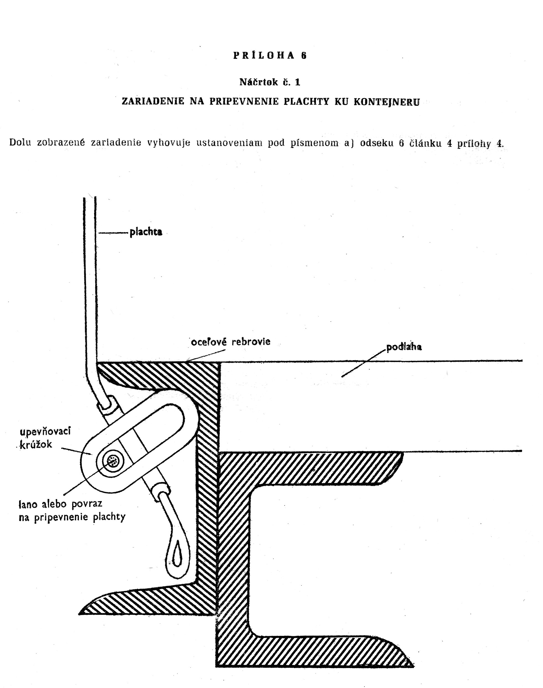
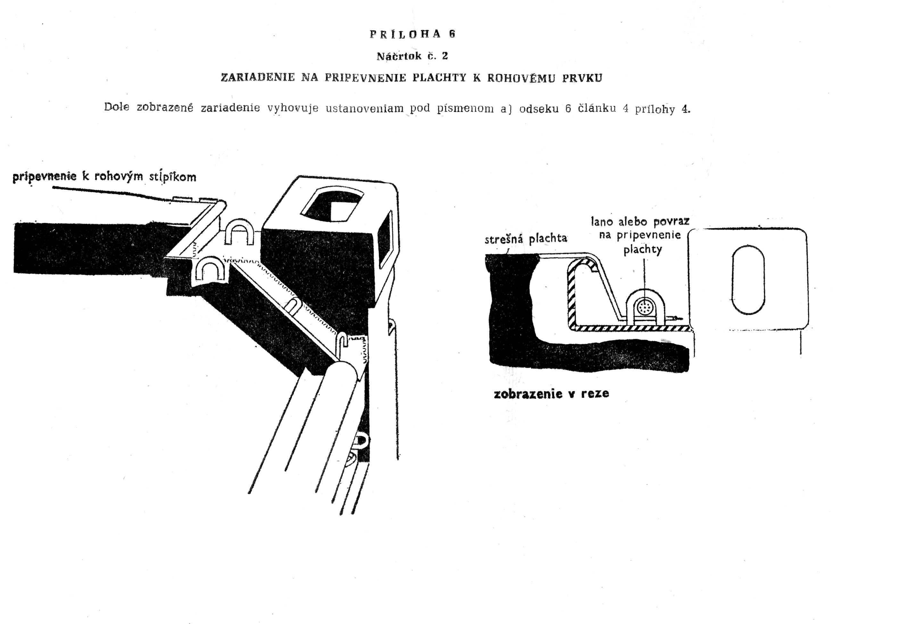
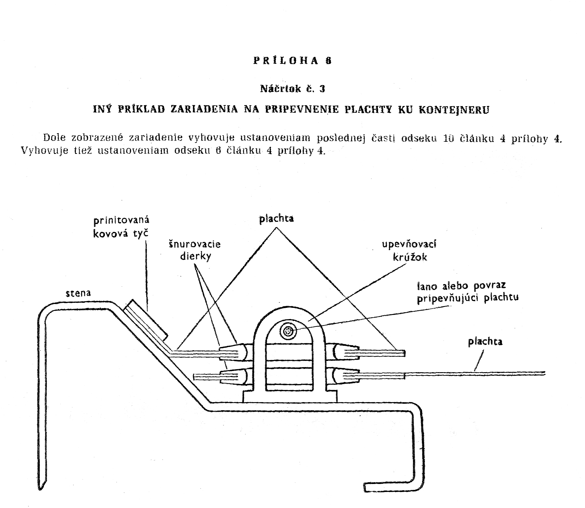

PRÍLOHA 6

- VYSVETLIVKY

  - ÚVOD

  - i) V súlade s ustanovením článku 13 tohto dohovoru podávajú vysvetlivky výklad niektorých ustanovení tohto dohovoru a jeho príloh.

  - ii) Vysvetlivkami sa nemenia ustanovenia dohovoru alebo jeho príloh; spresňuje sa nimi len ich obsah, význam a dosah.

  - iii) So zreteľom na zásady určené ustanoveniami článku 12prílohy 4 tohto dohovoru pre schvaľovanie kontejnerov na dopravu pod colnou uzáverou spresňujú vysvetlivky v prípadoch, keď je to možné, konštrukčné metódy, ktoré majú zmluvné strany prijímať v zhode s týmito ustanoveniami. Uvádzajú tiež prípadné konštrukčné metódy, ktoré týmto ustanoveniam nevyhovujú.

  - iv) Vysvetlivky umožňujú vykonávať ustanovenia dohovoru a jeho príloh v súlade s technickým rozvojom a požiadavkami hospodárskeho charakteru.

    - 0. ZÁKLADNÝ TEXT DOHOVORU

    - 0.1. Článok 1

      - Písmeno c) i) -Čiastočne uzavreté kontejnery

    - 0.1. c) i) - 1 V zmysle písmena c) i) článku 1 použitý výraz „kontejnery tvoriace celkom alebo čiastočne uzavretý priestor“ znamená zariadenie skladujúce sa obyčajne z podlahy a z hornej konštrukcie, ktorou sa vymedzuje ložný priestor rovnajúci sa ložnému priestoru uzavretého kontejnera. Horná konštrukcia sa obyčajne skladá z kovových prvkov tvoriacich kostru kontejnera. Tieto typy kontejnerov môžu tiež mať jednu alebo viacej bočných alebo čelných stien. Niektoré z týchto kontejnerov majú len strechu spojenú s podlahou zvislými stĺpikmi. Kontejnery tohto typu sa používajú najmä na dopravu objemného tovaru (napr. osobných automobilov).

      - Písmeno d) - Príslušenstvo a výstroj kontejnera

    - 0.1. c) - 1 Výraz „príslušenstvo a výstroj kontejnera“ zahŕňa najmä tieto zariadenia, aj keď sú snímateľné:

      - a) výstroj, ktorého účelom je kontrolovať, meniť alebo udržiavať teplotu vnútri kontejnera;

      - b) malé prístroje (zapisovače teploty alebo nárazov a pod.), ktoré udávajú alebo zaznamenávajú okolité podmienky a nárazy;

      - c) vnútorné priečky, palety, priehradky, podpery, háčiky a iné podobné zariadenia na uloženie tovaru.

    - 4. PRÍLOHA 4

    - 4.2. Článok 2

      - Odsek 1 pododsek a) - Montáž konštrukčných prvkov

      - 4.2.1.

      - a) - 1 a) Ak sa použijú spojovacie súčasti (nity, skrutky, svorníky, matice atď.), musia sa tieto súčasti v dostatočnom počte umiestniť zvonka, prechádzať spojenými prvkami a vyčnievať dovnútra a tam spoľahlivo pripevniť (napr. prinitovať, zvariť, dať krúžky, priskrutkovať a prinitovať alebo privariť k matici skrutky). Obyčajné nity (t.j. také, na priloženie ktorých treba zásah z obidvoch strán spojovaných prvkov) však možno prikladať aj zvnútra. Pritom však podlaha kontejnerov sa môže pripevniť samoreznými skrutkami, nitmi prikladanými pomocou výbušnej nálože alebo samopriechodnými nitmi priloženými zvnútra a prechádzajúcimi v pravom uhle podlahou a spodnými kovovými traverzami s podmienkou, že pri použití samorezných skrutiek budú niektoré z ich koncov vyčnievať nad vonkajší povrch traverz alebo budú k nim privarené.

      - b) Príslušný orgán určí počet a druh spojovacích súčastí, ktoré musia vyhovovať podmienkam písmena a) tejto vysvetlivky, pričom sa tento orgán musí presvedčiť, že takto spojené konštrukčné prvky nemožno premiestniť bez zanechania viditeľných stôp. Voľba a umiestnenie iných spojovacích súčastí nie sú nijak obmedzené.

      - c) Spojovacie súčasti, ktoré možno bez zanechania viditeľných stôp odstrániť a vymeniť zásahom z jednej strany, t. j. bez toho, aby bolo treba zasiahnuť z obidvoch strán spojovaného prvku, nie sú v zmysle písmena a) tejto vysvetlivky prípustné. Ide najmä o výbušné nity, slepé nity a pod.

      - d) Vyššie opísané spôsoby montáže platia aj pre špeciálne kontejnery, napr. pre izotermické kontejnery, chladiace kontejnery a cisternové kontejnery, pokiaľ tieto spôsoby nie sú nezlučiteľné s technickými predpismi, ktorým tieto kontejnery musia vyhovovať so zreteľom na ich použitie. Ak sa z technických dôvodov nedajú upevniť konštrukčné prvky spôsobom opísaným pod písmenom a) tejto vysvetlivky, môžu sa tieto konštrukčné prvky spojiť spojovacími súčasťami uvedenými pod písmenom c) tejto vysvetlivky, pokiaľ spojovacie súčasti použité na vnútornej strane steny nie sú prístupné z vonkajšej strany.

        - Odsek 1 písmeno b) - Dvere a iné uzavieracie systémy

    - 4.2.1. b) - 1

      - a) Zariadenie umožňujúce prikladať colné uzávery musí:

      - i) byť pripevnené zváraním alebo aspoň pomocou dvoch spojovacích súčastí vyhovujúcich ustanoveniam písmena a) vysvetlivky 4.2.1. a) - 1 alebo

      - ii) byť konštruované tak, aby sa po uzavretí a zaplombovaní kontejnera nemohlo odstrániť bez zanechania viditeľných stôp; alebo

  - iii) mať otvory priemeru aspoň 11 mm alebo prierezy dlhé aspoň 11 mm a široké 3 mm.

    - b) Kĺbové a nasadzovacie závesy, závesné čapy a iné zariadenia na zavesenie dverí a podobné prvky musia byť pripevnené podľa ustanovení písmena a) tejto vysvetlivky. Okrem toho rôzne súčasti takých závesných zariadení (napr. osi alebo drieky závesov alebo čapov) sa musia zamontovať tak, aby sa nedali bez zanechania viditeľných stôp odstrániť alebo demontovať, ak je kontejner uzavretý a je na ňom colná uzávera. Ak však závesné zariadenie nie je prístupné zvonka, stačí, aby dvere, ktoré boli uzavreté a na ktorých je colná uzávera, nemohli byť z neho vybraté bez zanechania viditeľných stôp. Ak dvere alebo uzavierací systém majú viac ako dva závesy, musia byť len dva z nich, ktoré sú najbližšie ku koncom dverí, pripevnené podľa ustanovenia vyššie uvedeného písmena a) i).

    - c) Kontejnery s veľkým počtom takých uzáverov, ako sú záklopky, kohúty, prielezy, príruby atď., musia byť upravené tak, aby počet colných uzáver mohol byť čo najmenší. Na tento účel sa musia susedné uzávery spojiť spoločným zariadením vyžadujúcim len jednu colnú uzáveru alebo sa musí dať na ne kryt vyhovujúci tomu istému účelu.

    - d) Kontejnery s otváracou strechou musia byť konštruované tak, aby počet colných uzáver mohol byť čo najmenší.

      - Odsek 1 písmeno c) - Vetracie otvory

      - 4.2.1. c) - 1

    - a) Ich najväčší rozmer nesmie byť v zásade väčší ako 400 mm.

    - b) Otvory, ktoré by umožňovali priamy prístup k tovaru, sa musia nahradiť kovovým pletivom alebo dierkovanou kovovou doskou (najväčší rozmer dier: 3 mm v obidvoch prípadoch) a chrániť privarenou kovovou mriežkou (najväčší rozmer ôk: 10 mm).

    - c) Otvory neumožňujúce priamy prístup k tovaru (napr. pri kolenových alebo priečkových systémoch) musia mať rovnaké zariadenia, ale diery a oká môžu byť veľké až 10 a 20 mm.

    - d) Ak sú otvory zhotovené v plachtách, vyžadujú sa v zásade zariadenia uvedené pod písmenom b) tejto vysvetlivky. Prípustné však sú uzáverové systémy zhotovené z dierkovanej kovovej dosky umiestnenej zvonka a z kovového pletiva alebo z pletiva z iného materiálu pripevneného zvnútra.

      - Odsek 1 písmeno c) - Výtokové otvory

      - 4.2.1. c) - 2

    - a) Ich najväčší rozmer nesmie byť v zásade väčší ako 35 mm.

    - b) Otvory umožňujúce priamy prístup k tovaru musia mať zariadenia uvedené pod písmenom b) vysvetlivky 4.2.1. c) - 1, týkajúcej sa vetracích otvorov.

    - c) Ak výtokové otvory neumožňujú priamy prístup k tovaru, nevyžadujú sa zariadenia uvedené pod písmenom b) tejto vysvetlivky za predpokladu, že otvory majú spoľahlivý priečkový systém, ľahko prístupný zvnútra kontejnera.

      - 4.4. Článok 4

      - Odsek 3 - Plachty zhotovené z niekoľkých kusov

      - 4.4.3 - 1

    - a) Jednotlivé kusy tej istej plachty môžu byť vyrobené z rôznych materiálov, vyhovujúcich ustanoveniam odseku 2 článku 4 prílohy 4.

    - b) Pri zhotovovaní plachty je prípustné akékoľvek usporiadanie kusov, ktoré dostatočne zaisťuje bezpečnosť, s podmienkou, že kusy sú spojené zhodne s ustanoveniami článku 4 prílohy 4.

      - Odsek 6 písmeno a)

      - 4.4.6. a) - 1

        - Na náčrtkoch č. 1, 2 a 3, pripojených k tejto prílohe, sú uvedené príklady vyhovujúcich zariadení na pripevnenie plachty ku kontejneru a systému pripevnenia plachiet k rohovým prvkom kontejnera z colného hľadiska.

        - Odsek 8 - Uzáverové laná s textilným jadrom

      - 4.4.8 - 1

        - Na účely tohto odseku sú prípustné laná obsahujúce textilné jadro obalené šiestimi prameňmi oceľových drôtov s podmienkou, že priemer týchto lán je najmenej 3 mm (nepočítajúc do toho prípadný plášť z priehľadnej umelej hmoty).

        - Odsek 10 písmeno c) - Remienky plachiet

      - 4.4.10 c) - 1

        - Na zhotovenie remienkov sa môže použiť tento materiál:

    - a) koža,

    - b) textílie, a to aj pogumované tkaniny alebo tkaniny potiahnuté umelou hmotou, s podmienkou, že po pretrhnutí sa nemôžu zvariť alebo spojiť bez zanechania viditeľných stôp.

      - 4.4.10 c) - 2

        - Zariadenie vyobrazené na náčrtku č. 3, pripojenom k tejto prílohe, vyhovuje ustanoveniam poslednej časti odseku 10 článku 4 prílohy 4. Vyhovuje tiež ustanoveniam pod písmenom a) odseku 4 prílohy 4.

      - 5. PRÍLOHA 5

      - 5.1. Odsek 1 - Schválenie spojených kontejnerov krytých plachtou

      - 5.1.1. Ak dva kontejnery kryté plachtou a schválené na dopravu pod colnou uzáverou sú spojené tak, že tvoria jediný kontejner krytý jedinou plachtou a vyhovujúci podmienkam dopravy pod colnou uzáverou, nevyžaduje sa pre tento celok osobitné schvaľovacie osvedčenie ani osobitný schvaľovací štítok.

- Náčrtok č.1

- ZARIADENIE NA PRIPEVNENIE PLACHTY KU KONTAJNERU

- Dolu zobrazené zariadenie vyhovuje ustanoveniam pod písmenom a) odseku 6 článku 4 prílohy 4.

- 

- Náčrtok č.2

- ZARIADENIE NA PRIPEVNENIE PLACHTY K ROHOVÉMU PRVKU

- Dolu zobrazené zariadenie vyhovuje ustanoveniam pod písmenom a) odseku 6 článku 4 prílohy 4.

- 

- Náčrtok č.3

- INÝ PRÍKLAD ZARIADENIa NA PRIPEVNENIE PLACHTY KU KONTAJNERU

- Dolu zobrazené zariadenie vyhovuje ustanoveniam poslednej časti odseku 10 článku 4 prílohy 4. Vyhovuje tiež ustanoveniam odseku 6 článku 4 prílohy 4.

- 
