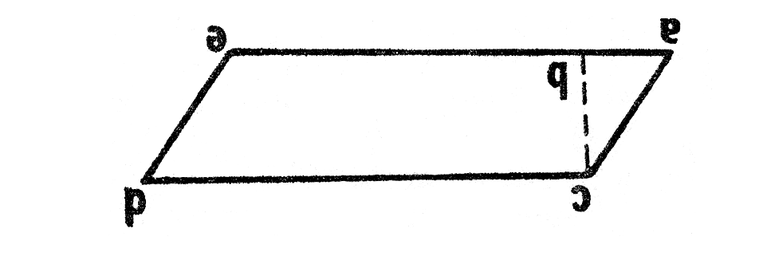

## Štvrtý oddiel

## Výrobky priemyslu celulózy a papiera

# § 30 Návrh zmluvy

(1) V návrhu zmluvy (objednávke) uvedie odberateľ

- a) označenie výrobku príslušnou položkou jednotnej klasifikácie výrobkov v slovnom a číselnom znení,3)

- b) názov výrobku podľa technických noriem,

- c) bližšie údaje o akosti alebo o požadovaných vlastnostiach, pokiaľ nie sú určené technickými normami,

- d) údaj o tom, či sa dodávka uskutoční podľa predložených vzoriek, výkresov alebo podľa inej technickej dokumentácie, a údaj o ich množstve, veľkosti a rozsahu, alebo či sa dodávka uskutoční podľa spôsobu uskutočnenia predchádzajúcej dodávky. Pokiaľ sa nedojedná niečo iné, je predložená vzorka výrobku záväzná iba na posúdenie rozmerov výrobkov a hrúbky použitého materiálu.

(2) Ako bližšie údaje o akosti a o požadovaných vlastnostiach uvedie odberateľ v návrhu zmluvy (objednávke) najmä

- a) pri vlákninách - základné kvalitatívne parametre podľa príslušných technických noriem alebo dohodnutých technických podmienok,

- b) pri papieroch, kartónoch a lepenkách (aj zošľachtených)

  - 1. požadované rozmery a spôsob vyhotovenia: či sa výrobky majú dodať v kotúčoch, kotúčikoch (bobinách), listoch alebo hárkoch, pri kotúčoch a kotúčikoch požadovaný rozmer, šírku a svetlosť dutinky; pri hárkoch, či sa výrobky majú dodať ploché či skladané; pri diagonálne obrezaných papieroch sa musia pri určovaní veľkosti udávať rozmery a-b, b-c, c-d podľa tohto nákresu:

  - 

  - 2. požadovanú farbu,

  - 3. údaj o hrúbke (kalibre)

  - pri papieroch pre elektrotechniku (kondenzátorové, káblové papiere),

  - pri papieroch pre izolanty (gumové a rúrkové papiere) a pri tesniacich papieroch,

  - pri všetkých ručných lepenkách okrem bielej, hnedej a sivej,

  - pri žakárovej, lesklej obyčajnej, lesklej pre elektrotechniku a drážkovanej lepenke,

  - 4. údaj o plošnej hmotnosti v g/m2 pri všetkých papieroch, kartónoch a lepenkách (aj zošľachtených),

  - 5. údaj o glejení a nasiakavosti,

  - 6. údaj o tom, či papier má byť v priehľade ryhovaný, rebrovaný (verge) alebo nerebrovaný (velin) a aký má mať povrch (nehladený, strojovo hladený, jednostranne hladký, hladený, ostro hladený),

  - 7. údaj o tom, či sa má papier dodatočne obrezať (hobľovať),

- c) pri výrobkoch z kartónov a lepeniek

  - 1. požadované rozmery, ktoré treba uvádzať v milimetroch (pokiaľ nie je uvedené inak, rozumejú sa nimi vnútorné rozmery); pri hranatej kartonáži sa musia rozmery uvádzať v tomto slede: dĺžka, šírka, výška, prípadne výška veka; pri vinutej kartonáži a pri trubiciach vnútorná výška, priemer a hrúbka steny; pri prírezoch z vlnitej lepenky znamená prvý údaj rozmer v smere vlny,

  - 2. požadovaný druh, akosť a farbu materiálu,

  - 3. pri výrobkoch s tlačou predlohu tlače s textom, s určením počtu a druhov farieb (odtieňov) a s udaním, kde sa má tlač umiestniť,

  - 4. prípadne iné osobitné vlastnosti, najmä vzhľadom na spôsob použitia.
