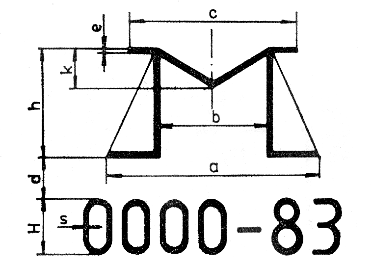
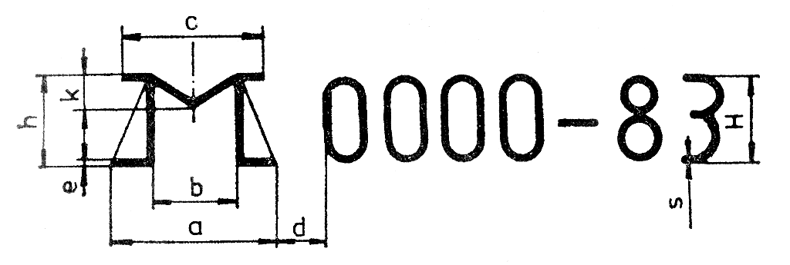
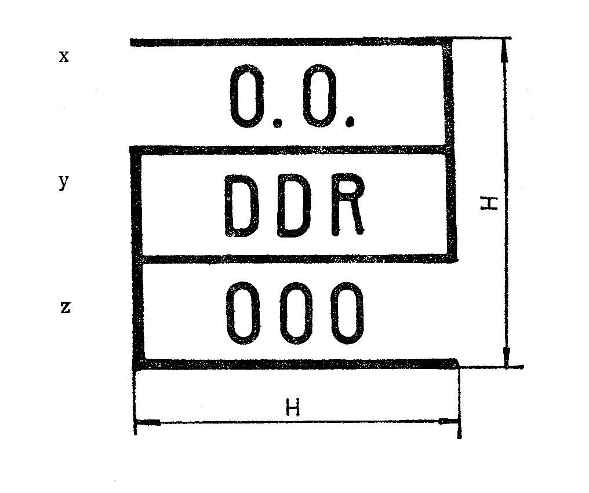
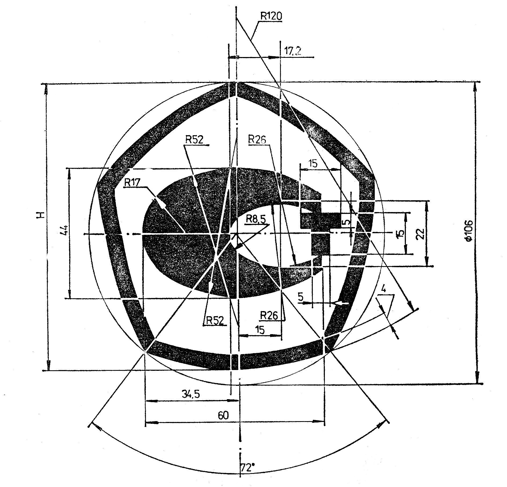
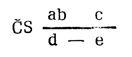

Príloha

- INFORMÁCIE O ZNAČKÁCH SCHVÁLENIA TYPOV MERADIEL ČLENSKÝCH ŠTÁTOV RVHP

  - 1. Tvar a rozmery značky schválenia typu meradiel Bulharskej ľudovej republiky.

  - Grafická úprava značky zodpovedá obr.1 a 2

- 

  - Obr.1

- Por. čís. | Menovité rozmery, mm | | | | | | | |

- | a | b | h | c | k | e | H | s | d

- 1 | 10 | 5 | 5 | 7,8 | 1,8 | 0,25 | 2,5 | 0,25 | 1,8

- 2 | 14 | 7 | 7 | 9,8 | 2,4 | 0,35 | 3,5 | 0,35 | 2,5

- 3 | 20 | 10 | 10 | 16,0 | 3,4 | 0,5 | 5,0 | 0,5 | 3,5

- 4 | 28 | 14 | 14 | 22,4 | 4,8 | 0,7 | 7,0 | 0,7 | 5,0

- 5 | 40 | 20 | 20 | 32,0 | 6,8 | 1,0 | 10,0 | 1,0 | 7,0

- 6 | 56 | 28 | 28 | 44,8 | 9,5 | 1,4 | 14,0 | 1,4 | 10,0

- 7 | 80 | 40 | 40 | 64,0 | 13,6 | 2,0 | 20,0 | 2,0 | 14,0

- 

  - Obr. 2

- Por. čís. | Menovité rozmery, mm | | | | | | | |

- | a | b | h | c | k | e | H | s | d

- 1 | 10 | 5 | 5 | 7,8 | 1,8 | 0,5 | 5 | 0,5 | 3,0

- 2 | 14 | 7 | 7 | 9,8 | 2,4 | 0,7 | 7 | 0,7 | 4,2

- 3 | 20 | 10 | 10 | 16,0 | 3,4 | 1,0 | 10 | 1,0 | 6,0

- 4 | 28 | 14 | 14 | 22,4 | 4,8 | 1,4 | 14 | 1,4 | 8,4

- 5 | 40 | 20 | 20 | 32,0 | 6,8 | 2,0 | 20 | 2,0 | 12,0

  - 2. Informácie o značke vykonania typových skúšok meradiel Maďarskej ľudovej republiky. Značka vykonania typových skúšok meradiel MĽR sa skladá z písmenovo-číselného označenia obsahujúceho:

  - písmená Th a štyri číslice pre meradlá, ktoré podliehajú povinnému overeniu; písmeno T a štyri číslice pre meradlá, ktoré nepodliehajú povinnému overeniu.

  - 3. Tvar a rozmery značky schválenia typu meradiel Nemeckej demokratickej republiky. Menovité rozmery H sa volia z radu: 8; 12; 25; 40 mm.

  - Grafická úprava a spôsob zostrojenia značky zodpovedá obr.3.

- 

  - x - poradové číslo meranej veličiny

  - y - skratka pre Nemeckú demokratickú republiku

  - z - registračné číslo

  - Obr.3

  - 4. Informácie o značke schválenia typu meradiel Poľskej ľudovej republiky. Značka schválenia typu meradiel PĽR sa skladá z písmenovo-číselného označenia a obsahuje 3 časti

  - PRL - skratka názvu štátu

  - T - skratka slova „typ“

  - písmenovo-číselné alebo číselné označenie typu

  - Dve prvé časti značky schválenia typu sú spoločné pre všetky meradlá, tretia časť obsahuje označenie typu meradiel.

  - Prvá časť značky sa píše kurzívou a ostatné obyčajným písmom. Veľkosť značky schválenia typu sa neurčuje.

  - Príklady značky schválenia typu niektorých typov meradiel PĽR:

  - PRL T A14 - sklonné analytické váhy so vstavaným závažím a so stálym zaťažením;

  - PRL T 302 - kompenzátor jednosmerného prúdu

  - 5. Tvar a rozmery značky schválenia typu meradiel Zväzu sovietskych socialistických republík. Menovité rozmery H sa volia z radu: 2,5; 4; 6; 10; 16; 25; 40; 60; 100 mm. Grafická úprava a spôsob zostrojenia značky pre rozmer H = 100 mm zodpovedá údajom na obr.4.

- 

  - Obr.4

  - 6. Informácie o značke schválenia typu meradiel Československej socialistickej republiky. Značka schválenia typu meradiel ČSSR sa skladá z písmenovo-číselného označenia v podobe

- 

  - kde: ČS - písmenové označenie názvu štátu;

  - a - číselné označenie oblasti merania;

  - b - číselné označenie meranej veličiny;

  - c - číselné označenie konkrétneho typu meradiel;

  - d - posledné dvojčíslie roku schválenia typu meradiel;

  - e - registračné číslo.
