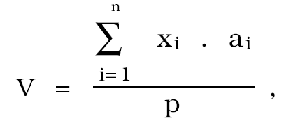

# § 2 (k § 13 zákona)

(1) Odpočítateľné minimum zo základu dane zo zisku [§ 13 ods. 2 písm. b)] sa určí v organizáciách, prípadne organizačných jednotkách zaradených do produkčných ekonomických skupín (§ 6 ods. 2) jednotným normatívom na 1 ha poľnohospodárskej pôdy vo výške 1200,– Kčs s odchýlkami ustanovenými v odsekoch 2 až 4. Celkovú výšku odpočítateľného minima v Kčs tvorí súčin výmery všetkých pozemkov a určeného normatívu. Pre určenie celoročnej daňovej povinnosti v organizáciách, v ktorých nedošlo v priebehu zdaňovacieho obdobia ku zmene vo výmere pozemkov, je rozhodná výmera všetkých pozemkov k 1. januáru zdaňovacieho obdobia s presnosťou na desatiny ha (bez zaokrúhlenia). V organizáciách, v ktorých došlo k zmene výmery v priebehu zdaňovacieho obdobia, je rozhodná výmera vypočítaná ako vážený priemer podľa vzorca

kde

V = priemerná výmera s presnosťou na desatiny ha (bez zaokrúhlenia)

xi = výmera (ha)

ai = počet dní, ktoré zodpovedajú nezmenenej výmere; deň, v ktorom dochádza k zmene výmery, sa zahŕňa do obdobia predchádzajúceho tejto zmene

n = počet zmien vo výmere

p = počet dní v zdaňovacom období.

Pre určenie preddavkov na daň zo zisku je rozhodná výmera pozemkov k 1. januáru zdaňovacieho obdobia s presnosťou na desatiny ha (bez zaokrúhlenia); v organizáciách vzniknutých v priebehu zdaňovacieho obdobia je rozhodná výmera ku dňu zápisu do podnikového registra.

(2) V spoločných podnikoch s prevažne poľnohospodárskou výrobou sa určí odpočítateľné minimum normatívom z výrobných fondov vo výške 0,8%. Výrobné fondy zahŕňajú základné prostriedky a zásoby; ich základ sa určí polovicou súčtu hodnoty základných prostriedkov, investícií v používaní v obstarávacej cene a zásob k 1. januáru a 31. decembru zdaňovacieho obdobia. Pre platenie preddavkov na daň zo zisku je rozhodný stav výrobných fondov k 1. januáru zdaňovacieho obdobia.

(3) V podnikoch štátneho rybárstva sa určí odpočítateľné minimum súčtom odpočítateľného minima podľa odseku 1 a z vodných plôch sadzbou 700 Kčs na 1 ha využívanej vodnej plochy.

(4) V štátnych hospodárskych organizáciách vojenských lesov a majetkov sa určí odpočítateľné minimum podľa odseku 1 jednotným normatívom na 1 ha poľnohospodárskej pôdy vo výške 1000 Kčs.
