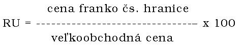

- 1) Výrobky, výkony a práce klasifikované v rámci jednotnej sústavy sociálno-ekonomických informácií a číselníkov.

- 2) § 17 Hospodárskeho zákonníka v úplnom znení č. 80/1989 Zb.

- 3) Vyhláška Federálneho cenového úradu, Ministerstva financií, cien a miezd Českej socialistickej republiky a Ministerstva financií, cien a miezd Slovenskej socialistickej republiky z 1. februára 1990 o zmluvných cenách.

- 4) Vyhláška z 1. februára 1990 o zmluvných cenách, pokiaľ ide o ocenenie základných prostriedkov obstaraných vo vlastnej réžii.

- Smernice k účtovým osnovám vydávané Federálnym ministerstvom financií.

- 5) Vyhláška Ministerstva miestneho hospodárstva č. 200/1956 Ú. v. (Ú. 1.) o nájomnom z pozemkov, na ktorých sa ťažia piesky.

- Vyhláška Ministerstva financií, cien a miezd ČSR č. 182/1988 Zb. o cenách stavieb, pozemkov, trvalých porastov, úhradách za zriadenie práva osobného užívania pozemkov a náhradách za dočasné užívanie pozemkov.

- Vyhláška Ministerstva financií, cien a miezd SSR č. 205/1988 Zb. o cenách stavieb, pozemkov, trvalých porastov, úhradách za zriadenie práva osobného užívania pozemkov a náhradách za dočasné užívanie pozemkov.

- Vyhláška Ústrednej správy pre rozvoj miestneho hospodárstva č. 60/1964 Zb. o úhrade za užívanie bytov a za služby spojené s užívaním bytov v znení neskorších predpisov.

- Vyhláška Ministerstva vnútra č. 98/1967 Zb. o úhrade za užívanie nebytových priestorov.

- § 397 ods. 3 Občianskeho zákonníka č. 40/1964 Zb. v úplnom znení č. 70/1983 Zb.

- 6) § 26a Hospodárskeho zákonníka.

- 7) Sadzobník dane z obratu vydaný Federálnym ministerstvom financií podľa § 16, 18 a § 19 ods. 1 zákona č. 73/1952 Zb. o dani z obratu.

- 8) Napr. v cenníku VC-MC 17/9/89 vodárenstvo a kanalizácia, Cenový vestník čiastka 46/1988, príloha č. III.

- 9) § 231 Občianskeho zákonníka.

- § 17 ods. 2 vyhlášky Ministerstva všeobecného strojárstva č. 137/1964 Zb., ktorou sa vydávajú základné podmienky dodávky opráv cestných vozidiel pre motorovú dopravu.

- § 2 ods. 6 a 7 vyhlášky Ministerstva všeobecného strojárstva a Ústrednej správy pre rozvoj miestneho hospodárstva č. 18/1965 Zb. o podmienkach údržby a opráv cestných vozidiel pre motorovú dopravu v majetku občanov a nesocialistických organizácií.

- 10) Výmer Federálneho cenového úradu, Ministerstva financií, cien a miezd ČSR a Ministerstva financií, cien a miezd SSR o zmenách cien.

- 11) § 201 Hospodárskeho zákonníka.

- § 251 a 252 Občianskeho zákonníka.

- § 10 vyhlášky Federálneho ministerstva financií, Ministerstva financií ČSR, Ministerstva financií SSR a predsedu Štátnej banky československej č. 136/1985 Zb. o finančnej, úverovej a inej pomoci družstevnej a individuálnej bytovej výstavbe a modernizácii rodinných domčekov v osobnom vlastníctve.

- 12) Smernice FMF č. VI-3/28571/76 pre vyrovnanie cenových rozdielov v maloobchodných cenách v organizáciách zaoberajúcich sa predajom výrobkov z trhových fondov za maloobchodné ceny v r. 1977 – 78 v znení úpravy č. VI-3/20060/79.

- 13) § 113 ods. 3 Zákonníka práce č. 65/1965 Zb. v úplnom znení č. 52/1989 Zb.

- 14) § 13 ods. 3 nariadenia vlády ČSSR č. 112/1985 Zb. o štátnom riadení cien.

- 15) Výmer Federálneho cenového úradu, Ministerstva financií, cien a miezd ČSR a Ministerstva financií, cien a miezd SSR č. 01/90 o metodike tvorby cien.

- 16) § 6 nariadenia vlády ČSSR č. 112/1985 Zb.

- 17) Inštrukcie Federálneho ministerstva zahraničného obchodu č. 6/86 o tvorbe a kontrole zahraničných cien.

- 18) Rozdielový ukazovateľ vývozu (RU) sa vypočíta takto:

- 19) Vyhláška Federálneho ministerstva pre technický a investičný rozvoj a Štátnej arbitráže ČSSR č. 77/1977 Zb. o centrálnej regulácii výrobkov a materiálov vo výstavbe.

- 20) § 11 ods. 1 písm. b) bod 4 zákona č. 156/1989 Zb. o odvodoch do štátneho rozpočtu.

- 21) § 13 ods. 1 nariadenia vlády ČSSR č. 112/1985 Zb.

- 22) § 18 ods. 2 a § 24c ods. 1 zákona č. 30/1968 Zb. o štátnom skúšobníctve v úplnom znení č. 84/1987 Zb.

- 23) § 4, 5, 6 a 10 zákona ČNR č. 127/1981 Zb. o vnútornom obchode.

- § 4, 5, 6 a 10 zákona SNR č. 130/1981 Zb. o vnútornom obchode.

- 24) § 201 Hospodárskeho zákonníka.

- § 235 ods. 1 Občianskeho zákonníka.

- 25) § 13 ods. 3 nariadenia vlády ČSSR č. 112/1985 Zb.

- 26) Pravidlá uplatňovania finančno-ekonomických nástrojov v zahraničnom obchode.

- 27) Výmer Federálneho cenového úradu č. 5030/5.1/89, ktorým sa určujú pravidlá pre určenie cien montážnych prác, Cenový vestník čiastka 9/1989.Výmer Federálneho cenového úradu č. 8241/331/88, ktorým sa určujú pravidlá pre určenie cien stavebných prác, Cenový vestník čiastka 2-3/1989.

- 28) Výmer Federálneho cenového úradu č. 8170/331/1988, ktorým sa určujú sadzby vedľajších rozpočtových nákladov stavieb, Cenový vestník čiastka 45/1988 v znení výmeru Federálneho cenového úradu č. 5050/5.1/1989, Cenový vestník čiastka 14/1989.

- 29) Výmer Federálneho cenového úradu, Českého cenového úradu a Slovenského cenového úradu č. 015/86 o tvorbe súhrnných cien stavebných objektov a skupinových cien stavebných sústav a stavebných dielov, Cenový vestník čiastka 6/1987, v znení výmeru Federálneho cenového úradu, Českého cenového úradu a Slovenského cenového úradu č. 065/1988, Cenový vestník čiastka 21/1988.

- 30) Nariadenie vlády ČSSR č. 228/1988 Zb., ktorým sa vydáva colný sadzobník obchodného tovaru.

- 31) § 62 ods. 4 tejto vyhlášky.

- Výmer Federálneho cenového úradu Ministerstva financií, cien a miezd ČSR a Ministerstva financií, cien a miezd SSR č. 05/90 o gesciách a pôsobnosti v určovaní maloobchodných cien, Cenový vestník čiastka 54/1989.

- 32) Smernice Ministerstva vnútra ČSR č. MH/21 – 1123/1973.Smernice Ministerstva vnútra SSR č. MH/3549/1973.

- Vyhláška Ministerstva obchodu ČSR č. 93/1982 Zb., ktorou sa vykonávajú niektoré ustanovenia zákona ČNR č. 127/1981 Zb. o vnútornom obchode, v znení vyhlášky č. 138/1988 Zb.

- Vyhláška Ministerstva obchodu SSR č. 100/1982 Zb., ktorou sa vykonávajú niektoré ustanovenia zákona SNR č. 130/1981 Zb. o vnútornom obchode, v znení vyhlášky č. 164/1988 Zb.

- 33) Napr. vyhlášky č. 66/1979 Zb. a č. 67/1979 Zb., ktorými sa vykonávajú niektoré ustanovenia Občianskeho zákonníka upravujúce poskytovanie služieb občanom, vyhláška Ministerstva všeobecného strojárstva č. 136/1964 Zb., ktorou sa vydávajú základné podmienky dodávky opráv strojárskych výrobkov, § 3 ods. 3 a 4 vyhlášky č. 18/1965 Zb.

- 34) § 2 ods. 6 a 7 vyhlášky č. 18/1965 Zb.

- 35) § 231 Občianskeho zákonníka.§ 2 ods. 6 a 7 vyhlášky č. 18/1965 Zb.

- 36) Spracovacími nákladmi sa rozumejú úplné vlastné náklady bez nákladov na priamy materiál a na polotovary vlastnej výroby.

- 37) Vyhláška Ústrednej komisie ľudovej kontroly a štatistiky č. 71/1965 Zb. o zavedení a využívaní jednotnej klasifikácie priemyselných odborov a výrobkov a jednotnej klasifikácie výrobkov v poľnohospodárstve a lesníctve.

- Vyhláška Federálneho štatistického úradu č. 116/1972 Zb. o vytváraní a udržiavaní odborových číselníkov priemyselných výrobkov.

- Vyhláška Federálneho štatistického úradu č. 124/1980 Zb. o jednotnej klasifikácii stavebných objektov a stavebných prác výrobnej povahy.

- Vyhláška Federálneho štatistického úradu č. 114/1972 Zb. o zavedení a využívaní jednotnej klasifikácie výkonov.

- Vyhláška Federálneho štatistického úradu č. 117/1981 Zb. o zavedení a využívaní jednotnej klasifikácie priemyselných prác výrobnej povahy.

- 38) Výmer Federálneho cenového úradu, Ministerstva financií, cien a miezd ČSR a Ministerstva financií, cien a miezd SSR č. 04/90 o uplatňovaní cenových gescií.

- 40) § 89 zákona č. 194/1988 Zb. o pôsobnosti federálnych ústredných orgánov štátnej správy.

- 41) Výmer Federálneho cenového úradu, Ministerstva financií, cien a miezd ČSR a Ministerstva financií, cien a miezd SSR č. 03/90 o cenníkoch a označovaní výrobkov maloobchodnými cenami.

- 42) § 8 nariadenia vlády ČSSR č. 112/1985 Zb.

- 43) Výkazy o tvorbe cien, o cenovom zvýhodnení a znevýhodnení a o zmenách cien.

- 44) § 106 zákona č. 194/1988 Zb.

- 45) Zákon ČNR č. 63/1986 Zb. o Českej poľnohospodárskej a potravinárskej inšpekcii.

- Zákon SNR č. 70/1986 Zb. o Slovenskej poľnohospodárskej a potravinárskej inšpekcii.

- Zákon ČNR č. 64/1986 Zb. o Českej obchodnej inšpekcii.

- Zákona SNR č. 71/1986 Zb. o Slovenskej obchodnej inšpekcii.

- 46) § 3 a 4 zákona ČNR č. 134/1973 Zb. o pôsobnosti orgánov Českej socialistickej republiky v oblasti cien, v úplnom znení č. 23/1989 Zb.§ 3 a 4 zákona SNR č. 135/1973 Zb. o pôsobnosti orgánov Slovenskej socialistickej republiky v oblasti cien, v úplnom znení č. 27/1989 Zb.

- 47) § 9 až 12 nariadenia vlády ČSSR č. 112/1985 Zb.

- § 2 a 3 nariadenia vlády ČSR č. 117/1985 Zb. o vykonávaní dodatkových odvodov národnými výbormi a rozpočtovými a príspevkovými organizáciami riadenými ústrednými orgánmi Českej socialistickej republiky a národnými výbormi v oblasti cien.§ 2 a 3 nariadenia vlády SSR č. 118/1985 Zb. o vykonávaní dodatkových odvodov národnými výbormi a rozpočtovými a príspevkovými organizáciami riadenými ústrednými orgánmi Slovenskej socialistickej republiky a národnými výbormi v oblasti cien.

- 48) § 123 Hospodárskeho zákonníka alebo § 451 Občianskeho zákonníka.§ 12 nariadenia vlády ČSSR č. 112/1985 Zb.§ 3 nariadenia vlády ČSR č. 117/1985 Zb.§ 3 nariadenia vlády SSR č. 118/1985 Zb.

- 49) Najmä § 77, 172 a nasledujúce Zákonníka práce.

- 50) § 11 ods. 4 nariadenia vlády ČSSR č. 112/1985 Zb.§ 2 ods. 4 nariadenia vlády ČSR č. 117/1985 Zb.§ 2 ods. 4 nariadenia vlády SSR č. 118/1985 Zb.

- 51) Výmer FCÚ, MFCM ČSR a MFCM SSR č. 02/90 o postupe pri cenovej kontrole.

- 52) Napr. podľa § 384a Hospodárskeho zákonníka.

- 53) § 51 zákona č. 88/1988 Zb. o štátnom podniku.

- § 9 nariadenia vlády ČSSR č. 112/1985 Zb.

- § 31 zákona č. 90/1988 Zb. o poľnohospodárskom družstevníctve.

- § 40 zákona č. 94/1988 Zb. o bytovom, spotrebnom a výrobnom družstevníctve.

- 54) § 9 ods. 3 nariadenia vlády ČSSR č. 112/1985 Zb.

- 55) § 11 nariadenia vlády ČSSR č. 112/1985 Zb.

- 56) § 123 Hospodárskeho zákonníka.§ 451 Občianskeho zákonníka.

- 57) § 4, 10, 100 až 107 zákona č. 194/1988 Zb.Nariadenie vlády ČSSR č. 22/1971 Zb., ktorým sa ustanovuje zoznam surovín, výrobkov, výkonov a služieb, ktorých ceny určuje Federálny cenový úrad, v úplnom znení č. 170/1980 Zb.

- 58) § 2 ods. 1 zákona ČNR č. 134/1973 Zb. v úplnom znení č. 23/1989 Zb.

- § 2 ods. 1 zákona SNR č. 135/1973 Zb. v úplnom znení č. 27/1989 Zb.

- 59) Zákon č. 30/1968 Zb. v úplnom znení č. 84/1987 Zb.

- 60) Vojenské lesy a majetky, Praha, Vojenské stavby, Praha, Vojenský projektový ústav, Praha, Naše vojsko tlačiareň, Praha, Naše vojsko nakladateľstvo a knižný obchod, Praha a Vydavateľstvo Naše vojsko, Praha.

- 61) § 9 vyhlášky Úradu pre normalizáciu a meranie č. 136/1982 Zb., ktorou sa vykonáva zákon o štátnom skúšobníctve.

- 62) § 3 ods. 3 a 6 zákona ČNR č. 134/1973 Zb. v úplnom znení č. 23/1989 Zb.§ 3 ods. 3, 4, 6 a 7 zákona SNR č. 135/1973 Zb. v úplnom znení č. 27/1989 Zb.

- 63) § 3 ods. 5 zákona SNR č. 135/1973 Zb. v úplnom znení č. 27/1989 Zb.

- 64) Napr. výmer Ministerstva financií, cien a miezd ČSR a Ministerstva financií, cien a miezd SSR č. 187/163/89-1059/8.3/89 o vyhradení pôsobnosti v zmenách cien výrobkov MFCM ČSR a MFCM SSR a o vykonávaní drobných operatívnych zmien veľkoobchodných cien krajskými národnými výbormi.

- 65) § 3 ods. 7 zákona ČNR č. 134/1973 Zb. v úplnom znení č. 23/1989 Zb.§ 3 ods. 8 zákona SNR č. 135/1973 Zb. v úplnom znení č. 27/1989 Zb.
