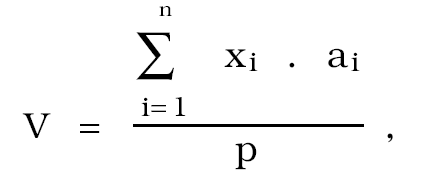

# Čl. I

Vyhláška Federálneho ministerstva financií č. 215/1988 Zb., ktorou sa vykonáva zákon o poľnohospodárskej dani, sa mení a dopĺňa takto:

- 1. Doterajší text § 1 sa označuje ako odsek 1 a dopĺňa sa novým odsekom 2, ktorý znie:

- „(2)

- Spoločnými podnikmi s prevažne poľnohospodárskou výrobou sú tie, v ktorých tržby z rastlinnej a živočíšnej výroby a z agrochemickej činnosti boli v predchádzajúcom zdaňovacom období viac ako 50 % z celkových tržieb. V spoločných podnikoch, ktorých daňová povinnosť vznikla v priebehu zdaňovacieho obdobia, je rozhodný pomer týchto predpokladaných tržieb v organizácii.“.

- 2. § 2 ods. 1 znie:

- 㤠2

- (k § 13 zákona)

- (1)

- Odpočítateľné minimum zo základu dane zo zisku [§ 13 ods. 2 písm. b)] sa určí v organizáciách, prípadne organizačných jednotkách zaradených do produkčných ekonomických skupín (§ 6 ods. 2) jednotným normatívom na 1 ha poľnohospodárskej pôdy vo výške 1200,– Kčs s odchýlkami ustanovenými v odsekoch 2 až 4. Celkovú výšku odpočítateľného minima v Kčs tvorí súčin výmery všetkých pozemkov a určeného normatívu. Pre určenie celoročnej daňovej povinnosti v organizáciách, v ktorých nedošlo v priebehu zdaňovacieho obdobia ku zmene vo výmere pozemkov, je rozhodná výmera všetkých pozemkov k 1. januáru zdaňovacieho obdobia s presnosťou na desatiny ha (bez zaokrúhlenia). V organizáciách, v ktorých došlo k zmene výmery v priebehu zdaňovacieho obdobia, je rozhodná výmera vypočítaná ako vážený priemer podľa vzorca

- 

- kde

- V = priemerná výmera s presnosťou na desatiny ha (bez zaokrúhlenia)

- xi = výmera (ha)

- ai = počet dní, ktoré zodpovedajú nezmenenej výmere; deň, v ktorom dochádza k zmene výmery, sa zahŕňa do obdobia predchádzajúceho tejto zmene

- n = počet zmien vo výmere

- p = počet dní v zdaňovacom období.

- Pre určenie preddavkov na daň zo zisku je rozhodná výmera pozemkov k 1. januáru zdaňovacieho obdobia s presnosťou na desatiny ha (bez zaokrúhlenia); v organizáciách vzniknutých v priebehu zdaňovacieho obdobia je rozhodná výmera ku dňu zápisu do podnikového registra.“.

- 3. V § 2 sa vypúšťa odsek 3. Doterajšie odseky 4 a 5 sa označujú ako odseky 3 a 4.
