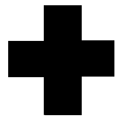
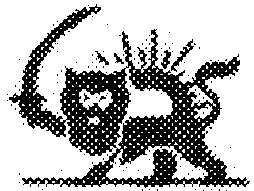
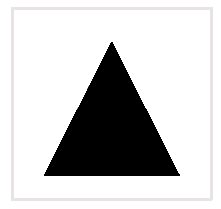
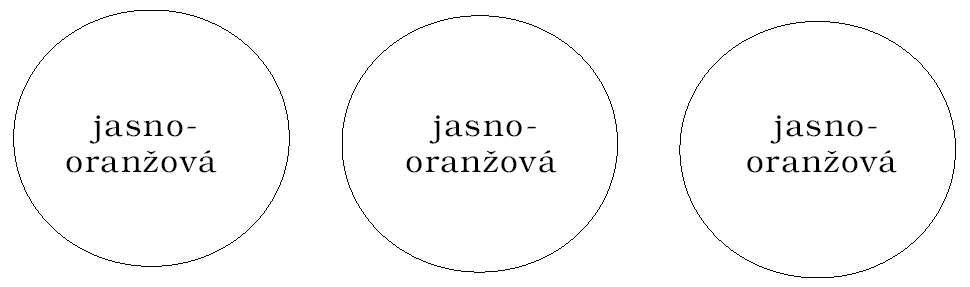

Príloha 1

- PRAVIDLÁ TÝKAJÚCE SA ZISŤOVANIA TOTOŽNOSTI

  - Kapitola 1 Preukazy totožnosti

    - Článok 1 00Preukaz totožnosti pre stály civilný zdravotnícky a duchovný personál

      - 1. Preukaz totožnosti pre stály civilný zdravotnícky a duchovný personál uvedený v článku 18 odsek 2 Protokolu by mal:

        - a) mať rozoznávací znak a takú veľkosť, aby sa mohol nosiť vo vrecku;

        - b) byť čo možno najtrvanlivejším;

        - c) byť vyplnený v národnom alebo v úradnom jazyku (a môže byť navyše vypísaný v ďalších jazykoch);

        - d) uvádzať meno, dátum narodenia (alebo pokiaľ tento dátum nie je k dispozícii, vek v dobe vydania) a rodné číslo držiteľa, pokiaľ ho má;

        - e) uvádzať, v akom rozsahu je držiteľ oprávnený požívať ochranu dohovorov a tohto Protokolu;

        - f) obsahovať fotografiu držiteľa, ako aj jeho podpis alebo odtlačok palca, alebo oboje;

        - g) mať pečiatku a podpis príslušného štátneho orgánu;

        - h) mať dátum vydania a dátum skončenia platnosti tohto preukazu.

      - 2. Preukaz totožnosti bude jednotný pre celé územie každej Vysokej zmluvnej strany, a ak to bude možné, bude rovnakého druhu pre všetky strany v konflikte. Strany v konflikte sa môžu riadiť jednoznačným vzorom uvedeným v tabuľke 1. Na začiatku nepriateľských akcií si navzájom odovzdajú vzor preukazu, ktorý používajú, pokiaľ sa tento vzor líši od vzoru uvedeného v tabuľke 1. Preukazy totožnosti sa budú vydávať, pokiaľ to bude možné, v duplikáte; jednu kópiu bude mať v úschove vydávajúci orgán, ktorý by mal vykonávať kontrolu nad preukazmi, ktoré vydal.

      - 3. Za žiadnych okolností nesmie sa stálemu civilnému zdravotníckemu a duchovnému personálu jeho preukaz totožnosti odobrať. Pre prípad straty preukazu bude mať nárok na vydanie duplikátu.

    - Článok 2 Preukaz totožnosti pre dočasný civilný zdravotnícky a duchovný personál

      - 1. Preukaz totožnosti dočasného civilného zdravotníckeho a duchovného personálu by mal byť, pokiaľ to bude možné, podobný preukazu, ktorý je ustanovený článkom 1 týchto pravidiel. Účastníci konfliktu sa môžu riadiť vzorom uvedeným v tabuľke 1.

      - 2. Pokiaľ okolnosti neumožňujú vydať pre dočasný civilný zdravotnícky a duchovný personál preukazy totožnosti podobné tým, ktoré sú opísané v článku 1 týchto pravidiel, môže sa tomuto personálu vydať potvrdenie podpísané príslušným orgánom, ktorým sa potvrdzuje, že osoba, ktorej je preukaz vydaný, je určená na plnenie povinností ako dočasný personál, a ktoré, pokiaľ možno, obsahuje oznámenie o dĺžke trvania tejto úlohy a o práve tejto osoby nosiť rozoznávací znak. Potvrdenie by malo obsahovať meno držiteľa, dátum jeho narodenia (alebo, pokiaľ tento dátum nie je k dispozícii, jeho vek v dobe vydania preukazu), jeho funkciu a rodné číslo, pokiaľ ho má. Bude obsahovať jeho podpis alebo odtlačok palca, alebo oboje.

      - [Příloha 01](../assets/523c704b5343824465fa9675e798c45d94f7480071dac6b6665776f6e18c8338.pdf)

  - Kapitola 2 Rozoznávací znak

    - Článok 3 Tvar a povaha

      - 1. Rozoznávací znak (červený na bielom podklade) bude tak veľký, ako to budú vyžadovať okolnosti. Pokiaľ ide o tvar červeného kríža, polmesiaca alebo leva a slnka, môžu sa Vysoké zmluvné strany riadiť vzormi uvedenými v tabuľke 2.

      - 2. V noci alebo za zníženej viditeľnosti môže byť rozoznávací znak rozsvietený alebo osvetlený; taktiež môže byť zhotovený z takých materiálov, aby ho bolo možné zistiť technickými detekčnými prostriedkami.

      - 

      - 

      - 

        - Tabuľka 2. Červené rozoznávacie znaky na bielom podklade

    - Článok 4 Použitie

      - 1. Rozoznávací znak sa bude, pokiaľ to bude možné, umiestňovať na hladký podklad alebo na vlajky viditeľné zo všetkých smerov a na tak veľkú vzdialenosť, ako to len bude možné.

      - 2. V závislosti od pokynov príslušného orgánu bude zdravotnícky a duchovný personál vykonávajúci svoje povinnosti v oblasti bojov, pokiaľ to bude možné, nosiť pokrývku hlavy a oblek s rozoznávacím znakom.

  - Kapitola 3 Rozoznávacie signály

    - Článok 5 Dobrovoľné používanie

      - 1. Bez ujmy na ustanoveniach článku 6 týchto pravidiel nebudú signály určené v tejto kapitole na výhradné použitie zdravotníckymi jednotkami a zdravotníckymi prepravnými prostriedkami používané na žiadne iné účely. Používanie všetkých signálov uvedených v tejto kapitole je dobrovoľné.

      - 2. Dočasné zdravotnícke lietadlo, ktoré z nedostatku času alebo pre svoje parametre nemôže byť označené rozoznávacím znakom, môže použiť rozoznávacie signály povolené v tejto kapitole. Najlepšou metódou účinnej identifikácie a rozoznávania zdravotníckeho lietadla je však použitie vizuálneho signálu, buď rozoznávacieho znaku, alebo svetelného signálu určeného v článku 6, alebo obidvoch, doplnených ostatnými signálmi uvedenými v článkoch 7 a 8 týchto pravidiel.

    - Článok 6 Svetelný signál

      - 1. Svetelný signál skladajúci sa z prerušovaného modrého svetla je určený na použitie zdravotníckym lietadlom na jeho identifikáciu. Tento signál nebudú používať žiadne iné lietadlá. Odporúčaná modrá farba sa získava použitím týchto troch chromatických koordinátorov:

        - hranica zelenej farby y = 0.065 + 0.805

        - hranica bielej farby y = 0.400 - x

        - hranica fialovej farby x = 0.133 + 0.600 y

        - Odporúčaná frekvencia zábleskov modrého svetla je medzi 60 a 100 zábleskami za jednu minútu.

      - 2. Zdravotnícke lietadlo by malo byť vybavené svetlami potrebnými na to, aby bol svetelný signál vidieť z toľkých smerov, ako je to len možné.

      - 3. Pokiaľ medzi stranami v konflikte neexistuje osobitná dohoda vyhradzujúca použitie prerušovaného modrého svetla pre identifikáciu zdravotníckych vozidiel, lodí a plavidiel, nie je použitie takých signálov pre ostatné vozidlá a lode zakázané.

    - Článok 7 Rádiové signály

      - 1. Rádiový signál sa bude skladať z rádiotelefonickej alebo rádiotelegrafickej správy, ktorej bude predchádzať zreteľný rozoznávací prednostný signál, ktorý určí a schváli Svetová administratívna rozhlasová konferencia Medzinárodnej telekomunikačnej únie. Bude vyslaný trikrát pred volacím znakom príslušného zdravotníckeho prostriedku. Táto správa sa bude vysielať v angličtine v príslušných intervaloch na kmitočte alebo kmitočtoch určených v súlade s odsekom 3. Použitie prednostného signálu bude povolené len zdravotníckym jednotkám a zdravotníckym prepravným prostriedkom.

      - 2. Rozhlasová správa, ktorej bude predchádzať zreteľný prednostný signál spomenutý v odseku 1, bude obsahovať nasledujúce údaje:

        - a) volací znak zdravotníckeho prepravného prostriedku;

        - b) stanovište zdravotníckeho prepravného prostriedku;

        - c) počet a druh zdravotníckych prepravných prostriedkov;

        - d) zamýšľanú trasu presunu;

        - e) podľa okolností odhadované časy v priebehu presunu a čas odchodu a príchodu;

        - f) akékoľvek ďalšie informácie ako letová výška, kontrolované rádiové kmitočty, dohodnuté jazyky, spôsoby práce a kódy systému druhotnej rádiolokačnej kontroly.

      - 3. Aby sa uľahčilo odovzdanie správ uvedených v odsekoch 1 a 2, ako i správ uvedených v článkoch 22, 23, 25, 26, 27, 28, 29, 30 a 31 tohto Protokolu, Vysoké zmluvné strany, ktoré sú stranami v konflikte, alebo jedna strana v konflikte konajúca po dohode alebo samostatne, môžu v súlade s Prehľadom pridelených kmitočtov v Rádiových pravidlách pripojených k Medzinárodnému telekomunikačnému dohovoru určiť a zverejniť vybrané národné kmitočty, ktoré budú na takéto oznámenia používať. Tieto kmitočty sa oznámia Medzinárodnej telekomunikačnej únii v súlade s postupom, ktorý schváli Svetová administratívna rozhlasová konferencia.

    - Článok 8 Elektronická identifikácia

      - 1. Systém druhotnej rádiolokačnej kontroly, ako je opísaný v prílohe 10 k Chicagskému dohovoru o medzinárodnej civilnej leteckej preprave zo 7. decembra 1944 spolu s neskoršími zmenami, môže sa použiť na identifikáciu a na sledovanie letového kurzu zdravotníckeho lietadla. Spôsob práce a kód systému SSR určenej na výlučné použitie zdravotníckymi lietadlami ustanovia Vysoké zmluvné strany, strany v konflikte alebo jedna zo strán v konflikte konajúce po dohode alebo samostatne v súlade s postupom, ktorý bude odporučený Medzinárodnou organizáciou civilného letectva.

      - 2. Strany v konflikte môžu medzi sebou uzavrieť osobitnú dohodu a v nej ustanoviť použitie obdobného elektronického systému na identifikáciu zdravotníckych vozidiel a zdravotníckych lodí a plavidiel.

  - Kapitola 4 Spojenie

    - Článok 9 Rádiové spojenie

      - Prednostný signál ustanovený v článku 7 týchto pravidiel môže predchádzať príslušné rádiové oznámenie vysielané zdravotníckymi jednotkami a zdravotníckymi prepravnými prostriedkami pri použití postupu ustanoveného v článkoch 22, 23, 25, 26, 27, 28, 29, 30 a 31 Protokolu.

    - Článok 10 Používanie medzinárodných kódov

      - Zdravotnícke jednotky a zdravotnícke prepravné prostriedky môžu taktiež používať kódy a signály ustanovené Medzinárodnou telekomunikačnou úniou, Medzinárodnou organizáciou civilného letectva a Medzivládnou námornou poradnou organizáciou. Tieto kódy a signály sa budú používať v súlade s normami, praxou a postupmi ustanovenými týmito organizáciami.

    - Článok 11 Iné prostriedky spojenia

      - Ak nie je možné obojsmerné rádiové spojenie, môžu sa používať signály ustanovené Medzinárodným signálnym kódom prijatým Medzivládnou námornou poradnou organizáciou alebo príslušnou prílohou k Chicagskému dohovoru o medzinárodnej civilnej leteckej preprave zo 7. decembra 1944 spolu s neskoršími zmenami.

    - Článok 12 Letové plány

      - Dohody a oznámenia týkajúce sa letových plánov ustanovených článkom 29 Protokolu budú podľa možností formulované v súlade s postupmi ustanovenými Medzinárodnou organizáciou civilného letectva.

    - Článok 13 Signály a postupy na zadržanie zdravotníckeho lietadla

      - Pokiaľ sa zadržujúce lietadlo použije na overenie totožnosti zdravotníckeho lietadla pri lete alebo na to, aby ho požiadalo o pristátie v súlade s článkami 30 a 31 Protokolu, malo by zadržujúce a zdravotnícke lietadlo použiť štandardné vizuálne a rádiové postupy na zadržiavanie predpísané prílohou 2 Chicagského dohovoru o medzinárodnej civilnej leteckej preprave zo 7. decembra 1944 spolu s neskoršími zmenami.

  - Kapitola 5 Civilná obrana

    - Článok 14 Preukaz totožnosti

      - 1. Preukaz totožnosti personálu civilnej obrany ustanovený článkom 66 odsek 3 Protokolu sa spravuje príslušnými ustanoveniami článku 1 týchto pravidiel.

      - 2. Preukaz totožnosti pre personál civilnej obrany sa môže spravovať vzorom uvedeným v tabuľke 3.

      - 3. Pokiaľ sa personálu civilnej obrany povolí nosiť ľahké osobné zbrane, mala by o tom byť zmienka v preukaze.

      - [Příloha 02](../assets/a0af7c654ab2e1699aef22c1ab0851843be6e8438b37250d236eb8353c23726f.pdf)

    - Článok 15 Medzinárodný rozoznávací znak

      - 1. Medzinárodným rozoznávacím znakom civilnej obrany ustanoveným v článku 66 odsek 4 Protokolu je rovnoramenný modrý trojuholník na oranžovom pozadí. Vzor je uvedený v tabuľke 4.

      - 

        - Tabuľka 4. Modrý trojuholník na oranžovom pozadí

      - 2. Odporúča sa, aby:

        - a) pokiaľ je modrý trojuholník na vlajke, páske alebo odeve, pozadie trojuholníka tvorila oranžová vlajka, páska alebo odev;

        - b) jeden z uhlov trojuholníka smeroval vertikálne hore;

        - c) žiadny z uhlov trojuholníka sa nedotýkal okraja oranžového pozadia.

      - 3. Medzinárodný rozoznávací znak bude tak veľký, ako to budú vyžadovať okolnosti. Rozoznávací znak bude, pokiaľ to bude možné, umiestnený na rovný podklad alebo na vlajky viditeľné zo všetkých smerov a na takú vzdialenosť, ako je to len možné. V súlade s inštrukciami príslušného orgánu bude personál civilnej obrany nosiť, pokiaľ to bude možné, pokrývku hlavy a odev s medzinárodným rozoznávacím znakom. V noci alebo za zníženej viditeľnosti môže znak svietiť alebo byť osvetlený; taktiež sa môže vyrobiť z materiálov umožňujúcich jeho zistenie technickými detekčnými prostriedkami.

  - Kapitola 6 Stavby a zariadenia obsahujúce nebezpečné sily

    - Článok 16 Medzinárodný osobitný znak

      - 1. Medzinárodný osobitný znak pre stavby a zariadenia obsahujúce nebezpečné sily, ako je ustanovené v článku 56 odsek 7 Protokolu, sa bude skladať zo skupiny 3 jasných oranžových kruhov rovnakej veľkosti položených na rovnakej ose, pričom vzdialenosť medzi každým kruhom bude jeden polomer v súlade s tabuľkou 5 vyobrazenou nižšie.

      - 2. Znak bude tak veľký, ako to budú vyžadovať okolnosti. Ak je umiestnený na väčšej ploche, môže byť opakovaný tak často, ako to budú vyžadovať okolnosti. Pokiaľ to bude možné bude umiestnený na rovnom povrchu alebo na vlajkách tak, aby bol viditeľný zo všetkých smerov a na takú vzdialenosť, ako to len bude možné.

      - 3. Na vlajke bude vzdialenosť medzi vonkajšími okrajmi znaku a priľahlými stranami vlajky jeden polomer kruhu. Vlajka bude pravouhlá s bielym pozadím.

      - 4. V noci alebo za zníženej viditeľnosti môže byť znak rozsvietený alebo osvetlený. Môže byť taktiež vyrobený z materiálov umožňujúcich zistiť ho technickými detekčnými prostriedkami.

      - 

      - Tabuľka 5.

      - Medzinárodný osobitný znak pre stavbu a zariadenia obsahujúce nebezpečné sily

    - [Příloha 02](../assets/fd10cfb51bdedae043f46031cd656ddf6ec86a367a8e05f592f37a593ea5e245.pdf)
