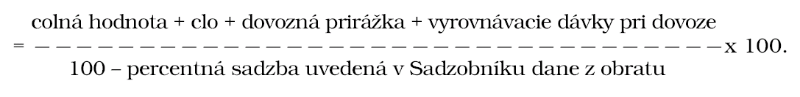

Príloha vyhlášky č. 575/1991 Zb.

- SPÔSOB UVÁDZANIA ÚDAJOV V HLÁSENÍ O DOVOZNEJ DANI

  - I. PRVOTNÝ DOKLAD

    - (1) Prvotným dokladom pre konanie vo veciach dovoznej dane je „Priznanie k dovoznej dani“ (ďalej len „PDD“). Doklad je zároveň hlásením o dovoznej dani.

    - (2) Základná PDD sa skladá z troch listov tvoriacich zložku. Prvý list označený na prvej strane číslami 1 a 6 je určený pre finančný orgán. Druhý list označený na prvej strane číslami 2 a 7 je určený na štatistické účely. Tieto dva potvrdené listy zašle colnica finančnému orgánu podľa čísla uvedeného v záhlaví druhej strany. Tretí potvrdený list označený na prvej strane číslami 3 a 8 colnica odovzdá platiteľovi.

    - (3) Ak treba na jeden PDD, ktorý je určený iba na deklaráciu jednej položky tovaru podľa položiek colného sadzobníka, uviesť viac položiek, prikladá sa k základnému tlačivu jedno alebo viac tlačív „Priznanie k dovoznej dani doplnkové“ (ďalej len „PDDd“). Počet ich listov a ich využitie je totožný s PDD, s ktorým sa predkladá a ktorého prílohu tvorí.

    - (4) Platiteľ uvedie v súlade s pravidlami uvedenými v tejto prílohe údaje do odsekov 3, 7, 14, 28, 31, 33, 37, 41, 45, 47 a 54 prvej strany PDD, resp. PDDd, do záhlavia, do oddielu 1 a prípadne do oddielu 3 druhej strany PDD, resp. PDDd. Uvedenie údajov do zostávajúcich odsekov prvej strany PDD, resp. PDDd nie je povinné, ale ich prípadné vyplnenie nie je na závadu.

    - (5) Tlačivo PDD a PDDd sa vydáva v českom alebo slovenskom jazyku, pričom obe znenia majú rovnakú platnosť.

    - (6) PDD a PDDd sa vypĺňajú strojom, tlačiarňou počítača alebo podobným strojovým spôsobom. Vypísať ich možno aj ručne, nie však obyčajnou alebo atramentovou ceruzkou. Vyplnené údaje v nich musia byť napísané modrou alebo čiernou farbou tak, aby boli nezmazateľné a maximálne čitateľné. Uviesť ich možno iba do predpísaných častí a nemožno ich dopĺňať údajmi, pre ktoré nie sú príslušné odseky a kolónky (napr. miesto v tabuľke určené číslom riadku a číslom stĺpca) vyhradené. Pri vypĺňaní jednotlivých listov musí byť list označený na prvej strane číslami 1 a 6 originál po oboch stranách.

    - (7) Číselné a kódované údaje napísané do PDD a PDDd sa nesmú mazať ani prepisovať. Prípadné opravy sa vykonávajú prečiarknutím chybných údajov pri zachovaní ich čitateľnosti a doplnením nových správnych údajov do rovnakého odseku alebo kolónky vedľa, nad alebo pod chybný údaj, alebo

      - a) ak ide o opravu na prvej strane tlačiva tiež do odseku 45 PDD, resp. PDDd,

      - b) v prípade opravy chybného údaja na druhej strane tlačiva tiež do stĺpca 6 toho istého riadku alebo riadok s chybným údajom možno prečiarknuť a nahradiť novým riadkom alebo riadne označený (napr. číslom riadku a číslom stĺpca) nový správny údaj možno uviesť tiež do oddielu 3.

  - II. VYKAZOVANÉ ÚDAJE

    - (8) Na prvej strane PDD, resp. PDDd platiteľ uvedie údaje do jednotlivých odsekov v súlade s pravidlami ustanovenými osobitným predpisom,5) pokiaľ táto vyhláška neustanovuje inak.

    - (9) Do odseku 28 prvej strany PDD platiteľ uvedie, a to iba pokiaľ je to potrebné v nadväznosti na údaj stĺpca „SP“ odseku 47, číslo účtu a bankového spojenia, ak nie je zahrnuté priamo v čísle účtu, z ktorého bude vykonávať úhradu dovoznej dane.

    - (10) Platiteľ uvedie kód mernej jednotky do pravého dolného rohu odseku 31 prvej strany PDD, resp. PDDd a množstvový údaj do odseku 41 prvej strany PDD, resp. PDDd iba v prípade, že použije pre výpočet dovoznej dane inú než percentnú sadzbu príslušnej položky Sadzobníka dane z obratu.

    - (11) Okrem údajov ustanovených osobitným predpisom5) platiteľ vždy uvedie do odseku 47 stĺpca „Základ pre vymeranie poplatku“ PDD, resp. PDDd sumu colnej hodnoty. Pre dovoznú prirážku uvedie v stĺpci „Druh“ veľkými tlačenými písmenami kód „DOP“. Tento kód uvádza aj v prípade, že tovar nepodlieha dovoznej prirážke. Súčasne platiteľ uvedie v stĺpci „Suma“ celkové súčty. Celkový súčet v stĺpci „Suma“ na tlačive PDDd vykoná týmto spôsobom:

      - a) súčet za jednotlivé položky tovaru uvedie do riadkov označených „Súčet za 1. položku“, „Súčet za 2. položku“ a „Súčet za 3. položku“;

      - b) celkový súčet v stĺpci „Suma“, ktorý je v pravom spodnom rohu vľavo od šípky, vykoná tak, že do prvého riadku uvedie súčet prenesený z predchádzajúceho listu PDD alebo celkový súčet z predchádzajúceho listu PDDd. V ďalších riadkoch uvedie súčet za jednotlivé položky tovaru podľa písmena a). Do riadku „Spolu“ uvedie súčet všetkých uvedených riadkov. Na poslednom PDDd je tento súčet konečný. Z iného než posledného PDDd prenesie tento súčet znova do prvého riadku rovnakého stĺpca nasledujúceho PDDd.

    - (12) Colnica uvedie do odseku 47 PDD, resp. PDDd do riadku označeného v stĺpci „Druh“ kódom „DOP“ príslušnú sumu vymeranej dovoznej prirážky. V prípade, že tovar dovoznej prirážke nepodlieha, uvedie nulu.

    - (13) Okrem údajov ustanovených osobitným predpisom5) platiteľ uvedie do odseku 54 PDD telefónne číslo jeho sídla, príp. miesta podnikania podľa 1 písm. a) tejto vyhlášky.

    - (14) V prípade predloženia dodatočného hlásenia o dovoznej dani platiteľ označí záhlavie druhej strany PDD, resp. PDDd slovom „DODATOČNÉ“. Súčasne uvedie do oddielu 3 dôvod predloženia dodatočného hlásenia.

    - (15) Číslo finančného orgánu si vyžiada platiteľ na miestne príslušnom finančnom úrade v Českej republike alebo na miestne príslušnom daňovom úrade v Slovenskej republike. Do predpísanej kolónky sa údaj uvádza zľava. Pokiaľ má toto číslo menej ako sedem číslic, ponechajú sa zostávajúce miesta v kolónke nevyplnené.

    - (16) Platiteľ uvedie identifikačné číslo (IČO) iba v prípade, že mu bolo pridelené. V opačnom prípade do príslušnej kolónky neuvedie žiadny údaj.

    - (17) Dátum vzniku daňovej povinnosti platiteľ uvedie vo forme šesťciferného číselného kódu. Do jeho prvého dvojčíslia uvedie posledné dvojčíslie roka. Do druhého dvojčíslia kódu uvedie dvojčíslie kalendárneho mesiaca (pokiaľ je menšie ako 10, doplní prvé číslo dvojčíslia nulou). Do tretieho dvojčíslia kódu uvedie dvojčíslie kalendárneho dňa mesiaca (ak je menšie ako 10, doplní prvé číslo dvojčíslia nulou).

    - (18) V prípade predloženia dodatočného hlásenia o dovoznej dani priamo finančnému orgánu, t. j., ak sa colná hodnota nemení, clo, dovozná prirážka alebo vyrovnávacie dávky pri dovoze, platiteľ uvedie údaje do odseku 54 prvej strany PDD a údaje na druhú stranu PDD, resp. PDDd.

    - (19) V stĺpci 1 oddielu 1 platiteľ uvedie šesťcifernú položku Sadzobníka dane z obratu.

    - (20) V stĺpci 2 oddielu 1 platiteľ uvedie názov tovaru, a to iba v prípade, že opis tovaru z odseku 31 prvej strany PDD, resp. PDDd nie je na účely určenia položky Sadzobníka dane z obratu dostatočný.

    - (21) V stĺpci 3 oddielu 1 platiteľ uvedie základ dovoznej dane ustanovený podľa zákona.6)

    - (22) V prípade použitia percentnej sadzby príslušnej položky Sadzobníka dane z obratu platiteľ vypočíta základ dovoznej dane podľa tohto vzorca:

      - 

    - (23) Základ dovoznej dane v prípade použitia percentnej sadzby príslušnej položka Sadzobníka dane z obratu možno tiež vypočítať podľa tohto vzorca:

      - základ dovoznej dane = (colná hodnota + clo + dovozná prirážka + vyrovnávacie dávky pri dovoze) x koeficient.

    - (24) Prepočítacie koeficienty podľa príslušných percentných sadzieb Sadzobníka dane z obratu sú uvedené v tabuľke.

    - sadzba | koeficient | sadzba | koeficient | sadzba | koeficient

    - 11 | 1,1236 | 25 | 1,3333 | 40 | 1,6667

    - 12 | 1,1364 | 29 | 1,4085 | 49 | 1,9608

    - 15 | 1,1765 | 34 | 1,5152 | 50 | 2,0000

    - 20 | 1,2500 | 35 | 1,5385 | 81 | 5,2632

    - 22 | 1,2821 | | | |

    - (25) Vypočítaný základ dovoznej dane uvedie platiteľ v prípade percentnej sadzby v celých korunách pri zaokrúhlení od 0,50 Kčs hore, včítane.

    - (26) V prípade použitia inej než percentnej sadzby uvedie platiteľ základ dovoznej dane v jednotke určenej v príslušnej položke Sadzobníka dane z obratu.

    - (27) Pokiaľ platiteľ predkladá dodatočné hlásenie uvedie iba rozdiel základu dovoznej dane oproti pôvodnému PDD, resp. PDDd. Ak predkladá dodatočné hlásenie, ktoré má za následok zníženie dane, uvedie pred sumou základu dovoznej dane znamienko mínus.

    - (28) V stĺpci 4 oddielu 1 platiteľ uvedie dovoznú daň vypočítanú podľa sadzby príslušnej položky Sadzobníka dane z obratu zo základu dane v stĺpci 3 oddielu 1 a zaokrúhlenú na celé koruny od 0,50 Kčs hore, včítane. V prípade predloženia dodatočného hlásenia uvedie platiteľ iba rozdiel oproti pôvodnému PDD, resp. PDDd. Ak predkladá dodatočné hlásenie, ktoré má za následok zníženie dane, uvedie pred sumou dovoznej dane znamienko mínus.

    - (29) V stĺpci 5 oddielu 1 platiteľ uvedie

      - a) kód „1“ v prípade oslobodenia od dovoznej dane tovaru dovážaného ako náhrada za tovar, ktorý vrátil zahraničnému dodávateľovi v rámci vyporiadania práv zo zodpovednosti za vady tovaru,

      - b) kód „2“ v prípade oslobodenia od dovoznej dane tovaru uvedeného v osobitnom predpise7) dovážaného výlučne pre potrebu svojho hospodárstva fyzickou osobou, ktorá vykonáva poľnohospodársku výrobu a je zapísaná do evidencie podľa osobitného predpisu,

      - c) kód „3“ v prípade oslobodenia od dovoznej dane späť vyvážaného tovaru, ktorý bol prepustený do záznamového obehu v tuzemsku za účelom dočasného použitia, na ktorý sa vzťahuje dočasné úplné oslobodenie od cla podľa medzinárodnej zmluvy, ktorou je Česká a Slovenská Federatívna Republika viazaná a ktorá bola uverejnená v Zbierke zákonov,

      - d) kód „4“ v prípade späť vyvážaného tovaru, ktorý bol prepustený do záznamového obehu v tuzemsku za účelom dočasného použitia a na ktorý sa nevzťahuje oslobodenie od dovoznej dane podľa ustanovenia písmena c).

    - (30) V stĺpci 6 oddielu 1 platiteľ okrem iného uvedie údaj odseku 7 pôvodného PDD v prípade predloženia dodatočného hlásenia.

    - (31) Do riadku „Súčet/prenos“ oddielu 1 PDD platiteľ uvedie súčet súm dovoznej dane stĺpca 4 oddielu 1. V prípade priloženia PDDd prenesie tento súčet do riadku „Prenos“ stĺpca 4 oddielu 1 PDDd.

    - (32) Do riadku „Súčet/prenos“ oddielu 1 PDDd platiteľ uvedie súčet súm dovoznej dane stĺpca 4 oddielu 1, včítane riadku „Prenos“. V prípade priloženia ďalšieho PDDd prenesie tento súčet do riadku „Prenos“ stĺpca 4 oddielu 1 nasledujúceho PDDd. Súčet v riadku „Súčet/prenos“ posledného tlačiva PDDd je konečný súčet dovoznej dane základného a k nemu patriacich doplnkových PDDd, t. j. suma daňovej povinnosti.

    - (33) Platiteľ je povinný dodržať zásadu, že celkový súčet colnej hodnoty, cla, dovoznej prirážky a vyrovnávacích dávok pri dovoze na prvej strane jednotlivého tlačiva PDD, resp. PDDd musí vždy súhlasiť so súčtom týchto hodnôt použitých pre výpočet základu dovoznej dane v riadkoch 1 až 6 PDD, resp. 1 až 18 PDDd na druhej strane toho istého tlačiva.

    - (34) Oddiel 2 je určený iba pre záznamy finančného orgánu.

    - (35) Do oddielu 3 platiteľ uvedie rozpis hodnôt podľa odseku 37 tejto prílohy. Platiteľ môže uviesť do tohto oddielu tiež informácie, pre ktoré nie je v príslušnej kolónke dostatok miesta s tým, že táto informácia bude riadne označená (napr. číslom riadku a číslom stĺpca).

  - III. ROZPIS POLOŽIEK TOVARU

    - (36) Vzhľadom na odlišnosti triedenia tovaru v colnom sadzobníku a Sadzobníka dane z obratu môže vzniknúť potreba, aby tovar zatriedený do jednej položky colného sadzobníka bol rozpísaný do niekoľkých položiek Sadzobníka dane z obratu. Na tento účel obsahuje oddiel 1 PDD 6 riadkov a oddiel 1 PDDd 18 riadkov.

    - (37) V prípade, že platiteľ vykonáva rozpis podľa odseku 36 tejto prílohy, rozpíše pri použití percentnej sadzby dane z obratu ku každej položke Sadzobníka dane z obratu pomernú časť colnej hodnoty, cla, dovoznej prirážky a vyrovnávacích dávok pri dovoze. Ak použije inú než percentnú sadzbu dane z obratu, rozpíše množstvo tovaru. Až na základe týchto hodnôt vypočíta dovoznú daň.
