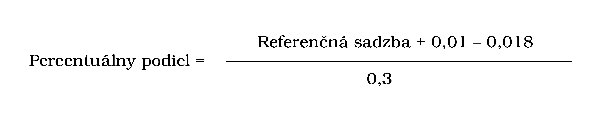

Príloha k zákonu Slovenskej národnej rady č. 310/1992 Zb.

- Vzorec na výpočet percentuálneho podielu pre nasledujúci kalendárny rok

  - Vzorec:

- 

- Pri výpočte sú použité nasledujúce veličiny a ich označenia: |

- Referenčná sadzba | - jednoduchý aritmetický priemer za rozhodujúce obdobie priemerných výnosov do splatnosti štátnych dlhopisov, ktoré tvoria bázu dlhopisového indexu (SDX pre štátne dlhopisy) počítaného a uverejneného v obchodných dňoch Burzou cenných papierov v Bratislave (BCPB). V prípade, že údaje neboli zverejnené BCPB počas viac ako 30 po sebe nasledujúcich dní, referenčná sadzba za rozhodujúce obdobie sa určí obdobným spôsobom z údajov o fixingu úrokových sadzieb na medzibankovom trhu depozit (12-mesačný BRIBOR) zverejňovaných Národnou bankou Slovenska,

- 0,01 | - zvýhodnenie stavebného sporenia oproti referenčnej sadzbe,

- Rozhodujúce obdobie | - obdobie od 1. júla predchádzajúceho kalendárneho roka do 30. júna aktuálneho kalendárneho roka.
