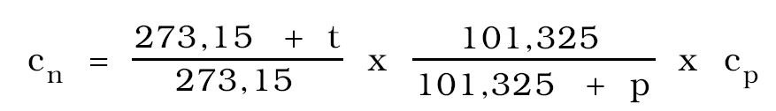
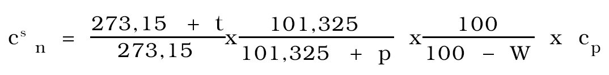
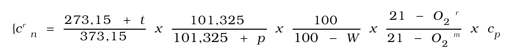

Príloha č. 4 vyhlášky č. 407/1992 Zb.

- VELIČINY, JEDNOTKY A PREPOČTOVÉ VZŤAHY

  - 1. Veličiny a jednotky emisií a emisných limitov

  - Na vyjadrenie emisií a emisných limitov sa používajú nasledovné veličiny a jednotky:

    - a) hmotnostná koncentrácia (ďalej len „koncentrácia“) je hmotnosť znečisťujúcej látky vypúšťanej zo zdroja, vztiahnutá na jednotku objemu nosného plynu. Vyjadruje sa v jednotkách g x m-3, prípadne mg x m-3. Pokiaľ nie je uvedené inak, hodnoty emisií sa udávajú ako koncentrácie vo vlhkom plyne (t. j. taká vlhkosť plynu, ktorá vyplýva z technologického procesu) po prepočítaní na normálne stavové podmienky (tlak 101,325 kPa, teplota 0 oC) a referenčný obsah kyslíka.

    - Ak nie je určený referenčný obsah kyslíka, je koncentrácia vztiahnutá na zloženie a množstvo nosného plynu, ktoré vyplýva z podstaty technologického procesu. Množstvo vzduchu, privádzané do zariadenia na riedenie spalín alebo odplynov, alebo na ich ochladzovanie, sa pri určovaní koncentrácie odpočítava.

    - b) hmotnostný tok je hmotnosť znečisťujúcej látky, vypúšťanej zo zdroja, vztiahnutá na jednotku času. Vyjadruje sa najmä v jednotkách kg x h-1, g x s-1, t x rok-1.

    - c) emisný tok je pomer hmotnosti znečisťujúcej látky, vypúšťanej zo zdroja, k jednotke hmotnosti alebo k inej jednotke množstva výrobku, polotovaru, suroviny alebo výkonu výrobnej technológie znečisťujúcej ovzdušie. Je údajom, charakterizujúcim pomerné množstvo emisií (merná výrobná emisia), vystupujúcich z daného technologického procesu (vrátane zariadenia na obmedzenie emisií) do atmosféry. Vyjadruje sa najmä v jednotkách kg x t-1, kg x GJ-1.

    - d) emisný stupeň je pomer hmotnosti znečisťujúcej látky vypúšťanej zo zdroja ku hmotnosti tejto látky privedenej do procesu v surovinách a palivách. Vyjadruje sa v percentách.

    - e) tmavosť dymu je optická vlastnosť dymu, vyvolaná pohltením svetla v dymovej vlečke, vystupujúcej z komína. Vyjadruje sa v stupňoch podľa Ringelmanna (stupne 0 až 5) alebo opacitou v percentách (pri použití optických prístrojov). Ak sa kontroluje obsah sadzí meraním tmavosti škvrny na filtri z odsatej vzorky podľa Bacharacha, vyjadruje sa v stupňoch (0 až 9).

  - 2. Prepočtové vzťahy

  - Hodnoty emisných limitov vyjadrené ako koncentrácia sa uvádzajú, ak nie je stanovené inak, ako hmotnostné koncentrácie vo vlhkom plyne, prepočítané na normálne stavové podmienky (tlak 101,325 kPa, teplota 0 oC).

  - Ak sú koncentrácie stanovené za iných než za normálnych stavových podmienok, použijú sa na prepočet na normálne stavové podmienky alebo na referenčný obsah kyslíka tieto prepočtové vzťahy:

    - a) prepočet koncentrácií na normálne stavové podmienky vlhkého plynu:

    - 

    - b) prepočet koncentrácií na normálne stavové podmienky suchého plynu:

    - 

    - c) prepočet koncentrácií na normálne stavové podmienky suchého plynu a referenčný obsah kyslíka v spalinách:

    - 

    - Význam symbolov v uvedených vzťahoch:

    - cn - koncentrácia po prepočte na normálny stav vo vlhkom plyne

    - csn - koncentrácia po prepočte na normálny stav v suchom plyne

    - crn - koncentrácia po prepočte na normálny stav v suchom plyne a referenčné podmienky dané obsahom kyslíka Or2,

    - cp - koncentrácia zodpovedajúca prevádzkovým podmienkam (nameraná)

    - t - teplota nosného plynu pri prevádzkových podmienkach [o C]

    - p - tlaková diferencia oproti normálnemu tlaku, zodpovedajúca prevádzkovým podmienkam [kPa]

    - W - obsah vody v spalinách [obj. %]

    - O2r - referenčný obsah kyslíka v spalinách [obj. %]

    - O2m - obsah kyslíka v spalinách zodpovedajúci prevádzkovým podmienkam (zmeraný) [obj. %]
