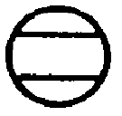
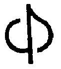

Príloha vyhlášky č. 585/1992 Zb.

- Značky podľa § 6 ods. 3 č. 1 Schvaľovacia značka všeobecná*)

- 

- č. 2 Schvaľovacia značka odolnosti v určitom prostredí so sťaženými klimatickými alebo inými podmienkami

- 

- č. 3 Štátna značka akosti

- 

- č. 4 Značka prvého stupňa akosti

- 
